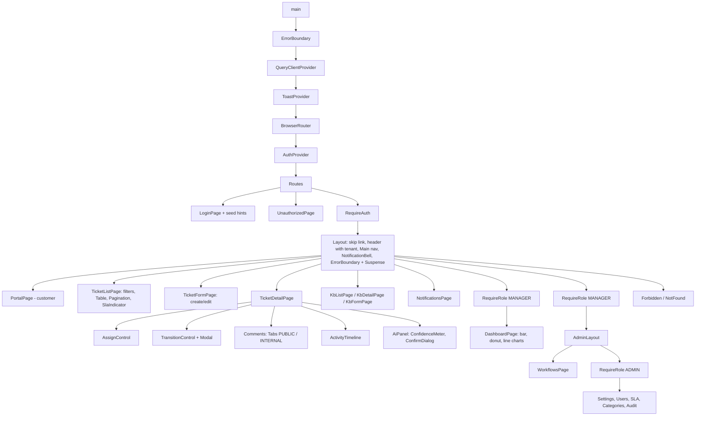

# Frontend component tree

Source of truth is `frontend/src` (React); the Angular twin in `frontend-angular/src/app` has the same feature set (see `frontend-angular/README.md`); the diagram is also in `diagrams/03-frontend-component-tree.mmd`.

All pages except Login and the status pages are `React.lazy` chunks. Query keys are prefixed with the tenant id. Roles: customers get the portal nav (Home, My tickets, New ticket, Help articles); staff get Dashboard (MANAGER+), Tickets, Knowledge base, Administration (ADMIN) and Workflows (MANAGER).
