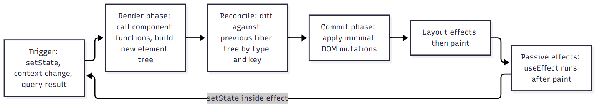
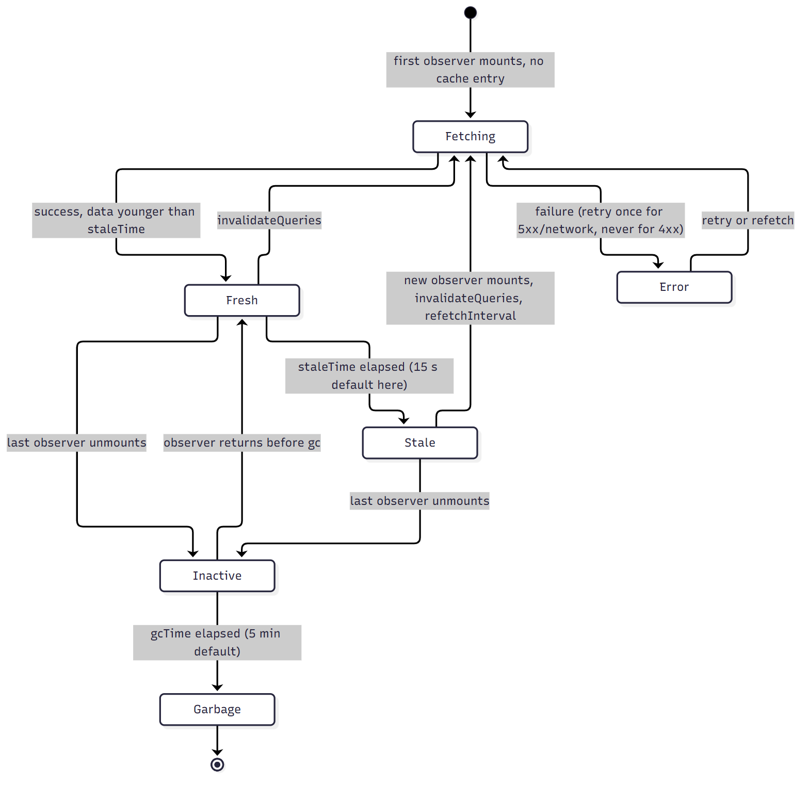

# Part C. React and TypeScript

This part explains the React 18 and TypeScript front end of the multi-tenant CX + ITSM portfolio platform (a self-built learning project, not Freshworks code). Every claim about the project is tied to a real file under `frontend/src`. (The repository also contains a second, feature-equivalent Angular UI in `frontend-angular/`; this part covers the React app, and `frontend-angular/README.md` maps each React idea to its Angular counterpart.) Every example is labelled so you always know what you are reading.

> **Labels used in this part.** "Project-implemented behaviour" means the code exists in the repository and you can open the cited file. "Conceptual learning example" means a teaching snippet that is not in the repository. Conceptual TypeScript snippets in this part were type-checked once with `tsc --strict` (exit code 0) but never run in a browser. Conceptual React snippets were not executed. "NOT implemented" means the feature does not exist in the project; the text then explains how it would work.

> **What was actually executed for this part.** From `frontend/`, `npx tsc --noEmit` finished with exit code 0. `npx vitest run` ran 86 tests in 10 files (a later full re-run on 2026-10-17 passed 86 of 86); on the first full run 85 passed and 1 (`TicketFormPage > a fresh form mount uses a new idempotency key`) timed out at the default 5000 ms on a loaded laptop. Re-running that file alone passed all 5 of its tests in 11.3 s. The test durations (2 to 4 seconds per form test) show how slow this machine is under jsdom; the timeout is a machine-speed symptom, not a logic failure, but it is a real flake risk and is noted in the troubleshooting section. No browser run was made.

## C.1 Component architecture

### What it is and why it exists

A React application is a tree of functions that return descriptions of UI. Component architecture is the set of decisions about how that tree is cut up: which components own state, which are purely presentational, where cross-cutting concerns (auth, server cache, toasts, errors) live, and how routes map to page components. It exists because a UI of hundreds of elements is unmaintainable as one blob, and because React re-renders by subtree: where state lives decides what re-renders.

### How the project is organised (Project-implemented behaviour)

The folder layout from `frontend/README.md`:

| Folder | Responsibility | Example file |
|---|---|---|
| `src/api` | The only code that talks to the network: a `fetch` wrapper, endpoint functions, contract types | `api/client.ts`, `api/endpoints.ts`, `api/types.ts` |
| `src/auth` | Session state, token storage, role maths, route guards | `auth/AuthContext.tsx`, `auth/tokenStore.ts`, `auth/Guards.tsx`, `auth/roles.ts` |
| `src/components` | Shared UI kit (`ui/`), charts, shell (`Layout`), cross-page widgets (`NotificationBell`, `AiPanel`), `ErrorBoundary` | `components/ui/Form.tsx`, `components/Layout.tsx` |
| `src/hooks` | Custom hooks wrapping TanStack Query | `hooks/useLookups.ts`, `hooks/useNotifications.ts` |
| `src/lib` | Pure functions and configuration with no UI: query keys, Zod schemas, URL-to-filter mapping | `lib/queryKeys.ts`, `lib/schemas.ts`, `lib/ticketFilters.ts` |
| `src/pages` | One component per route, default-exported so `React.lazy` can load it | `pages/TicketListPage.tsx`, `pages/admin/*` |
| `src/test` | Vitest and React Testing Library suites | `test/ticketForm.test.tsx` |

The provider tree is assembled in `src/main.tsx`. The order matters, because an inner provider may use an outer one but never the reverse:

```tsx
createRoot(document.getElementById('root') as HTMLElement).render(
  <StrictMode>
    <ErrorBoundary>
      <QueryClientProvider client={queryClient}>
        <ToastProvider>
          <BrowserRouter>
            <AuthProvider>
              <AppRoutes />
            </AuthProvider>
          </BrowserRouter>
        </ToastProvider>
      </QueryClientProvider>
    </ErrorBoundary>
  </StrictMode>,
);
```

Reading the tree from outside in: the outermost `ErrorBoundary` catches anything that goes wrong in the providers themselves; `QueryClientProvider` must wrap `AuthProvider` because `AuthProvider` calls `useQueryClient()` to clear the cache on logout; `BrowserRouter` must wrap `AuthProvider` and the routes because guards call `useLocation`. A second `ErrorBoundary` lives inside `Layout` (see C.9) so a page crash leaves the navigation bar usable.

The design rule the project follows is "pages orchestrate, kit components render". A page such as `TicketListPage` reads the URL, runs a query, and passes plain props to `Table`, `Pagination`, `Select`. The kit components in `components/ui` know nothing about tickets except badges, which take a typed status.

### Implemented versus not implemented

| Feature | Status |
|---|---|
| Route-level lazy pages with a shell in the entry chunk | Implemented (`App.tsx`) |
| Feature folders (everything about tickets in one folder) | NOT implemented; the project is layer-first (`pages`, `hooks`, `lib`) |
| Barrel file for the UI kit | Implemented (`components/ui/index.ts`) |
| Storybook / component catalogue | NOT implemented |
| Design tokens as CSS variables | Partially: `styles.css` uses variables such as `--border`, `--primary`, `--danger`, `--muted` |
| Global state library (Redux, Zustand) | NOT implemented, deliberately: server state is in TanStack Query, auth in context, filters in the URL |

### Additional features and how they would work

Feature-first folders (`features/tickets/{api,hooks,components,pages}`) would scale better past roughly 30 pages because a change to tickets touches one folder. The migration is mechanical: move files, keep the barrel exports, and add an ESLint `no-restricted-imports` rule so a feature cannot import from another feature's internals.

### Performance, security, mistakes, debugging

- **Performance.** Provider placement decides blast radius. If `AuthProvider` put `user` and a rapidly changing value in one context object, every consumer would re-render on every change. The project memoises the context value with `useMemo` (see C.3) and keeps rapidly changing state (query results) out of context entirely.
- **Security.** The component that decides what a user sees (`Layout` filters the nav by role) is a convenience, not a control. All authorisation is enforced by the server; the UI only avoids showing dead ends.
- **Common mistakes.** Putting server data in `useState` and copying it from props (two sources of truth); creating a context for everything; defining components inside components (they get a new identity on each render and the subtree is remounted).
- **Debugging.** React DevTools Components tab shows the provider chain and each component's props and hooks. The "Highlight updates when components render" option shows which subtrees re-render on an interaction. (NOT executed in this project.)

### Alternatives

| Approach | Strength | Weakness | Why not here |
|---|---|---|---|
| Layer-first folders (used) | Easy to learn, tiny app | Cross-feature edits touch many folders | Fine at 20 pages |
| Feature-first folders | Locality of change | Needs import discipline | Reasonable next step |
| Next.js app router | SSR, file routing | Server runtime, different mental model | The contract is a pure SPA against a gateway |
| Micro-frontends | Independent deploy by team | Heavy runtime and tooling cost | One author, one deployable |

### Interview questions and answers

**Q1. Why is the `QueryClientProvider` outside the `AuthProvider` in `main.tsx`?**
Because `AuthProvider` calls `useQueryClient()` so that `clearSession` can call `qc.clear()`. A hook can only read a context provided by an ancestor. If the order were reversed, `useQueryClient` would throw "No QueryClient set". The same logic puts `BrowserRouter` above `AuthProvider`'s children that call `useLocation`.

**Q2. How do you decide whether state belongs in a component, in context, in the URL, or in a query cache?**
Ask who else needs it and how long it lives. Ephemeral UI state used by one component (dropdown open) stays in `useState`. Data owned by the server goes in the query cache. State that a user should be able to bookmark or share, such as ticket filters, sort and page, goes in the URL (`lib/ticketFilters.ts` is the single source of truth). Cross-cutting, rarely changing values (current user, toast API) go in context. The project has no global client-state store because nothing remained that needed one.

**Q3. What is the cost of the layer-first layout and when would you change it?**
Locality: adding a field to tickets touches `api/types.ts`, `lib/schemas.ts`, a page, and a test in four folders. I would change it when the number of features and contributors grows, moving to feature folders with a lint rule on cross-feature imports. I would not do it at 20 pages with one author because the move has a cost and no demonstrated benefit.

**Q4. Why default-export page components when many style guides prefer named exports?**
`React.lazy` requires a module whose `default` export is the component. All pages are default exports for that reason; shared kit components use named exports. The two conventions are visible in `App.tsx` (`lazy(() => import('./pages/DashboardPage'))`) versus `import { Layout } from './components/Layout'`.

## C.2 Props and component design

### What it is and why it exists

Props are the input of a component: a plain object passed as the first function argument. They exist so a component is a pure-ish function of its inputs, which makes it testable and reusable. Two design questions matter: what is the smallest honest prop surface, and who owns the state (controlled versus uncontrolled).

### How it works internally

JSX compiles to calls that create element objects `{ type, props, key, ref }`. React never mutates props; if the parent supplies a new props object (always the case on a parent re-render) the child function is called again, unless wrapped in `memo` and every prop is `Object.is`-equal. `children` is just a prop. `ref` is special: in React 18 it is not in `props` for function components, which is why the kit uses `forwardRef`.

### How this project uses it (Project-implemented behaviour)

`components/ui/Form.tsx` is the clearest example. `Input`, `Select` and `Textarea` are `forwardRef` components whose props extend the native element's attributes and add a label, an error and a hint:

```tsx
interface InputProps extends InputHTMLAttributes<HTMLInputElement> { label: string; error?: string; hint?: string }
export const Input = forwardRef<HTMLInputElement, InputProps>(function Input({ label, error, hint, id, required, ...rest }, ref) {
  const gen = useId();
  const fid = id ?? gen;
  return (
    <FieldShell id={fid} label={label} error={error} hint={hint} required={required}>
      <input ref={ref} id={fid} aria-invalid={!!error || undefined} aria-describedby={describedBy(fid, error, hint)} aria-required={required || undefined} {...rest} />
    </FieldShell>
  );
});
```

Why this shape:

1. **Extending the native attributes** means the caller can pass `maxLength`, `type`, `placeholder`, `onChange` without the kit author predicting them.
2. **`forwardRef`** lets React Hook Form's `register('title')` (which returns `{ name, onChange, onBlur, ref }`) attach its ref to the real `<input>`. Without it, RHF could not read the value of an uncontrolled field.
3. **`useId`** generates a stable, SSR-safe id so the `<label htmlFor>` association exists even when the caller supplies no id (accessibility, see C.10).
4. **`{...rest}` last** lets the caller override anything, and `aria-*` attributes are computed from `error` and `hint` so callers cannot forget them.

`Table<T>` in `components/ui/Table.tsx` is a generic component: `Table<T>({ caption, columns, rows, rowKey, sort, onSort })` with `Column<T>` holding a `render: (row: T) => ReactNode`. The generic parameter flows from `rows` into every column's `render`, so `TicketListPage` gets `r.title` and `r.status` checked against the `Ticket` type with no casts. The `rowKey` prop makes the key explicit instead of using array index.

`Button` is the project's "variant" component: a union `variant?: 'primary' | 'secondary' | 'danger' | 'ghost'` and a `loading` prop that sets `disabled` and `aria-busy`. This makes the "disabled while pending" rule from the ticket form a prop, not a copy-pasted attribute.

### Controlled versus uncontrolled in this project

| Place | Style | Why |
|---|---|---|
| Ticket form fields (`TicketFormPage`) | Uncontrolled via RHF `register` (refs) | Typing does not re-render the page; RHF reads values on submit/validate |
| Ticket list filters (`TicketListPage`) | Controlled: `value={urlFilters.status ?? ''}` | The URL is the state; the input mirrors it |
| Ticket list search box | Controlled local state `search`, debounced into the URL | Typing must feel instant while URL updates are rate-limited to 300 ms |

### Implemented versus not implemented

- Implemented: prop-typed variants, `forwardRef` form kit, a generic table, `children` composition (`Card`, `Modal`), render-prop style columns.
- NOT implemented: compound components (for example `<Tabs><Tabs.Tab/></Tabs>`), polymorphic `as` props, a `Table` with virtualisation, theming props.

### Additional features and how they would work

A compound `Tabs` would use context internally so the parent passes only children; this removes the index bookkeeping callers do today. A virtualised table would render only the visible rows (for example with `@tanstack/react-virtual`) by measuring the container, computing the start and end index from `scrollTop`, and absolutely positioning the visible slice inside a spacer of total height. It becomes worthwhile above roughly a few hundred rows; the project's server page size is 20 (maximum 100), so it is not needed.

### Performance, security, mistakes, debugging

- **Performance.** Passing a new inline object or arrow as a prop defeats `memo` on the child. The project does not use `memo` on kit components, deliberately (README: "Memoisation is used sparingly, never blanket"), because the cost of the extra comparison and the risk of stale closures exceed the saving for a 20-row table.
- **Security.** React escapes text in JSX. The project contains no `dangerouslySetInnerHTML` (stated in `auth/tokenStore.ts` and the README). `Table` renders `c.render(r)` output as React nodes, never as HTML strings.
- **Common mistakes.** Spreading `{...rest}` before explicit props so they cannot be overridden; forgetting `forwardRef` so RHF warns "Function components cannot be given refs"; using `index` as key for a list that can reorder; mutating props.
- **Debugging.** If an RHF field never validates, check that `ref` reached the DOM node (React DevTools shows the host `input` under your component). If a label is not clickable, check `htmlFor` equals the input `id`.

### Alternatives and trade-offs

| Option | Good | Bad |
|---|---|---|
| Hand-built kit (used) | Tiny bundle (index chunk 32.4 kB), full control of accessibility | You own the bugs |
| Headless library (Radix, React Aria) | Battle-tested focus/keyboard behaviour | More dependencies, API learning |
| Full component library (MUI, Ant) | Fast to build | Large bundle, visual lock-in |

### Interview questions and answers

**Q1. Why does the kit's `Input` use `forwardRef`, and what changes in React 19?**
React Hook Form registers a field by receiving the DOM element through a ref callback; the wrapper must forward its `ref` to the real `<input>`. In React 18 (this project: `react ^18.3.1`) function components do not receive `ref` as a prop, so `forwardRef` is mandatory. In React 19 `ref` becomes an ordinary prop and `forwardRef` is no longer required for new code. I would say that as a fact about the version change, not claim the project uses React 19.

**Q2. What does the generic `Table<T>` buy you over `Table` taking `any[]`?**
The `Column<T>.render` callback receives a `T`, so `render: (r) => r.title` is checked and autocompleted against `Ticket`, and a typo such as `r.titel` fails the build. `rowKey: (row: T) => string` forces the caller to name a stable key. The cost is a slightly noisier type signature and the need to write `Column<Ticket>[]` once.

**Q3. When is `memo` the wrong tool?**
When the props change on nearly every render anyway, when the component is cheap, or when the comparison costs more than the render. In this project the 20-row ticket table re-renders only when the query data or sort changes; memoising `Table` would add a shallow comparison per render and a risk of stale props through captured closures, with no measured benefit. The right trigger for `memo` is a profiler recording that shows an expensive subtree re-rendering with unchanged props.

**Q4. A teammate passes `columns={[...]}` inline and says `memo(Table)` does not help. Why?**
The array literal is a new object each render, so `Object.is(prevColumns, nextColumns)` is false and `memo` re-renders anyway. The fix is to hoist the array outside the component or wrap it in `useMemo`. `TicketListPage` builds `columns` inline each render (it depends on `customer`), which is another reason `memo` on `Table` would not have helped without extra work.

## C.3 State and hooks

### What it is and why it exists

A hook is a function that lets a component use React features from a function body: state, lifecycle-like effects, refs, context, memoisation. Hooks exist because class lifecycle methods split related logic (subscribe in `componentDidMount`, unsubscribe in `componentWillUnmount`) across methods while unrelated logic shared one method. Hooks group logic by concern and make it reusable as custom hooks.

### How hooks work internally

Each function component instance has a fiber with a linked list of hook cells. On every render React calls your function; each `useState`, `useMemo`, and so on call reads the next cell in order. That is the origin of the rules of hooks: call hooks unconditionally and in the same order, because the position in the list is the only identity a hook has. `useState` returns the current cell value and a stable setter; calling the setter schedules a re-render. `useEffect` stores the callback and its dependency array; after commit and paint, React compares dependencies to the previous array with `Object.is` and re-runs the effect (after running the previous cleanup) only if one changed. `useRef` returns one mutable object whose identity never changes, and writing `.current` does not trigger a render. `useMemo` and `useCallback` cache a value or function and recompute only when dependencies change; they are a performance hint, not a semantic guarantee.

### useState (Project-implemented behaviour)

`TicketFormPage` keeps small pieces of UI state in `useState`: `formError`, `conflict`, `attachments`, `attachError`. Form field values are deliberately not in `useState`; RHF owns them. The lazy initialiser form is used in `AuthContext`:

```tsx
const [user, setUser] = useState<AuthUser | null>(() => tokenStore.get()?.user ?? null);
```

The function runs only on the first render, so the `sessionStorage` read and JSON parse is not repeated on every render. An eager `useState(tokenStore.get()?.user ?? null)` would execute the read each render and discard the result.

Functional updates avoid stale state when the next value depends on the previous one: `setOpen((o) => !o)` in `NotificationBell`, and `setItems((cur) => [...cur, { id, kind, message }])` in `ToastProvider`.

### useEffect (Project-implemented behaviour)

Effects synchronise a component with something outside React. The project has four distinct patterns.

1. **Subscribing to the DOM with cleanup** (`NotificationBell`): while the panel is open, add `mousedown` and `keydown` listeners on `document`, and remove them in the cleanup. The dependency `[open]` means the listeners exist only while open.

```tsx
useEffect(() => {
  if (!open) return;
  function onDoc(e: MouseEvent) { if (wrapRef.current && !wrapRef.current.contains(e.target as Node)) setOpen(false); }
  function onKey(e: KeyboardEvent) { if (e.key === 'Escape') { setOpen(false); btnRef.current?.focus(); } }
  document.addEventListener('mousedown', onDoc);
  document.addEventListener('keydown', onKey);
  return () => { document.removeEventListener('mousedown', onDoc); document.removeEventListener('keydown', onKey); };
}, [open]);
```

2. **A debounce with a timer** (`TicketListPage`): `setTimeout` 300 ms, cleared by the cleanup if `search` changes again, so only the last keystroke of a burst updates the URL.

3. **Syncing local state from an external value** (`TicketFormPage`): when the existing ticket loads in edit mode, `reset({...})` fills the form. Effect dependencies `[existing.data, reset]`.

4. **Focus management** (`Modal`): on open, remember `document.activeElement`, move focus into the dialog, trap Tab, and in the cleanup restore focus to the opener.

Two honest caveats visible in the code:

- `TicketListPage` has `// eslint-disable-next-line react-hooks/exhaustive-deps` on the debounce effect, because the effect calls `update`, a function recreated each render, and listing it would restart the timer on every render. That is a deliberate suppression but also a code smell: the safe fix is to read the latest filters from a ref or to compute the next URL params inside the timeout from the current `sp`. Mention it in an interview as a known trade-off rather than hiding it.
- The effect that does `setSearch(urlFilters.q ?? '')` when the URL changes and the effect that debounces `search` into the URL form a two-way sync. It works because the second effect returns early when `search === (urlFilters.q ?? '')`. Two-way sync between two sources is where loops hide; the early return is the loop breaker.

**Do you need an effect at all?** Data fetching is not done in `useEffect` in this project (TanStack Query does it). Derived values (`hasFilters`, `customer`) are computed during render, not copied into state through an effect. That is the guidance in "You might not need an effect".

### useRef (Project-implemented behaviour)

`useRef` has two jobs in the project.

- **DOM handles**: `wrapRef`, `btnRef` in `NotificationBell`; `ref` in `Modal`.
- **Mutable values that must not cause renders**: in `TicketFormPage`, `idempotencyKey = useRef(newId())` and `submitting = useRef(false)`.

```tsx
const idempotencyKey = useRef(newId());   // one key per form mount
const submitting = useRef(false);         // synchronous guard against double-click before React re-renders
```

Why a ref for `submitting` and not state? `setState` is asynchronous: two clicks in the same tick both see the old `false`. A ref write is synchronous, so the second click sees `true` immediately. The test `duplicate-submit protection: double click sends one request` in `src/test/ticketForm.test.tsx` locks this in.

One subtle point: `useRef(newId())` evaluates `newId()` on every render and throws the result away after the first. That is harmless here (`crypto.randomUUID()` is cheap) but for an expensive initial value use lazy initialisation: `const ref = useRef<string | null>(null); if (ref.current === null) ref.current = newId();`.

`Modal` uses the "latest ref" pattern: `const onCloseRef = useRef(onClose); onCloseRef.current = onClose;` so the keyboard listener installed once per open can call the newest `onClose` without listing it as an effect dependency (which would reinstall the listener and re-run focus logic on every parent render).

### useMemo and useCallback (Project-implemented behaviour)

Used only where identity matters, not for speed:

- `AuthContext`: `const value = useMemo(() => ({ user, login, logout, sessionExpired }), [...])`. Without it the provider would hand every consumer a new object each render and all consumers would re-render whenever `AuthProvider` re-rendered. `login`, `logout` and `clearSession` are wrapped in `useCallback` so the memoised value is stable and so `useEffect` dependencies on them are stable.
- `ToastProvider`: `push` is `useCallback` with `[]` dependencies (it uses `nextId` ref and a functional `setItems`, so it never needs fresh closures); `api = useMemo(() => ({ push }), [push])`. Any component calling `useToast()` therefore never re-renders because a toast appeared.

Rule of thumb used: `useMemo` and `useCallback` are justified when (a) the value is a context value or an effect dependency, or (b) it is passed to a `memo` child, or (c) the computation is measurably expensive. The README says they are "used sparingly, never blanket", and that is the right answer to the standard interview question.

### useId, useContext and custom hooks

`useId` supplies label ids (see C.2). `useContext` is wrapped by two custom hooks that fail fast:

```tsx
export function useAuth(): AuthState {
  const ctx = useContext(AuthContext);
  if (!ctx) throw new Error('useAuth must be used within AuthProvider');
  return ctx;
}
export function useTenantId(): string {
  const { user } = useAuth();
  return user?.tenant.id ?? 'anonymous';
}
```

Throwing when the provider is missing turns a confusing `undefined` property error into an immediate, named failure. `useTenantId` is the keystone of the tenant-safe cache (C.8): every query hook calls it and puts the result first in its query key.

The custom hooks in `hooks/useLookups.ts` and `hooks/useNotifications.ts` wrap `useQuery`/`useMutation`. They encapsulate three things so pages do not repeat them: the tenant-prefixed key, the `queryFn`, and per-resource policy (`staleTime: 5 * 60_000` for categories, `enabled: atLeast(user, 'AGENT')` for assignable users so customers never call `/users`). A custom hook is just a function that calls other hooks; its value is naming and reuse, not a new mechanism.

### Implemented versus not implemented

| Hook / feature | Status |
|---|---|
| `useState`, `useEffect`, `useRef`, `useMemo`, `useCallback`, `useContext`, `useId` | Implemented, as described above |
| `useReducer` | NOT used; state transitions are simple booleans |
| `useTransition`, `useDeferredValue` | NOT used; the search box uses a manual 300 ms debounce |
| `useSyncExternalStore` | NOT used directly (TanStack Query uses it internally) |
| `useLayoutEffect` | NOT used |
| `useOptimistic` (React 19) | NOT available in React 18; optimistic update is done by TanStack Query `onMutate` |

### Additional features and how they would work

- **`useDeferredValue` for the search box.** `const deferred = useDeferredValue(search)` lets typing stay urgent while the filtered render is deprioritised. It replaces the timer for client-side filtering but not for a server query, because the network request would still fire per deferred value; so the debounce is still correct for server-side search.
- **`useReducer` for the workflow editor.** The admin `WorkflowsPage` edits nested rules and transitions; a reducer with typed actions (a discriminated union, see C.6) would make add/remove/move operations testable pure functions.

### Performance, security, mistakes, debugging

- **Performance.** An effect that sets state causes an extra render. Derive values during render instead. Avoid objects in dependency arrays unless they are memoised.
- **Security.** Effects that read `document` or `window` (the bell's `mousedown` listener) must check `e.target as Node`; the cast is safe here because DOM events always deliver Nodes, but never feed `e.target.value` into `innerHTML`.
- **Common mistakes.** (1) Missing cleanup, leading to duplicate listeners (symptom: handlers fire twice after reopening). (2) Stale closure: an interval callback capturing old state; fix with functional updates or a ref. (3) Conditional hooks. (4) Putting a function in dependencies that is recreated each render, causing an effect loop. (5) Using `useEffect` to derive state. (6) Treating `useMemo` as a guarantee.
- **Debugging.** StrictMode in development mounts, unmounts and remounts every component once to expose missing cleanups; `main.tsx` uses `StrictMode`, so a double-firing effect in development is usually a missing cleanup, not a React bug. Use the React DevTools Profiler "Why did this render?" (needs the "record why each component rendered" setting). For a loop, put `console.count('effect X')` inside the effect.

### Alternatives and trade-offs

| Need | Used | Alternative | Trade-off |
|---|---|---|---|
| Server data | TanStack Query | `useEffect` + `fetch` + `useState` | Hand-written loading, error, race, cache logic |
| Complex local state | `useState` | `useReducer`, Zustand | More ceremony, better testability |
| Debounce | manual `setTimeout` | `useDeferredValue`, lodash debounce | Deferred value does not reduce network calls |

### Interview questions and answers

**Q1. Why does the double-submit guard use `useRef` instead of `useState`?**
State updates are batched and applied on the next render, so two clicks dispatched before React re-renders both observe the old value `false`. `submitting.current = true` is synchronous and immediately visible to the second click handler. The project layers three defences: the ref guard, `mutation.isPending` plus the `loading` prop disabling the button, and the server-side `Idempotency-Key`. Only the last one is authoritative; the first two are UX.

**Q2. Explain the dependency array of `useEffect`. What happens with `[]`, with no array, and with `[open]` in `NotificationBell`?**
No array: run after every render. `[]`: run after mount only (and in StrictMode dev, mount, cleanup, mount). `[open]`: run after the first render and whenever `open` changes, running the previous cleanup first. In the bell, the effect returns early when `open` is false, so listeners exist only while the panel is open, and the cleanup removes them when it closes or the component unmounts.

**Q3. Why is the `AuthProvider` value wrapped in `useMemo`?**
A context consumer re-renders when the provided value changes by `Object.is`. An object literal created in render is new each time `AuthProvider` re-renders, which happens whenever its own state changes or its parent re-renders. `useMemo` returns the same object until `user`, `login`, `logout` or `sessionExpired` change, so unrelated parent renders do not cascade to every `useAuth()` consumer.

**Q4. The debounce effect has an `eslint-disable` for exhaustive-deps. Is that acceptable?**
It is a documented trade-off, not a best practice. Adding `update` to the dependencies would restart the 300 ms timer on every render, so the debounce would never fire while the component keeps re-rendering. The robust fix is to remove the dependency on a render-scoped function: compute the next params inside the timeout from the latest search params held in a ref, or move the URL update into the `onChange` with a debounced callback created once via `useRef`/`useMemo`. I would raise it myself in a review and propose the ref-based fix.

**Q5. What does StrictMode do, and why might an effect run twice in development?**
In development StrictMode renders components twice and, since React 18, simulates unmount and remount on first mount to surface effects that lack cleanup. It does nothing in the production build. If an effect run twice breaks your logic (a duplicate subscription, a double POST), the effect is not resilient to remounting. The project's effects either return cleanups or are idempotent resets.

## C.4 Rendering lifecycle and reconciliation



### What it is and why it exists

Rendering in React is the process of calling your component functions to compute what the UI should look like. Reconciliation is the diffing step that compares the new element tree with the previous one and works out the smallest set of DOM changes. React keeps this separate from the DOM so that your code can be declarative ("the UI is a function of state") while the library does the imperative work.

### How it works internally

1. **Trigger.** A `setState`, a context value change, a `useReducer` dispatch, or an external-store notification (TanStack Query uses `useSyncExternalStore`) schedules an update on a fiber.
2. **Render phase.** React calls the component functions from the updated fiber downwards. This phase must be pure: no DOM mutation, no network, no writes to refs. In concurrent features React may pause, abandon, or repeat it, and StrictMode deliberately double-invokes it.
3. **Reconciliation (diff).** For each position React compares the new element with the old fiber. Same `type` at the same position: keep the instance and update props. Different `type`: unmount the subtree and mount a new one (state is lost). For lists, `key` is the identity: keyed children are matched by key, unkeyed children by index.
4. **Commit phase.** React applies the computed DOM mutations synchronously, runs layout effects (`useLayoutEffect`), lets the browser paint, then runs passive effects (`useEffect`).
5. **Automatic batching.** Since React 18 with `createRoot` (used in `main.tsx`), several state updates in the same event, timeout or promise callback are batched into one render.

The heuristics are O(n): the algorithm assumes two elements of different types produce different trees and that keys are stable hints. That is why a changing component type or an unstable key is expensive and surprising.

### How this project uses it (Project-implemented behaviour)

- **Keys.** `Table` uses `rowKey(r)` which `TicketListPage` sets to `r.id` (a UUID from the server). `NotificationBell` uses `key={n.id}`. The ticket form attachments list uses `key={a.fileName + i}`, an index-mixed key: acceptable for a short list that only supports removal, but the "remove first item" operation changes the keys of all following items, so React treats them as new rows. A stable client id per attachment (for example the `crypto.randomUUID()` the project already exposes as `newId()`) would be better.
- **Preserved state across route changes.** In `App.tsx`, `/tickets/new` and `/tickets/:id/edit` both render `TicketFormPage`, but they are different `Route` elements in different positions, so React mounts a new instance. If they were the same element position, state (including the `idempotencyKey` ref) would be preserved between URLs, which would be a bug for create. This is a concrete reconciliation consequence in the project: "one Idempotency-Key per form mount" depends on the form being freshly mounted.
- **`ErrorBoundary resetKey`.** `Layout` passes `resetKey={location.pathname}`; when it changes, `componentDidUpdate` clears the error so a crashed page does not poison the next route.
- **Suspense.** `Layout` wraps `<Outlet />` in `<Suspense fallback={<Skeleton .../>}>`. A lazy page that has not loaded throws a promise; the nearest Suspense boundary shows the skeleton.
- **keepPreviousData.** `placeholderData: keepPreviousData` on the ticket list means that when the page number changes, the old rows stay on screen (`aria-busy={query.isFetching}`) instead of flashing a skeleton. It changes what is rendered, not how React diffs.

### Implemented versus not implemented

| Feature | Status |
|---|---|
| `createRoot` with automatic batching | Implemented |
| Suspense for lazy routes | Implemented (`Layout`) |
| Suspense for data fetching (`useSuspenseQuery`) | NOT implemented; queries use `isLoading` branches |
| Transitions (`startTransition`) | NOT implemented |
| Streaming SSR / server components | NOT applicable (SPA) |
| Error boundary per route | Implemented via one boundary with `resetKey` |

### Additional features and how they would work

`startTransition` around a navigation or a filter change marks the resulting render as non-urgent, so a slow list render does not block typing. In a React 18 SPA this would wrap `setSp(...)`. Since `useSearchParams`' setter navigates, wrapping it would let the previous UI stay interactive while the new one renders; the benefit appears only if the render is genuinely slow (not the case for a 20-row table).

### Conceptual learning example: why a component defined inside a component is a bug

```tsx
// Conceptual learning example (not in the repository, not executed)
function TicketPage() {
  const [n, setN] = useState(0);
  function Row() { return <input defaultValue="x" />; }   // new function identity every render
  return <><button onClick={() => setN(n + 1)}>{n}</button><Row /></>;
}
```

Each render creates a new `Row` function, so the element's `type` differs from the last render, reconciliation unmounts the old `<input>` and mounts a new one, and the user's typed text is lost on every click. Hoist `Row` out of `TicketPage`.

### Performance implications

- A re-render is not a DOM update. React calls the function (cheap for small components) and only touches the DOM where the diff found a change.
- The real cost is components that do expensive work during render, or very large lists. The project's heaviest page is `TicketDetailPage` (15.4 kB, 5.0 kB gzip), with comments, activity and AI panel; the sub-components (`AssignCard`, comment list) each own their queries and mutations so a comment submit does not recompute the whole page.
- Context changes re-render all consumers regardless of `memo`. That is why `useAuth` consumers are limited to what needs the user.

### Security, mistakes, debugging

- **Security.** The render phase must never be where tokens are written to logs; the `ErrorBoundary` logs only `error.message` and the component stack (verified by the test "logs only the message, not the error object").
- **Common mistakes.** Unstable keys (`Math.random()`), index keys on reorderable lists, mutating state in place (`arr.push` then `setArr(arr)`, which `Object.is` sees as unchanged), side effects in render, reading `ref.current` during render.
- **Debugging.** React DevTools Profiler (record, interact, inspect flame chart and "why did this render"), the "Highlight updates" overlay, `console.count('render X')` temporarily, and checking that a list item remounts (a focus loss or an input resetting means the key or type changed).

### Alternatives

Vue (fine-grained reactivity, no virtual DOM diff by default), Svelte (compile-time updates), Solid (signals). React's model trades some re-render work for a simple "re-run the function" mental model. React Compiler (a build step that auto-memoises) would make most manual `useMemo`/`useCallback` unnecessary; it is NOT used here.

### Interview questions and answers

**Q1. Walk through what happens from `setOpen(true)` in `NotificationBell` to pixels.**
The setter schedules an update. React re-renders `NotificationBell`: `open` is now true, so the conditional panel element appears and `aria-expanded` is `true`. Reconciliation diffs against the old tree: the button props changed (aria-expanded), and a new `div.bell-panel` subtree is inserted. Commit applies those DOM changes, the browser lays out and paints, and then passive effects run: the `[open]` effect attaches the document listeners. Because `useNotificationList(false, open)` now has `enabled: true`, TanStack Query starts fetching in an effect-like subscription; the panel shows "Loading…" until data arrives.

**Q2. Why must the create-ticket form be a fresh mount for each new ticket?**
The `Idempotency-Key` is held in `useRef(newId())`, initialised once per mounted instance. A new mount means a new key and so a new logical ticket; a retry within the same mount reuses it so the server replays instead of duplicating. If React reused the instance when navigating from one create to another, the second ticket would send the first key and the server would either replay the first ticket's response (same body) or return 409 `DUPLICATE_SUBMISSION` (different body). The test `a fresh form mount uses a new idempotency key` checks this.

**Q3. What is the difference between the render phase and the commit phase and why does it matter?**
Render computes the next tree and may be interrupted or repeated, so it must be pure. Commit mutates the DOM once and runs effects, so side effects belong there. Writing to a ref or calling an API in the render body is a bug under StrictMode and concurrent rendering because it can run twice or never commit.

**Q4. When would a key change be a useful trick?**
Changing the `key` on a component forces a remount with fresh state. For example, `<TicketFormPage key={id}/>` would reset the form when navigating between two edit URLs. It is cleaner than an effect that manually resets every field.

## C.5 Controlled forms: React Hook Form, Zod and the Idempotency-Key

### What it is and why it exists

A form library manages field values, validation, touched/dirty state and submission. React Hook Form (RHF) is built on uncontrolled inputs and refs: it reads values from the DOM on demand, so typing does not re-render the whole form. Zod is a schema library that validates data and infers a TypeScript type from the same schema. `@hookform/resolvers/zod` connects the two. The result: one schema is the source of truth for runtime validation and for the compile-time form type.

### How it works internally

- `useForm({ resolver, defaultValues })` creates a form-state store. `register('title')` returns `{ name, onChange, onBlur, ref }`; the `ref` registers the DOM node so RHF can read and focus it. Subscriptions to `formState` (errors, isSubmitting) are proxy-tracked: a component re-renders only for the pieces of `formState` it actually read.
- `handleSubmit(onValid)` collects values, runs the resolver (Zod `safeParse` and conversion of issues into field errors), and either focuses the first invalid field and sets `errors`, or calls `onValid(values)`.
- Zod builds immutable schema objects; `z.infer<typeof schema>` extracts the output type.

### How this project uses it (Project-implemented behaviour)

`lib/schemas.ts`:

```ts
export const ticketSchema = z.object({
  type: z.enum(TICKET_TYPES as [string, ...string[]]),
  title: z.string().trim().min(5, 'Title must be at least 5 characters').max(200, 'Title must be at most 200 characters'),
  description: z.string().trim().min(10, 'Please describe the issue (at least 10 characters)').max(10000, 'Description is too long'),
  priority: z.enum(PRIORITIES as [string, ...string[]]),
  severity: z.enum(SEVERITIES as [string, ...string[]]),
  categoryId: z.string(),
  tags: z.string().max(200, 'Tags are too long').refine((s) => s.split(',').map((t) => t.trim()).filter(Boolean).length <= 10, 'At most 10 tags'),
});
export type TicketForm = z.infer<typeof ticketSchema>;
```

`pages/TicketFormPage.tsx` wires it:

```tsx
const { register, handleSubmit, reset, setError, formState: { errors } } = useForm<TicketForm>({
  resolver: zodResolver(ticketSchema),
  defaultValues: { type: 'SUPPORT', title: '', description: '', priority: 'MEDIUM', severity: 'MINOR', categoryId: '', tags: '' },
});
```

The full submit path:

1. `handleSubmit(onSubmit)` validates against `ticketSchema`. Invalid: errors shown (`role="alert"` on the message via `FieldShell`), `ticketApi.create` is never called (test: `shows validation errors and does not call the API`).
2. `onSubmit` checks the synchronous guard `submitting.current || mutation.isPending`, sets the guard and calls `mutation.mutate(v)`.
3. `mutationFn` builds the body, converting the comma string to an array (`parseTags` dedupes with a `Set`), `categoryId || null`, and for create passes `idempotencyKey.current` as the second argument to `ticketApi.create`, which sets the `Idempotency-Key` request header (`api/endpoints.ts`).
4. On success: invalidate `qk.tickets(t)`, toast "Ticket #N created", navigate to the new ticket.
5. On error: a `version_conflict` while editing shows the conflict banner; `duplicate` shows "already submitted"; otherwise `applyFieldErrors` maps server `fieldErrors` onto the matching RHF fields via `setError(field, { type: 'server', message })`; anything else becomes a form-level message through `describeError`.

The `Idempotency-Key` lifecycle in the browser:

| Event | Key |
|---|---|
| Form mounts | `useRef(newId())` creates a UUID (`crypto.randomUUID`, with a fallback for old browsers in `lib/correlation.ts`) |
| User submits and the request fails (network error, 5xx) | Same key reused on the next click (test: `sends an Idempotency-Key and reuses the same key when retrying after a failure`) |
| User submits and succeeds | Navigates away; the form unmounts; the key is discarded |
| User opens the form again | New mount, new key (test: `a fresh form mount uses a new idempotency key`) |

The server half (Part E.6) scopes the key to (tenant, user), stores a SHA-256 of the body and replays the stored 201 with `Idempotent-Replay: true` on the same body, or returns 409 `DUPLICATE_SUBMISSION` for a different body. A subtle consequence for the form: if a user changes the title after a failed attempt and resubmits within the same mount, the key is the same but the body hash differs, so the server returns 409 `DUPLICATE_SUBMISSION` and the form shows "This ticket was already submitted. Check the ticket list before trying again." even though the first attempt may have created nothing. That is a real edge case of "one key per mount"; a fix is to regenerate the key whenever the submitted body differs from the last attempt. NOT implemented.

### Implemented versus not implemented

| Feature | Status |
|---|---|
| Schema-driven validation, trimmed strings, cross-field `refine` (settings, SLA) | Implemented |
| Server `fieldErrors` mapped to fields | Implemented (`lib/formErrors.ts`) |
| Duplicate-submit protection (ref + pending + idempotency) | Implemented and tested |
| Optimistic concurrency on edit (`version` in the body) | Implemented (edit path sends `existing.data.version`) |
| File upload | NOT implemented: attachments are metadata only (name, type, size), as the label says "metadata only in this demo" |
| Autosave / draft restore | NOT implemented |
| Typed enums in the form type | Weak: `z.enum(PRIORITIES as [string, ...string[]])` widens the inferred type to `string`, which is why `TicketFormPage` casts `v.priority as Priority` |

### Additional features and how they would work

- **Real file upload.** Request a pre-signed upload URL from the API, `PUT` the file bytes directly to object storage with progress via `XMLHttpRequest` or `fetch` streams, then send the returned object key in the ticket body. The browser validates size and type first (the form already enforces 5 files and 10 MB), but the server must re-validate; content type from the browser is only a claim.
- **Narrow the enum types.** Declare `export const PRIORITIES = ['LOW','MEDIUM','HIGH','URGENT'] as const;` and use `z.enum(PRIORITIES)`; then `TicketForm['priority']` is the union and the casts disappear. See the type-checked conceptual example in C.6.
- **Key regeneration on body change.** Keep `lastBodyHash` in a ref; if it differs on submit, assign a new key.

### Performance, security, mistakes, debugging

- **Performance.** Uncontrolled inputs avoid a render per keystroke. Zod validation runs on submit by default (`mode: 'onSubmit'`), not per keystroke. Use `watch` sparingly because it re-renders on every change; prefer `useWatch` in a small subcomponent.
- **Security.** Client validation is UX only; the server validates again (`@Valid` and `GlobalExceptionHandler` return `VALIDATION_FAILED` with `fieldErrors`). The error message shown to the user comes from `describeError`, which never leaks internals; for unknown shapes it shows a generic sentence. Do not put the `Idempotency-Key` in the URL or logs as a secret; it is not a secret but it identifies a request.
- **Common mistakes.** Forgetting `noValidate` on the form (the browser's native validation bubbles will fight Zod; the project sets `noValidate`); using `defaultValue` instead of `defaultValues`/`reset` for async data; not forwarding refs; reading `errors.x.message` for nested fields without optional chaining; resetting the form every render by calling `reset` outside an effect.
- **Debugging.** Log `formState.errors` to see which field failed; check the resolver is applied (a form that submits invalid data usually lacks `resolver`). For a server error not shown on a field, check that the server's `fieldErrors[].field` is in the `FIELDS` list passed to `applyFieldErrors`; unknown fields fall through to the form-level message.

### Alternatives and trade-offs

| Option | Pros | Cons |
|---|---|---|
| RHF + Zod (used) | Few re-renders, one schema for type and validation, 93.9 kB forms chunk including zod (26.4 kB gzip) | Two libraries; enum typing needs care |
| Formik | Familiar, controlled | More re-renders, larger |
| Controlled `useState` form | No dependency | Boilerplate, re-render per keystroke, hand-written validation |
| Native constraint validation only | Zero JS | Poor message control, no cross-field rules |
| Server-driven forms (JSON schema) | Dynamic fields | Complex client renderer |

### Interview questions and answers

**Q1. Why does the form disable the button, use a ref guard, and send an Idempotency-Key? Is that three times the same thing?**
No, they defend different failure windows. The ref guard stops two submits in the same tick before React re-renders. `isPending` plus `loading` stops further clicks after the render. Neither survives a lost response: if the response times out, the user (or an automatic retry) sends the same POST again, and only the server can know whether the first one committed. The `Idempotency-Key` lets the server answer the retry with the original response. The server side is the authoritative defence; the client ones prevent most duplicates cheaply.

**Q2. What is the exact behaviour if two clicks arrive and the key is reused?**
The first request creates the ticket and stores the response keyed by (tenant, user, key). The second finds the key row and, if the SHA-256 of the body matches, returns the stored 201 with `Idempotent-Replay: true`. If the requests are truly concurrent, both try to insert the key row, the unique constraint `uq_idem_scope` makes the loser roll back (including its ticket), and it loops once to replay the winner's response. The server test with four concurrent same-key creates produced one ticket (ADR-008).

**Q3. How are server-side field errors displayed, and what if the server names a field the form does not have?**
`applyFieldErrors(err, setError, FIELDS)` loops over `err.fieldErrors`; for names in the `known` list it calls `setError(name, { type: 'server', message })` and returns true. If none was mapped it returns false and the caller falls back to a form-level message from `describeError`. An unknown field name is silently skipped, which is why the function reports whether anything was mapped.

**Q4. Why does `z.enum(PRIORITIES as [string, ...string[]])` cause casts later, and how would you fix it?**
`PRIORITIES` is typed `Priority[]` (a mutable array), which Zod's `z.enum` will not accept as a non-empty tuple, so the code asserts it to `[string, ...string[]]`, and the inferred form type has `priority: string`. Declaring the list `as const` makes it a readonly tuple of literals, so `z.enum(PRIORITIES)` infers the union `'LOW' | 'MEDIUM' | 'HIGH' | 'URGENT'` and `TicketForm` lines up with `TicketInput` without `as`.

**Q5. `type="number"` fields and Zod: how does `slaSchema` handle them?**
Inputs always yield strings. `slaSchema` uses `z.coerce.number().int().min(1)` for the minute fields so the string is converted before validation, and a final `.refine` checks `resolutionMinutes >= firstResponseMinutes` with `path: ['resolutionMinutes']` so the error appears on the right field. A known caveat of `coerce` is that an empty string becomes 0 and then fails `min(1)`, which is the desired outcome here but surprising elsewhere.

## C.6 TypeScript in the project

### What it is and why it exists

TypeScript adds a static type system to JavaScript. Types exist so that a class of bugs (wrong property name, null dereference, forgotten switch case, wrong argument order) fails at build time instead of at the user's keyboard. The project uses `"strict": true` plus `noUnusedLocals`, `noUnusedParameters` and `noFallthroughCasesInSwitch` in `tsconfig.json`, and `npm run build` runs `tsc --noEmit` before Vite, so a type error fails the build. Types are erased at compile time: nothing in `types.ts` exists at runtime, which is why data from the network is still validated (the API wrapper trusts the server, see the "mistakes" list).

### The API types (Project-implemented behaviour)

`api/types.ts` is the TypeScript mirror of `docs/API-CONTRACT.md`. Highlights:

1. **String-literal unions as enums.** `export type TicketStatus = 'NEW' | 'OPEN' | 'PENDING' | 'ON_HOLD' | 'RESOLVED' | 'CLOSED' | 'REOPENED';` There is no `enum` keyword; unions erase to nothing and serialise as the same strings the server sends. A matching runtime array (`STATUSES`) is used for dropdowns.
2. **`Record` for total maps.** `DEFAULT_TRANSITIONS: Record<TicketStatus, TicketStatus[]>` forces an entry for every status; adding `'ARCHIVED'` to the union breaks the build until the map is updated. The same pattern appears in `auth/roles.ts` (`RANK: Record<Role, number>`).
3. **Generics for envelopes.** `export interface Page<T> { content: T[]; page: number; size: number; totalElements: number; totalPages: number }` is reused as `Page<Ticket>`, `Page<Article>`, `Page<AppNotification>`.
4. **Interfaces for payloads, with `null` for absent values.** `assignee: UserRef | null`, `categoryId: string | null`. `strictNullChecks` forces every consumer to handle `null` (`r.assignee?.displayName ?? <span>Unassigned</span>` in the list).
5. **Interface inheritance.** `Workflow extends WorkflowInput`, adding the server fields (`id`, `version`, `active`, `createdAt`).
6. **Honest unions for contract looseness.** `Article.author: string | { id: string; displayName: string } | null` and `Ticket.number: number | string` document that the contract is not yet strict.

### Generics in the API layer (Project-implemented behaviour)

`api/client.ts`:

```ts
export async function request<T>(path: string, opts: RequestOptions = {}): Promise<T> { /* ... */ }

export const api = {
  get: <T>(p: string, params?: RequestOptions['params'], signal?: AbortSignal) => request<T>(p, { params, signal }),
  post: <T>(p: string, body?: unknown, headers?: Record<string, string>) => request<T>(p, { method: 'POST', body: body ?? {}, headers }),
  /* put, del */
};
```

and `endpoints.ts`: `list: (f: TicketFilters) => api.get<Page<Ticket>>('/tickets', { ...f })`. The generic parameter `T` is a promise that the response has this shape. It is an assertion, not a check: `JSON.parse(text) as T`. If the server changes the shape, TypeScript will not notice. The two real defences are the contract tests on the backend and (not implemented) a runtime Zod parse of responses.

Indexed access types are used: `RequestOptions['params']` reuses a property's type instead of repeating it; `Pick<TicketInput, 'title' | 'description' | 'priority' | 'severity' | 'categoryId' | 'tags'> & { version: number }` in `ticketApi.update` builds the update body from the create input type, so a renamed field in `TicketInput` propagates.

### Discriminated unions (Project-implemented behaviour and the gap)

A discriminated union is a union of object types that share a literal-typed property (the discriminant); checking it narrows the type. In the project:

- `ApiErrorKind` is a union of string literals, and `mapKind(status, code)` returns it. `describeError` does a `switch (e.kind)` with a `default`. `TicketFormPage` checks `e instanceof ApiError && e.kind === 'version_conflict'`.
- The project does not currently model results as `{ ok: true; value } | { ok: false; error }`; errors are exceptions (`ApiError`), caught by TanStack Query's `onError`/`error`. `useQuery` itself returns a discriminated union internally (`status: 'pending' | 'error' | 'success'`), which is why `if (query.isError) { ... query.error ... }` narrows.
- `Column<T>` and `RequestOptions['method']` use plain literal unions.

> **Conceptual learning example (type-checked with `tsc --strict`, exit 0; not run).**

```ts
type Result<T, E = Error> =
  | { ok: true; value: T }
  | { ok: false; error: E };

function unwrapOr<T>(r: Result<T>, fallback: T): T {
  return r.ok ? r.value : fallback;      // r.value only exists when ok is true
}

type Action =
  | { type: 'assign'; assigneeId: string | null }
  | { type: 'transition'; to: string; reason: string };

function describe(a: Action): string {
  switch (a.type) {
    case 'assign': return a.assigneeId ?? 'unassigned';
    case 'transition': return `${a.to}: ${a.reason}`;
    default: { const _never: never = a; return _never; }   // adding a new action breaks the build here
  }
}
```

This is how a workflow-editor reducer (C.3) would be typed, and how the project's `ApiError.kind` switch could become exhaustive by assigning `e.kind` to `never` in the default branch.

### Utility types and `as const` (Conceptual learning example, type-checked)

```ts
interface TicketInput {
  type: 'SUPPORT' | 'IT_SERVICE'; title: string; description: string; priority: 'LOW' | 'MEDIUM' | 'HIGH' | 'URGENT';
  severity: 'MINOR' | 'MAJOR' | 'CRITICAL'; categoryId: string | null; tags: string[];
}
type EditableFields = Pick<TicketInput, 'title' | 'description' | 'priority'>;  // choose
type Draft = Partial<TicketInput>;                                               // all optional
type WithVersion<T> = T & { version: number };
type UpdateBody = WithVersion<Omit<TicketInput, 'type'>>;                       // drop 'type': it is immutable after create

const PRIORITIES = ['LOW', 'MEDIUM', 'HIGH', 'URGENT'] as const;                // readonly tuple of literals
type Priority = (typeof PRIORITIES)[number];                                      // 'LOW' | 'MEDIUM' | 'HIGH' | 'URGENT'

function pluck<T, K extends keyof T>(rows: T[], key: K): T[K][] { return rows.map((r) => r[key]); }
const ROUTES = { tickets: '/tickets', admin: '/admin' } satisfies Record<string, `/${string}`>;
```

Reference table of utility types with project relevance:

| Utility | Meaning | Where the idea appears |
|---|---|---|
| `Partial<T>` | all properties optional | `Partial<ApiErrorBody>` in `client.ts`: an error body might lack any field, so it is parsed defensively |
| `Pick<T, K>` | subset | `ticketApi.update` body |
| `Omit<T, K>` | all but K | `categoryApi.create: (b: Omit<Category, 'id'>)` |
| `Record<K, V>` | map with fixed keys | `DEFAULT_TRANSITIONS`, `RANK`, `ticketsByPriority: Record<Priority, number>` |
| `ReturnType<typeof f>` | return type | `test/ticketForm.test.tsx` casts mocks with `ReturnType<typeof vi.fn>` |
| `z.infer<typeof schema>` | type from schema | `TicketForm`, `LoginForm` |
| `as const` + `typeof X[number]` | union from array | NOT used in the project today (the proposed fix for enum typing) |

### Type guards and narrowing

`instanceof ApiError` narrows `unknown` (errors in `catch` and in TanStack Query's `error: Error | null`) to the class, after which `.kind`, `.status` and `.fieldErrors` are available. A user-defined type guard looks like `function isApiErrorLike(e: unknown): e is ApiErrorLike`. Optional chaining and nullish coalescing express the null paths compactly.

### Implemented versus not implemented

| Feature | Status |
|---|---|
| `strict` mode, unused checks | Implemented, `tsc` exit 0 in this session |
| Contract types by hand | Implemented; no code generation |
| Generated types from OpenAPI (`openapi-typescript`) | NOT implemented, although the backend exposes `/v3/api-docs` (Swagger UI path is permitted in `SecurityConfig`) |
| Runtime validation of responses | NOT implemented |
| Branded ids (`type TicketId = string & { __brand: 'TicketId' }`) | NOT implemented; ids are plain strings |
| `noUncheckedIndexedAccess` | NOT enabled |

### Additional features and how they would work

- **Generated API types.** Run `npx openapi-typescript http://localhost:8081/v3/api-docs -o src/api/generated.ts` as an npm script (NOT executed here), then derive `Ticket` from the generated schema. Pros: no drift between server and client. Cons: generated names are noisy; the generator can only be as accurate as the OpenAPI annotations.
- **Runtime-checked responses.** Define `const ticketSchema = z.object({...})` for responses and call `schema.parse(await res.json())` in endpoint functions; cost: bundle size and CPU per response; benefit: failures at the boundary with a clear error instead of `undefined is not an object` three components later. A pragmatic middle path is to validate only high-risk endpoints.
- **Branded ids** stop passing a `userId` where a `ticketId` is expected (a classic multi-tenant bug), at the cost of casts at the boundary.

### Performance, security, mistakes, debugging

- **Performance.** Types have no runtime cost. The type checker cost grows with complex conditional types; the project keeps types simple.
- **Security.** Types do not validate untrusted input. Treat the server response, `sessionStorage` content (`tokenStore.get` does `JSON.parse(raw) as StoredSession`) and URL parameters as untrusted. `lib/ticketFilters.ts` shows the right posture for URL input: every numeric parameter is parsed with `parseInt`, defaulted and clamped (`size` between 1 and 100).
- **Common mistakes.** `as` assertions that silence errors (the enum casts); `any` leaking from untyped JSON (`JSON.parse` returns `any`); optional property versus `| undefined`; `!` non-null assertions; widening literals (`let x = 'OPEN'` is `string`); forgetting that `Object.keys` returns `string[]`.
- **Debugging.** `npx tsc --noEmit --pretty` for full errors, hovering types in the editor, `tsc --explainFiles` for module resolution issues, and temporarily assigning an expression to `const _x: never` to see what a type narrows to.

### Alternatives and trade-offs

| Option | Trade-off |
|---|---|
| TypeScript (used) | Build-time safety, tooling; type erasure means no runtime guarantee |
| JavaScript + JSDoc types | No compile step; weaker tooling, verbose |
| Flow | Largely abandoned in the ecosystem |
| Zod-first types (derive all types from schemas) | One source for runtime and static types; heavier bundle if used on every response |

### Interview questions and answers

**Q1. Why `type TicketStatus = 'NEW' | ...` and not a TypeScript `enum`?**
String-literal unions exist only at compile time and are structurally typed, so values from JSON are assignable without conversion, there is no generated JavaScript, and the wire strings are the type. Enums emit runtime code, are nominal, and numeric enums allow surprising assignments. If you need the list at runtime you pair the union with an `as const` array and derive the union from it.

**Q2. `api.get<Page<Ticket>>(...)` returns a `Page<Ticket>` type. Is the data guaranteed to be shaped that way?**
No. The generic is an assertion: `JSON.parse` returns `any` and the code casts it. TypeScript trusts you. Guarantees come from the backend contract tests or from a runtime schema parse at the boundary. I would say that, state that the project has the first and not the second, and explain how I would add Zod parsing for the riskiest endpoints.

**Q3. How would you make `describeError`'s switch exhaustive?**
Remove the `default` or make it assign `e.kind` to a `never` constant. Then adding a new `ApiErrorKind` member fails compilation at that switch until a case is added. In this project the `default` is intentional because many kinds share the generic fallback `e.message || 'Request failed.'`, so exhaustiveness would be implemented with an explicit list of grouped cases.

**Q4. Explain `Pick<TicketInput, ...> & { version: number }` in `ticketApi.update`.**
The update body is a subset of the create input plus the optimistic-lock version. Pick reuses the property types so there is a single definition of `priority`; the intersection adds `version`. Compared with writing a new interface, a rename of `title` in `TicketInput` flows into the update body automatically.

**Q5. What is `satisfies` and where would it help here?**
`satisfies` (TypeScript 4.9) checks that a value conforms to a type without widening its inferred type. For a route table `{ tickets: '/tickets' } satisfies Record<string, `/${string}`>` you get validation that every value looks like a path while keeping the literal property names for autocomplete. It would help for the nav item table in `Layout` and for `DEFAULT_TRANSITIONS`.

## C.7 React Router: guards and lazy routes

### What it is and why it exists

A client-side router maps URLs to components without a page reload using the History API. React Router v6 (`react-router-dom ^6.27.0` in this project) models routes as nested `<Route>` elements. A parent route renders its children through `<Outlet />`, which makes layout routes and guard routes natural: a guard is a route with no path whose element decides whether to render the `Outlet`.

### How it works internally

`BrowserRouter` creates a history object and puts the current location in context. `<Routes>` ranks the route tree and matches the URL by segments, preferring more specific paths. For the matched chain it renders the elements from the outermost to the innermost, each exposing the matched child as `<Outlet />`. `Navigate` triggers navigation in an effect after render. `lazy()` plus `Suspense`: `React.lazy(() => import(...))` returns a component that throws a promise until the chunk has loaded, and the nearest `Suspense` boundary displays its fallback.

### How this project uses it (Project-implemented behaviour)

`src/App.tsx` is the route table; `src/auth/Guards.tsx` holds the guards.

```tsx
export function RequireAuth() {
  const { user } = useAuth();
  const location = useLocation();
  if (!user) return <Navigate to="/login" replace state={{ from: location.pathname + location.search }} />;
  return <Outlet />;
}

export function RequireRole({ min, staffOnly, customerOnly }: RoleProps) {
  const { user } = useAuth();
  if (!user) return <Navigate to="/login" replace />;
  const ok =
    (!min || atLeast(user, min)) &&
    (!staffOnly || !isCustomerOnly(user)) &&
    (!customerOnly || isCustomerOnly(user));
  if (!ok) return <Navigate to="/forbidden" replace />;
  return <Outlet />;
}
```

The route structure:

| Path | Guards (outer to inner) | Notes |
|---|---|---|
| `/login`, `/unauthorized` | none | public |
| `/` | `RequireAuth` then `Layout` | `HomeRedirect` goes to `/portal`, `/dashboard` or `/tickets` by role (`homeFor`) |
| `/tickets`, `/tickets/new`, `/tickets/:id` | `RequireAuth` | customers can use these; the server limits what they see |
| `/tickets/:id/edit` | `RequireAuth` + `RequireRole staffOnly` | customers redirected to `/forbidden` |
| `/kb/new`, `/kb/:id/edit` | `RequireRole min="AGENT" staffOnly` | |
| `/dashboard` | `RequireRole min="MANAGER"` | |
| `/admin` | `RequireRole min="MANAGER"`; children `workflows` open to managers, other pages under `RequireRole min="ADMIN"` | index redirects to `settings` |
| `*` | inside `Layout` | `NotFoundPage` |

Role maths (`auth/roles.ts`): `RANK = { CUSTOMER: 0, AGENT: 1, MANAGER: 2, ADMIN: 3 }`, and `atLeast(user, 'MANAGER')` compares the highest rank among the user's roles. `isCustomerOnly` is a separate concept: CUSTOMER is a restriction, not a privilege level (mirroring the server's `RoleHierarchy`, where `CUSTOMER` is deliberately outside the hierarchy), which is why guards combine `min` with `staffOnly`. An AGENT who is also a CUSTOMER role-holder is not customer-only.

Lazy routes: every page except `LoginPage` and the status pages is `lazy(() => import('./pages/...'))`. The `Suspense` boundary sits in `Layout` around `<Outlet />`, so the header remains while a chunk loads, and the fallback is an accessible `Skeleton`.

Return-to behaviour: `RequireAuth` stores `from` (pathname plus search) in navigation state, and `LoginPage` reads it after a successful login (`navigate(from && from !== '/login' ? from : homeFor(u), { replace: true })`). Because `navigate` receives a path string and the value is produced by the guard itself, it cannot point to another origin.

### The security truth about route guards

A route guard is a UX feature, not a security control. The JavaScript bundle for every chunk is downloadable by anyone, and a user can edit `sessionStorage` (`cx.session.v1`) to claim `ADMIN` in the UI. The guard would then render the admin page, but every API call would be rejected: the server derives roles from the signed JWT, not from the client, and `@PreAuthorize` plus the `RoleHierarchy` enforce it. So the chain is: client guard hides dead ends, server enforces. In an interview say exactly this.

### Implemented versus not implemented

| Feature | Status |
|---|---|
| Nested guard routes with `Outlet` | Implemented, tested (`test/guards.test.tsx`) |
| Lazy routes with Suspense | Implemented |
| Router data APIs (`createBrowserRouter`, loaders, actions) | NOT used; `BrowserRouter` plus TanStack Query |
| Prefetching a lazy chunk on hover | NOT implemented |
| Per-route titles and focus management on navigation | NOT implemented (a gap for screen reader users, see C.10) |
| Redirect back to the original URL after login | Implemented (`RequireAuth` sets `state.from`, `LoginPage` consumes it) |
| Scroll restoration | NOT implemented |

### Additional features and how they would work

- **Prefetch on intent.** `onMouseEnter={() => import('./pages/TicketDetailPage')}` on links starts the chunk download early; the browser caches the module so the real navigation resolves instantly.
- **Route-change announcements.** On location change, set `document.title` and move focus to `#main` (which already has `tabIndex={-1}`) so screen readers announce the new page.
- **Loaders.** Moving to `createBrowserRouter` allows `loader` functions that call `queryClient.ensureQueryData(...)`, starting the data fetch in parallel with the chunk download instead of after it (removing a render-fetch waterfall).

### Performance, security, mistakes, debugging

- **Performance.** Route-level splitting keeps the entry path small (see Part D). A lazy page whose first action is a query creates a waterfall: HTML, then entry JS, then page chunk, then API data. The loader approach above flattens it.
- **Security.** Do not put secrets in `location.state` or the URL. Beware open redirects: if `from` is later used with `navigate(from)`, it must be restricted to same-origin paths (the guard builds it from `pathname + search`, which is same-origin by construction).
- **Common mistakes.** Forgetting `replace` on redirects so Back returns to the redirecting page and loops; placing `Suspense` outside the layout so the whole shell flashes; using `<a href>` instead of `<Link>` and doing full reloads; reading `useParams` values as non-nullable (`id` is `string | undefined`; the project handles it with `const { id = '' } = useParams()` in the detail page).
- **Debugging.** Enable React Router's devtools-free approach: log `useLocation()`, check route ranking (a splat `*` inside a layout still matches last). When a guard seems to be bypassed, check that the guard element wraps the intended routes and is not a sibling.

### Alternatives and trade-offs

| Option | Trade-off |
|---|---|
| React Router v6 `BrowserRouter` (used) | Simple, declarative; no built-in data loading |
| React Router data router / Remix | Loaders and actions; more concepts |
| TanStack Router | End-to-end typed routes and search params; newer, different API |
| Next.js | File routing, SSR; server runtime required |
| Hash routing | No server fallback needed; ugly URLs. The project's nginx has `try_files $uri $uri/ /index.html` for history-mode routing |

### Interview questions and answers

**Q1. How would an attacker bypass `RequireRole min="ADMIN"` and what stops them?**
Edit `sessionStorage` or patch the bundle to make the UI believe they are an admin. Nothing in the browser can stop that. What stops the damage is the server: the JWT is signed (HS256) and carries the roles; `@PreAuthorize("hasRole('ADMIN')")` and tenant scoping reject the API calls; tenant is taken from the token, never from the client. The guard just avoids rendering pages that would be broken.

**Q2. Why are guards written as layout routes returning `<Outlet />` rather than wrapping each element?**
One declaration protects a whole subtree and nested guards compose (`/admin` requires MANAGER and a child group requires ADMIN). It also keeps the page components unaware of authorisation. The cost is that the guard logic is far from the page, so tests (`guards.test.tsx`) are important.

**Q3. What happens if a lazy chunk fails to load (deploy happened, old hash is gone)?**
`import()` rejects, `React.lazy` throws that error during render, and the nearest `ErrorBoundary` (the one in `Layout`) shows "Something went wrong" with a "Try again" button. A reload fetches the new `index.html` with new hashes. The project does not detect a version mismatch proactively; a robust approach is to catch the chunk-load error, and do one `location.reload()` guarded by a `sessionStorage` flag to avoid loops. NOT implemented.

**Q4. Why is `CUSTOMER` not "rank 0 below AGENT" in guard logic?**
Because the customer is a different audience with fewer rights on some resources and different data scope, not simply a lower rung: a customer must not see internal comments or other users' tickets. The client mirrors the server's decision to place CUSTOMER outside the role hierarchy by using `staffOnly` and `customerOnly` flags in addition to `min`.

## C.8 TanStack Query: server state



### What it is and why it exists

TanStack Query (v5, `@tanstack/react-query ^5.59.0`) manages server state: data that lives on a server, is shared and can become stale. It exists because hand-written `useEffect` + `fetch` gets caching, de-duplication, retries, race conditions, background refresh and invalidation wrong. It is not a state manager for UI state.

### How it works internally

A `QueryClient` owns a `QueryCache` keyed by the hash of the `queryKey` (stable JSON serialisation, object key order ignored, array order significant). Each key has a `Query` object with state (`data`, `error`, `status`, `fetchStatus`, `dataUpdatedAt`). Components subscribe through observers (`useQuery` creates a `QueryObserver` using `useSyncExternalStore`). Rules:

- **Fresh vs stale.** Data is fresh for `staleTime` after `dataUpdatedAt`. Fresh data is served without a request; stale data is served instantly while a refetch is triggered on mount, window focus, reconnect, interval, or invalidation.
- **Inactive and garbage collection.** When the last observer unmounts the query becomes inactive but stays cached for `gcTime` (default 5 minutes), then is removed.
- **De-duplication.** Many components with the same key share one in-flight request.
- **Mutations.** `useMutation` runs a function; lifecycle callbacks `onMutate` (before), `onSuccess`, `onError`, `onSettled`. Mutations do not touch the cache unless you tell them to (`setQueryData`, `invalidateQueries`).
- **Invalidation.** `invalidateQueries({ queryKey })` marks all queries whose key starts with the given prefix as stale and refetches the active ones. Prefix matching is why the key layout matters.

### How this project configures it (Project-implemented behaviour)

`lib/queryClient.ts`:

```ts
export function createQueryClient(): QueryClient {
  return new QueryClient({
    defaultOptions: {
      queries: {
        staleTime: 15_000,
        refetchOnWindowFocus: false,
        // Do not retry client errors (4xx incl. 401/403/404); retry transient failures once.
        retry: (count, err) => !(err instanceof ApiError && err.status >= 400 && err.status < 500) && count < 1,
      },
    },
  });
}
```

| Option | Value | Reasoning |
|---|---|---|
| `staleTime` | 15 s | Lists may be up to 15 s old without a request; cuts duplicate fetches when moving between pages (ADR-016 lists this as a consequence) |
| `refetchOnWindowFocus` | false | Avoids a burst of requests on every tab switch; the notification bell polls on its own timer |
| `retry` | custom | No retry for 4xx (a 403 or 404 will not improve); one retry for network and 5xx |
| `gcTime` | default 5 min | |

Per-resource overrides: categories `staleTime: 5 * 60_000` (reference data), users `60_000`, unread count `refetchInterval: 30_000` with `refetchIntervalInBackground: false` (polling pauses in hidden tabs), and `select: (d) => d.count` so the component re-renders only when the count changes.

### Query keys including the tenant (Project-implemented behaviour)

`lib/queryKeys.ts` defines the convention `['t', tenantId, resource, ...params]`:

```ts
export const qk = {
  all: (t: string) => ['t', t] as const,
  tickets: (t: string) => ['t', t, 'tickets'] as const,
  ticketList: (t: string, f: unknown) => ['t', t, 'tickets', 'list', f] as const,
  ticket: (t: string, id: string) => ['t', t, 'tickets', 'detail', id] as const,
  comments: (t: string, id: string) => ['t', t, 'tickets', 'detail', id, 'comments'] as const,
  /* ... */
};
```

Why tenant first:

1. **Cache isolation.** If a user signs out of tenant A and into tenant B in the same tab, a key such as `['tickets', 'list', filters]` would be shared, and stale tenant A data could flash. With the tenant in the key they never collide. The project also does `qc.clear()` on login and logout (`AuthContext`), a belt-and-braces measure, so even a bug in a key cannot leak across sessions.
2. **Hierarchical invalidation.** `invalidateQueries({ queryKey: qk.tickets(t) })` matches every key that starts with `['t', t, 'tickets']`: all lists and all detail pages, including comments, activity and AI. After a mutation the form invalidates `qk.tickets(t)` once and everything related refetches (active ones) or is marked stale (inactive ones).
3. **Wipe by tenant.** `qk.all(t)` can remove everything of one tenant.

Filters are part of the key (`ticketList(t, filters)`) so every filter/sort/page combination is its own cache entry, and going back to a previous page is instant (within `staleTime`) because the entry exists.

Important caveat: the tenant id in the key is for cache hygiene, not security. The server decides the tenant from the JWT, not from the key; the key never goes over the wire.

### Invalidation versus setQueryData (Project-implemented behaviour)

- After creating a ticket: `invalidateQueries(qk.tickets(t))` and navigate to the detail; the detail query fetches fresh.
- After assign/transition in `TicketDetailPage`, `useTicketMutationHandlers.onSuccess` does `qc.setQueryData(qk.ticket(t, ticketId), updated)` (the PUT/POST response is the new ticket, with the new `version`, so no extra GET), then invalidates the lists and the activity feed. Writing the response into the cache is important for optimistic locking: the next action must carry the new `version`.
- On a 409 conflict the page shows the banner; "Reload latest" invalidates the ticket and list keys.

### Optimistic update: only for notification read (Project-implemented behaviour)

`hooks/useNotifications.ts` `useMarkRead` is the only optimistic mutation. Sequence:

1. `onMutate`: `await qc.cancelQueries(...)` so an in-flight refetch cannot overwrite the optimistic state; snapshot every cached notification list and the unread count; write `read: true` into each list and decrement the count (never below 0) if the item was unread; return the snapshot as context.
2. `onError`: restore each list and the count from the snapshot.
3. `onSettled`: `invalidateQueries(qk.notifications(t))` so the cache converges with the server whether the call succeeded or failed.

Why only here? Marking a notification read is low risk, idempotent, easy to reverse, and the user feels a delay as a bug. Ticket edits, transitions and assignments have server-side rules (version checks, workflow validation returning 422, permissions), so predicting success is wrong often enough that the project waits for the server. The tests in `test/notifications.test.tsx` cover the optimistic path and the rollback.

### Polling

`useUnreadCount` polls every 30 s; `useNotificationList` polls only when the panel is open (`refetchInterval: enabled ? 30_000 : false`). `ADR-016` records the cost: load scales with open tabs, not users. Alternatives: Server-Sent Events or WebSocket (push) at the price of a stateful gateway (the hand-written gateway does not proxy websockets, ADR-015).

### Implemented versus not implemented

| Feature | Status |
|---|---|
| Tenant-first hierarchical keys | Implemented |
| Cache cleared on login/logout/401 | Implemented |
| Optimistic update with rollback | Implemented for notification read only |
| `useInfiniteQuery` | NOT implemented (the contract is offset pagination with page numbers) |
| `useSuspenseQuery` | NOT implemented |
| Prefetching (`prefetchQuery`) | NOT implemented |
| Persisted cache (`persistQueryClient`) | NOT implemented (and would need tenant/user scoping and encryption considerations) |
| Query cancellation via `AbortSignal` | Partially: `api.get` accepts a `signal` but the endpoint functions do not pass TanStack Query's signal through |
| Global error handler (`QueryCache.onError`) | NOT implemented; each page handles its error state |
| React Query DevTools | NOT installed |

### Additional features and how they would work

- **Pass the abort signal.** Change `queryFn: ({ signal }) => ticketApi.list(filters, signal)` so rapidly changing filters cancel the previous request instead of letting the browser finish it; saves bandwidth and avoids wasted server work.
- **Prefetch next page.** In the list page, `qc.prefetchQuery({ queryKey: qk.ticketList(t, {...filters, page: page + 1}), queryFn: ... })` makes "Next" instant. Cost: one extra request per page view, so only do it when measured user behaviour justifies it.
- **Ticket detail from list cache.** `initialData` from the list item gives instant paint but must be marked with `initialDataUpdatedAt` so it is considered stale; the list item lacks some detail fields, so a partial `placeholderData` is safer.
- **Cursor pagination.** If the backend moved to keyset pagination, `useInfiniteQuery` with `getNextPageParam` would be the natural client (see E.4).

### Conceptual learning example (not executed): a safer optimistic toggle

```ts
// Conceptual learning example; the real code is in hooks/useNotifications.ts
useMutation({
  mutationFn: (id: string) => api.post(`/notifications/${id}/read`),
  onMutate: async (id) => {
    await qc.cancelQueries({ queryKey });
    const prev = qc.getQueryData(queryKey);
    qc.setQueryData(queryKey, (old) => markRead(old, id));
    return { prev };
  },
  onError: (_e, _id, ctx) => ctx && qc.setQueryData(queryKey, ctx.prev),
  onSettled: () => qc.invalidateQueries({ queryKey }),
});
```

The four-step discipline (cancel, snapshot, apply, rollback and re-sync) is what interviewers want. Forgetting `cancelQueries` allows a slow in-flight GET to land after the optimistic write and visually undo it.

### Performance, security, mistakes, debugging

- **Performance.** `select` limits re-renders to the selected slice (`useUnreadCount`). `placeholderData: keepPreviousData` avoids layout flicker during pagination. Stable keys avoid duplicate caches: note `filters` objects are hashed structurally, so a new object each render with the same content is fine.
- **Security.** Clear the cache on logout (done); never put tokens or PII in query keys (they are stored in memory and can show up in devtools and logs); do not persist authenticated data to `localStorage` without encryption and expiry thinking.
- **Common mistakes.** (1) Copying query data into `useState` (stale copy). (2) Missing a variable in the key (two lists share an entry). (3) Using `refetch` instead of key-based invalidation. (4) Treating `isLoading` and `isFetching` as the same. In v5, `isLoading` is `isFetching && isPending` (first load); `isFetching` is any fetch. The list page shows a skeleton on `isLoading` only, and uses `aria-busy={query.isFetching}` for background refreshes. (5) Optimistic updates without rollback. (6) `staleTime: 0` default causing refetch storms.
- **Debugging.** Install React Query Devtools in development (NOT installed): inspect keys, state, and trigger invalidation. Without devtools, `queryClient.getQueryCache().getAll()` in the console lists entries. In Network, verify de-duplication (one request for two components) and that invalidation caused a refetch only of active queries. For "data not updating", check the key prefix matches the invalidation prefix and that the data is not shadowed by `placeholderData`.

### Alternatives and trade-offs

| Option | Pros | Cons |
|---|---|---|
| TanStack Query (used) | Mature cache, devtools, invalidation, optimistic helpers | Another concept to learn; 12.5 kB gzip |
| SWR | Smaller, simple | Fewer mutation and cache control features |
| RTK Query | Fits Redux Toolkit, codegen | Requires Redux |
| Apollo Client | GraphQL normalised cache | Not applicable to REST |
| Hand-rolled `useEffect` | No dependency | Reimplements cache, de-dupe, retry, races |

### Interview questions and answers

**Q1. Why is the tenant id the first element of every query key, and is it a security measure?**
It prevents cache bleed: two tenants never share an entry, and invalidation can be scoped to one tenant. It is hygiene, not a security control; authorisation is enforced by the server using the tenant claim in the JWT. The project also clears the whole cache on login, logout and 401, so a key bug could not leak data across sessions. I would also mention it makes `qk.tickets(t)` a prefix that invalidates every ticket-related query in one call.

**Q2. Explain `staleTime` versus `gcTime`.**
`staleTime` is how long data is considered fresh: during that time a new observer gets the cache without a request. `gcTime` is how long an unused (no observers) entry stays in memory before removal. Here `staleTime` is 15 s globally and 5 minutes for categories; `gcTime` is the default 5 minutes. A common confusion: v5 renamed `cacheTime` to `gcTime`.

**Q3. Walk through the notification optimistic update and what can go wrong.**
Cancel in-flight queries for notifications, snapshot lists and the badge count, set `read: true` and decrement the count, run the POST; on failure restore the snapshot; in every case invalidate to resync. Things that go wrong: skipping the cancel (a stale refetch overwrites the optimistic state), snapshotting only one list (other cached lists, for example the unread-only list, stay wrong), decrementing for an item that was already read (the code checks `wasUnread`), and double-click races (two mutations racing on one snapshot; the `onSettled` invalidate heals this).

**Q4. When do you invalidate and when do you `setQueryData`?**
`setQueryData` when the mutation response is exactly the new state of that entry and the next operation depends on it (the ticket detail with its new `version`). `invalidateQueries` when other cached views are affected in ways you cannot compute locally (all lists, activity feed). The project does both: write the detail response, invalidate lists and activity.

**Q5. Why does the retry function skip 4xx errors?**
A 400 validation error, 403 forbidden or 404 will return the same answer; retrying wastes time and delays the user-visible error. Network failures and 5xx can be transient, so one retry. Note the function also never retries mutations, because mutation retry defaults to 0, which matters for non-idempotent POSTs such as comments (ADR-008 notes comment creation is not idempotent).

## C.9 Error boundaries and error handling

### What it is and why it exists

An error boundary is a class component that implements `static getDerivedStateFromError` and/or `componentDidCatch` to catch errors thrown while rendering its subtree (including lifecycle methods and constructors of children) and display a fallback instead of unmounting the whole app. Function components cannot be boundaries; hooks have no equivalent in React 18.

### What boundaries do not catch

Errors in event handlers, in `setTimeout` or promise callbacks, in server rendering, and errors thrown by the boundary itself. These need `try/catch`, the mutation `onError`, or a global `window.onerror` / `unhandledrejection` handler. TanStack Query catches request errors and exposes them as state, so they never reach the boundary unless you opt in (`throwOnError`).

### How this project uses it (Project-implemented behaviour)

`components/ErrorBoundary.tsx`:

- `getDerivedStateFromError` stores the error to render the fallback.
- `componentDidCatch` logs only `error.message` and `info.componentStack`, never the error object (which could contain request data) or tokens. The test `logs only the message, not the error object` asserts it.
- `componentDidUpdate` resets when `resetKey` changes; `Layout` passes `location.pathname`, so navigating away from a crashed page recovers.
- The default fallback has `role="alert"`, a heading and a "Try again" button that clears the state.

Two boundaries exist: one at the root in `main.tsx` (catches provider and shell failures) and one in `Layout` around `Suspense` and `Outlet` (so the header and navigation survive a page crash and a failed lazy chunk).

Beyond boundaries, the project has a layered error strategy for API errors:

| Layer | File | What it does |
|---|---|---|
| Transport | `api/client.ts` | Converts fetch failures to `ApiError(0,'NETWORK_ERROR')`; non-2xx bodies to `ApiError(status, code, message, fieldErrors, correlationId)`; 401 triggers the global unauthorised handler (except login) |
| Classification | `mapKind` | Maps contract `code` first, then HTTP status, to `ApiErrorKind` |
| Presentation | `describeError` | Turns a kind into a safe, human message; unknown errors get a generic sentence; never shows stack traces or raw server messages for network/server/forbidden/not found/rate limited |
| Field-level | `applyFieldErrors` | Server `fieldErrors` onto RHF fields |
| Page-level | `ErrorNotice` with `onRetry` | List and detail pages render an error block with retry |
| Global | `setUnauthorizedHandler` | 401 clears the session and cache and sends the user to login with "session expired" |

`ApiError.correlationId` carries the `X-Correlation-Id` returned by the server. It is not displayed in the generic message today, but it is the key to find the matching server log line (see Part E.7 and Part F debugging).

### Implemented versus not implemented

| Feature | Status |
|---|---|
| Route-scoped boundary with reset | Implemented |
| Reporting to a monitoring service (Sentry etc.) | NOT implemented: errors go to `console.error` only |
| Showing the correlation id to the user for support | NOT implemented |
| `react-error-boundary` library | NOT used; hand-written class |
| Global `unhandledrejection` handler | NOT implemented |
| Retry with backoff for queries | Single retry only |

### Additional features and how they would work

Wire `componentDidCatch` to a reporting call that sends `{ message, componentStack, route, tenantId, userId, correlationId?, release }` (never tokens, never form bodies). Add a "Reference: <correlationId>" line to the fallback for API errors so a user can quote it to support. Use a sampling rate to avoid flooding.

### Performance, security, mistakes, debugging

- **Security.** Error text can leak internals. The server's `GlobalExceptionHandler` returns codes and a controlled message; the client shows `e.message` only for the default kinds (validation, conflict, duplicate), which come from the server's controlled text. Never render `error.stack` to users. Do not log request bodies.
- **Common mistakes.** One giant boundary at the root (any error blanks everything); a boundary that never resets (user stuck until reload); expecting boundaries to catch async errors; swallowing errors in `catch {}` (the project's few empty catches are annotated: storage unavailable, best-effort logout).
- **Debugging.** In development React shows an overlay even when a boundary catches; production shows the fallback. Reproduce with a component that throws (the test `Bomb` does exactly that). For lazy-chunk failures, simulate offline in DevTools Network and navigate to an unloaded route.

### Alternatives

`react-error-boundary` (hooks like `useErrorBoundary`, reset keys), Sentry's boundary wrapper, framework-level `error.tsx` (Next.js), and `throwOnError` in TanStack Query to route request errors into boundaries.

### Interview questions and answers

**Q1. Why is the error boundary a class component in a hooks-only codebase?**
React provides the error-catching lifecycle only through class methods (`getDerivedStateFromError`, `componentDidCatch`). There is no hook equivalent in React 18. The class is small and isolated; everything else is function components.

**Q2. How does the boundary recover when the user navigates to another page?**
`Layout` passes `resetKey={location.pathname}`. When the path changes, `componentDidUpdate` sees a different `resetKey` while an error is set and clears the state, which re-renders the children (the new route). The test `resets when resetKey changes (route change)` covers it.

**Q3. A user clicks Save and the request fails. Does the boundary show?**
No. Request failures are asynchronous and handled by the mutation's `onError`, which shows a toast, a banner, or field errors. Boundaries catch render-phase exceptions only. If an `onClick` handler throws synchronously, it is also not caught by a boundary.

**Q4. What do you do for errors the boundary cannot see?**
Handle them at the source (`try/catch`, `onError`), add global handlers for `window.onerror` and `unhandledrejection` that forward to monitoring, and use query-level `throwOnError` only for errors that should blank a section.

## C.10 Accessibility

### What it is and why it exists

Accessibility (a11y) means people using keyboards, screen readers, magnification, voice control or reduced motion can use the product. It is a legal requirement in many markets (WCAG 2.1 AA is the common target) and it improves quality for everyone (keyboard shortcuts, clear errors). The browser builds an accessibility tree from the DOM (roles, names, states); assistive technology reads that tree. Semantic HTML gives you a correct tree for free; ARIA patches gaps.

### How it is implemented in the project (Project-implemented behaviour)

From `frontend/README.md` and the code:

| Practice | Where |
|---|---|
| Skip link to `#main`, with `main id="main" tabIndex={-1}` | `components/Layout.tsx` |
| Every control has a programmatically associated label (`label htmlFor` + `useId`) | `components/ui/Form.tsx` |
| Errors announced with `role="alert"`; `aria-invalid`, `aria-describedby` pointing at the message | `Form.tsx` `FieldShell` |
| Required marker is `aria-hidden` and `aria-required` carries the semantics | `Form.tsx` |
| Toasts: region with `aria-live="polite"`; error toasts `role="alert"`, others `role="status"` | `Toast.tsx` |
| Modal: `role="dialog"`, `aria-modal`, `aria-labelledby`, focus moved in, Tab trapped, Esc closes, focus restored | `components/ui/Modal.tsx` |
| Disclosure button: `aria-haspopup`, `aria-expanded`, descriptive `aria-label` with unread count; Esc returns focus to the button | `NotificationBell.tsx` |
| Table: `caption` (screen-reader only), `th scope="col"`, `aria-sort`, real `button` in sortable headers | `components/ui/Table.tsx` |
| Loading and busy states: `aria-busy` on the results container and on buttons | `TicketListPage`, `Button` |
| Search landmark: `role="search"` with `aria-label` | `TicketListPage` filters form |
| Colour is never the only signal (status, SLA, priority carry text) | badges in `Display.tsx` |
| `prefers-reduced-motion` honoured for skeleton and spinner animations | `styles.css` |
| Tabs implement the ARIA tab pattern with arrow-key navigation | `components/ui/Nav.tsx` |
| Responsive down to phone width using `flex-wrap` and `grid` with `minmax` | `styles.css` |

One honest gap: the bell button shows a bell glyph (a Unicode character) inside an `aria-hidden` span and its accessible name comes from `aria-label`, which is correct; the visual treatment depends on the glyph that each operating system renders differently, so an inline SVG icon would be more consistent.

### How it works internally

The accessible name of a control is computed in a defined order: `aria-labelledby`, then `aria-label`, then native label or content. `aria-describedby` adds a description. Live regions (`aria-live`, `role="status"`, `role="alert"`) cause screen readers to announce DOM changes; they only work reliably if the region exists in the DOM before its content changes, which is why `ToastProvider` always renders the region and fills it later. Focus order follows DOM order, so visual reordering with CSS `order` or `position` can desynchronise them.

### Implemented versus not implemented

| Feature | Status |
|---|---|
| Keyboard operation of all interactive elements | Implemented (native `button`, `a`, `select`) |
| Automated a11y checks (axe, jest-axe, Lighthouse CI) | NOT implemented; no automated audit was run |
| Screen reader test passes (NVDA, VoiceOver) | NOT executed |
| Route-change announcement and title updates | NOT implemented |
| Colour contrast audit | NOT executed; colours are plain CSS values not verified against 4.5:1 |
| Language attribute | Implemented: `<html lang="en">` in `index.html` |
| High-contrast / forced-colors support | NOT verified |

### Additional features and how they would work

- **Automated checks in tests.** Add `jest-axe` and assert `expect(await axe(container)).toHaveNoViolations()` on rendered pages in Vitest; catches missing labels and invalid ARIA. Not a substitute for manual testing (automated tools find roughly a third of issues).
- **Route announcements.** A visually hidden `aria-live="polite"` region updated with the new page title on navigation, plus moving focus to the `h1`.
- **Roving tabindex for the table's sort buttons** is unnecessary; the real danger is custom widgets, which is why the project prefers native controls.

### Performance, security, mistakes, debugging

- **Performance.** Accessibility attributes cost nothing at runtime; focus-trap code runs on keydown only. Heavy `aria-live` regions that update frequently can overwhelm screen readers; the toast region fires only on events.
- **Security.** `aria-label` text must never include sensitive data not otherwise visible (the bell label includes only a count).
- **Common mistakes.** `div` with `onClick` instead of `button`; placeholder as the only label; `aria-label` that contradicts visible text (breaks voice control, WCAG "label in name"); removing focus outlines; trapping focus in a non-modal; `aria-hidden` on a focusable element; modal without restoring focus; error text not associated with its input.
- **Debugging.** Keyboard-only walk-through (Tab, Shift+Tab, Enter, Space, Esc); browser DevTools Accessibility pane for the computed name and role; Lighthouse accessibility audit; the Testing Library queries used in this repo (`getByRole`, `getByLabelText`) double as an accessibility smoke test because they fail when names and roles are missing, e.g. `screen.getByLabelText(/^Title/)` in `ticketForm.test.tsx`.

### Alternatives and trade-offs

Using a headless accessible library (Radix UI, React Aria, Headless UI) buys tested focus and keyboard behaviour for dialogs, menus and tabs at the cost of dependencies; the project hand-wrote `Modal` and `Tabs` for control and small size, which means it owns every edge case (nested modals, scroll locking, inert background are not covered; the modal does not set `inert` or `aria-hidden` on the rest of the page and does not lock body scroll).

### Interview questions and answers

**Q1. How do you make a form error accessible?**
Associate the message with the input via `aria-describedby`, set `aria-invalid`, make the message appear in a live region (`role="alert"`) so a screen reader announces it, and move focus to the first invalid field on submit (RHF does that by default with `shouldFocusError`). The kit's `FieldShell` does the first three.

**Q2. What are the requirements for an accessible modal and which does the project meet?**
`role="dialog"` with `aria-modal` and a name, focus moved into the dialog on open, focus trapped while open, Esc to close, focus returned to the opener on close, and the background inert. The project meets all except making the background inert and locking scroll.

**Q3. `aria-live="polite"` versus `role="alert"`?**
`polite` waits for the screen reader to finish speaking; `role="alert"` is assertive and interrupts. The toast region is polite overall while individual error toasts use `role="alert"`. Overusing assertive announcements is hostile.

**Q4. How would you prove the app meets WCAG 2.1 AA?**
You cannot prove it by tests alone. Combine automated checks (axe in CI), manual keyboard testing, screen reader passes on core flows (login, create ticket, transition), contrast checks and zoom/reflow at 400 percent. State what was done: in this project none of the automated or screen reader audits were executed, only structural patterns implemented and unit tests that query by role and label.

## C.11 React performance optimisation

### What it is and why it exists

React performance work reduces three costs: JavaScript downloaded and parsed (bundle), work done per render (CPU), and work done per interaction that the user feels (latency). The first lever is almost always "do less": fewer renders, smaller bundles, less data.

### What the project actually does (Project-implemented behaviour)

| Technique | Where | Effect |
|---|---|---|
| Route-level code splitting with `React.lazy` | `App.tsx` | Pages load on demand; `/login` loads about 104 kB gzip (Part D.5 has the table) |
| Vendor `manualChunks` (`react`, `query`, `forms`) | `vite.config.ts` | Stable vendor files cache across deploys because app code changes do not change their hash |
| Server-side pagination (size capped at 100) and sorting | `ticketFilters.ts`, API | Never renders thousands of rows |
| URL as state | `ticketFilters.ts` | No duplicated state to keep in sync |
| Debounced search (300 ms) | `TicketListPage` | Fewer requests while typing |
| `keepPreviousData` | `TicketListPage` | No skeleton flash between pages |
| `staleTime` and per-resource overrides | `queryClient.ts`, `useLookups.ts` | Fewer requests |
| `select` to narrow subscriptions | `useUnreadCount` | Re-render only on count change |
| Memoised context values | `AuthContext`, `ToastProvider` | Avoid cascade renders |
| Inline SVG charts, no chart library | `components/charts/Charts.tsx` | No chart dependency in the bundle (DashboardPage chunk 5.7 kB) |
| `memo` sparingly | README | Only where measured |

### What was not done and why

No profiling session was captured (React DevTools Profiler and Chrome Performance were NOT executed, per `PERFORMANCE-AND-TROUBLESHOOTING-GUIDE.md` section 5.4). All of the above are design choices, not measured wins; the only measured numbers are bundle sizes from `npm run build`. Be explicit about that in an interview.

### A procedure to find and fix a re-render problem (Conceptual learning example)

1. Reproduce a slow interaction (typing in the search box on a 100-row list).
2. React DevTools Profiler: start recording, perform the interaction, stop. Open the flame chart, enable "Record why each component rendered".
3. Find components that render and whose props did not change; find the expensive commit.
4. Choose the smallest fix in this order: move state down (so only the small component re-renders), lift content up (pass expensive children as `children` so they keep identity), split context, memoise the expensive child with `memo` and stable props, virtualise a long list, debounce, and only then `useMemo` an expensive computation.
5. Record again and compare.

Move-state-down example (conceptual, not executed): in `TicketListPage` the `search` state lives in the page, so every keystroke re-renders the filters, the table and the pagination. Moving the search input into its own `SearchBox` component that keeps local state and calls `onCommit(value)` after the debounce would confine keystroke renders to one input. The saving is tiny with 20 rows, which is exactly why the project did not do it.

### Performance traps worth knowing

- Creating objects and functions in JSX props for memoised children.
- Context with a frequently changing value and many consumers.
- Large lists without virtualisation or pagination.
- Layout thrash from effects that read layout (`offsetHeight`) then write.
- Expensive derived values in render (sorting a big array each render): `useMemo` it, or sort on the server (the project sorts on the server).
- Hidden cost of `JSON.parse` on large responses; keep page sizes small.
- Bundle bloat from importing a whole library for one function.

### Security, mistakes, debugging, alternatives

- **Security.** Performance shortcuts must not weaken controls: for instance, caching authenticated responses beyond logout (`persistQueryClient`) is a leak risk; the project clears the cache on logout.
- **Common mistakes.** Premature `useMemo`/`useCallback`; memoising with unstable dependencies so it never hits; measuring dev mode (StrictMode double renders, no minification) instead of a production build (`npm run build && npm run preview`); optimising without a profile.
- **Debugging.** React Profiler, Chrome Performance panel (look for long tasks over 50 ms), `performance.mark/measure` around suspicious code, and Lighthouse on the production preview. All NOT executed here.
- **Alternatives.** React Compiler (auto-memoisation), signals libraries, server components, island architectures; each shifts where the work happens.

### Interview questions and answers

**Q1. How would you decide whether to memoise a component?**
Profile first. If the Profiler shows a costly component re-rendering with unchanged props, wrap it in `memo` and make its props referentially stable (`useCallback`, `useMemo`, hoisted constants). If the cost is trivial, do nothing, because memoisation has its own costs (comparison, memory, stale closure risks). The project's README states exactly this policy.

**Q2. What is the cheapest large win in a React SPA?**
Not rendering or shipping unneeded code: route-level code splitting and paginating on the server. Here the shell and login are about 104 kB gzip for first load and every other page loads on demand; the dashboard and workflow editor are 2.3 and 2.8 kB gzip.

**Q3. How does `keepPreviousData` affect perceived performance and accessibility?**
It keeps the old rows visible while the next page loads, avoiding a skeleton flash and layout shift. The container gets `aria-busy={query.isFetching}` so assistive tech knows the content is refreshing. The trade-off is that stale rows are briefly shown under new pagination state; the `Pagination` control reads `page` from the data, so the page indicator lags until the response arrives.

**Q4. What is wrong with measuring performance with `npm run dev`?**
Development builds are unminified, include warnings and StrictMode double rendering, use the HMR runtime, and Vite serves unbundled modules. Numbers are not representative. Use `npm run build` and `npm run preview`, with CPU throttling in DevTools.

## C.12 Testing the front end

### What exists (Project-implemented behaviour)

Vitest with jsdom, React Testing Library and `@testing-library/user-event` (`vite.config.ts` test block, `src/test/setup.ts`). 10 test files, 86 tests in the run described at the top of this part (85 passed, 1 timeout on the first run, passed on re-run). `src/test/utils.tsx` provides `renderApp`, which wraps the UI in a fresh `QueryClient` (`retry: false`, `gcTime: 0`), `ToastProvider`, `MemoryRouter` and `AuthProvider`, signs a user in through the real `tokenStore`, and returns the client. Tests mock the endpoint module with `vi.mock('../api/endpoints', ...)` for page tests and mock `fetch` for client tests.

| Suite | What it proves |
|---|---|
| `schemas.test.ts` | Zod rules for login, ticket, settings, SLA |
| `guards.test.tsx` | Anonymous, AGENT, MANAGER, CUSTOMER routing outcomes |
| `ticketForm.test.tsx` | Validation, duplicate-submit protection, Idempotency-Key reuse and renewal, server field errors |
| `ticketList.test.tsx` | URL to filter to query mapping |
| `notifications.test.tsx` | Optimistic update and rollback |
| `errorBoundary.test.tsx` | Fallback, recovery, reset key, safe logging |
| `client.test.ts` | Error mapping, headers, 401 handler |
| `auth.test.tsx`, `aiPanel.test.tsx`, `components.test.tsx` | Session handling, AI panel states, kit behaviour |

Playwright specs in `e2e/` need the backend running and were not executed for this part.

### How to run (Project-implemented behaviour)

```bash
cd frontend
npx tsc --noEmit          # exit 0 in this session
npx vitest run            # 85 of 86 passed on the first run; the one timeout passed in isolation
npx vitest run src/test/ticketForm.test.tsx   # 5 of 5 passed in 11.3 s
```

### Interview questions and answers

**Q1. Why test through the UI (`getByRole`, `getByLabelText`) instead of calling component methods?**
It tests what users and assistive technology experience, survives refactors, and doubles as an accessibility check, since elements without roles or labels cannot be found.

**Q2. How would you reduce the flaky timeout in `ticketForm.test.tsx`?**
The test is slow because `userEvent.type` dispatches many events under jsdom on a loaded machine. Options: `userEvent.setup({ delay: null })`, fewer characters, `fireEvent.change` for bulk text, or raising `testTimeout` in `vite.config.ts`. The right fix is the smallest change that keeps the user-level behaviour; raising the timeout only hides slowness.

## C.13 Comparison tables, troubleshooting exercises and checklist

### Hook comparison

| Hook | Triggers render on change | Typical use | Project example |
|---|---|---|---|
| `useState` | Yes | UI state | `open` in `NotificationBell` |
| `useRef` | No | DOM node, mutable box | `submitting`, `idempotencyKey` |
| `useMemo` | No (returns cached value) | Stable object, costly compute | `AuthContext` value |
| `useCallback` | No (returns cached function) | Stable function identity | `login`, `logout`, `push` |
| `useEffect` | n/a (after paint) | Sync with external system | Listeners, debounce, reset |
| `useContext` | Yes when value changes | Cross-cutting values | `useAuth`, `useToast` |
| `useId` | No | Unique ids for labels | `Input`, `Modal` |

### State location comparison

| State | Where it should live | Why | Project example |
|---|---|---|---|
| Server data | Query cache | Staleness, sharing, retries | tickets, categories |
| Shareable view state | URL | Bookmarks, back button | filters, sort, page |
| Form values | RHF | No per-key re-render | ticket form |
| Session | Context + token store | Cross-cutting | `AuthContext` |
| Ephemeral UI | `useState` | Local | modal open |
| Cross-render mutable flags | `useRef` | No render needed | `submitting` |

### Troubleshooting exercises

**Exercise 1. A customer from tenant B briefly sees tenant A's ticket list after login.** Where do you look? Check that the query key starts with the tenant id for that list (`qk.ticketList(t, filters)`), that `AuthProvider.login` still calls `qc.clear()`, and that `useTenantId` is not falling back to `'anonymous'` because `user` was not yet set. Reproduce with two tenants in one tab and the Query cache inspected via `queryClient.getQueryCache().getAll()`. Answer: the three layers (key prefix, `qc.clear()`, server tenant from JWT) are independent; at least one is missing.

**Exercise 2. Duplicate tickets appear after a slow network.** Check the Network tab: are both POSTs sending the same `Idempotency-Key`? If the keys differ, the form was remounted between attempts (route key change, parent key), or `newId()` was called per render rather than held in the ref. Check the server response header `Idempotent-Replay: true` on the second call. If the keys are the same but two tickets exist, the server's unique constraint `uq_idem_scope` or the (tenant, user) scoping is the thing to inspect.

**Exercise 3. After saving an edit, the next save returns 409 "modified by someone else" although nobody else edited.** The detail cache holds the old `version`. Check that `onSuccess` writes the response with `setQueryData(qk.ticket(t,id), updated)` (as `useTicketMutationHandlers` does) and that the edit form `reset`s from fresh data. The edit form sends `existing.data.version`, so a stale `existing` query (15 s `staleTime`) is the usual cause.

**Exercise 4. The notification badge flickers back to the old number after clicking an item.** The optimistic write was overwritten by an in-flight refetch. Verify `await qc.cancelQueries(...)` is present in `onMutate`, and that `refetchInterval` did not land between `onMutate` and `onSettled`.

**Exercise 5. A modal closes when the parent re-renders.** Look for `onClose` captured in an effect dependency list that re-subscribes and re-focuses; the project's `onCloseRef` pattern avoids it.

**Exercise 6 (type error).** `Type 'string' is not assignable to type 'Priority'` appears at `priority: v.priority`. Cause: Zod enum cast to `[string, ...string[]]`. Fix shown in C.5 and C.6 (as const tuple). Not executed in the repository.

**Exercise 7. The page flashes the login screen on reload for a signed-in user.** `AuthProvider` reads `sessionStorage` synchronously in the lazy `useState` initialiser, so `user` is set on the first render; if a flash occurs, someone replaced it with an async `useEffect` read. This is the reason the initialiser is lazy and synchronous.

### Self-review checklist

1. Can I name where each piece of state lives and why?
2. Can I explain every `useEffect` in one sentence about what it synchronises?
3. Can I draw the provider tree and justify the order?
4. Can I explain the three layers that prevent duplicate tickets and the one that is authoritative?
5. Can I state what is a UX guard and what is a security control?
6. Can I list what was executed (tsc, vitest) versus not (browser, profiler, axe)?
