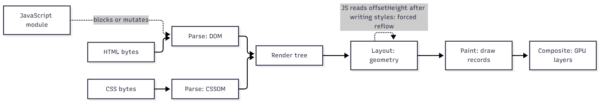

# Part D. Browser and frontend performance

This part explains what the browser does with the application, why the front end is shaped the way it is, and how to measure and reason about performance and token security. The subject is the React 18 + Vite single-page application in `frontend/` (a self-built learning project, not Freshworks code).

> **Labels used in this part.** "Project-implemented behaviour" means the code or configuration exists in the repository. "Conceptual learning example" means a teaching snippet or procedure that is not in the repository and was not executed. "NOT implemented" means the feature does not exist. "NOT executed" means a procedure is described but was not run for this guide.

> **Honesty box: what was and was not measured.** The only measured numbers in this part are the production bundle sizes from `npm run build`, copied from `frontend/README.md` and cross-checked against the raw byte sizes of the files in `frontend/dist/assets` (for example `react-B2q_PyKT.js` is 164,459 bytes, `forms-DxCKw-oE.js` 93,856, `query-Czeq17AX.js` 41,544, `index-MciuOUHE.js` 32,383). Gzip figures are from the README; this session did not recompute them. No measurement was taken in a browser: no Lighthouse run, no Chrome Performance recording, no React Profiler session, no Core Web Vitals field or lab data. Everything about LCP, INP, CLS, frame time or network waterfalls below is concept and procedure, not a result. This matches `PERFORMANCE-AND-TROUBLESHOOTING-GUIDE.md` section 5.4, which marks frontend profiling as NOT EXECUTED.

## D.1 The browser rendering pipeline



### What it is and why it exists

The rendering pipeline is the sequence of steps the browser engine performs to turn HTML, CSS and JavaScript bytes into pixels. It exists because the web separates content (HTML), presentation (CSS) and behaviour (JS), and the engine must combine them efficiently, reusing work when only part of the page changes. Knowing the stages tells you which kind of change is expensive: changing geometry costs more than changing colour, and changing a compositor-only property costs least.

### How it works internally

1. **Bytes to DOM.** The HTML parser tokenises bytes into tokens and builds the Document Object Model tree incrementally. The preload scanner looks ahead for resources (scripts, styles, images) while the main parser may be blocked.
2. **CSS to CSSOM.** Stylesheets are parsed into the CSS Object Model. CSS is render-blocking: the browser will not paint until the stylesheets in `<head>` have loaded, because painting unstyled content would flash.
3. **JavaScript.** A classic `<script>` without `async` or `defer` is parser-blocking and also waits for pending CSS (it may read computed styles). A module script (`type="module"`) is deferred by default: it executes after the document is parsed, in order.
4. **Style calculation and render tree.** DOM and CSSOM combine into computed styles per element. Elements with `display: none` are not in the render tree.
5. **Layout (reflow).** The engine computes size and position (geometry) of each box. A change to width, height, margin, font size, or content can invalidate layout for the element and its descendants or even the whole document.
6. **Paint.** Draw records (text, borders, backgrounds, shadows) are produced for each layer.
7. **Compositing.** Layers are rasterised and combined on the GPU. Properties such as `transform` and `opacity` can often be changed on the compositor thread without layout or paint, which is why animations that use them stay smooth even when the main thread is busy.
8. **The event loop.** All of the above plus JavaScript run on the main thread (with some work on worker and compositor threads). A long task (over 50 ms) delays input handling; this is what the Interaction to Next Paint metric punishes.

Forced synchronous layout ("layout thrashing") happens when JavaScript writes a style then reads a layout property (`offsetHeight`, `getBoundingClientRect`) in a loop: each read forces the engine to run layout immediately.

### How this project uses it (Project-implemented behaviour)

The app is a client-rendered SPA. `frontend/index.html` is tiny: a `<div id="root">` and `<script type="module" src="/src/main.tsx">`. After `npm run build`, Vite rewrites it (`frontend/dist/index.html`) to:

```html
<script type="module" crossorigin src="/assets/index-MciuOUHE.js"></script>
<link rel="modulepreload" crossorigin href="/assets/react-B2q_PyKT.js">
<link rel="modulepreload" crossorigin href="/assets/query-Czeq17AX.js">
<link rel="modulepreload" crossorigin href="/assets/forms-DxCKw-oE.js">
<link rel="stylesheet" crossorigin href="/assets/index-CXDkpKXk.css">
```

What this implies for the first paint:

- The HTML contains no visible content. The first meaningful paint happens after the entry module executes and React renders into `#root`. This is the classic client-side-rendering cost: the user sees a blank page until JavaScript downloads, parses and runs. Mitigations in the project: the `modulepreload` hints (added by Vite) let the browser fetch the three vendor chunks in parallel with the entry module instead of discovering them after parsing it; the CSS is a single 12.3 kB file (3.4 kB gzip) so the render-blocking cost is small.
- For a signed-in reload, `AuthProvider` reads `sessionStorage` synchronously in a lazy `useState` initialiser, so the first React render already knows the user and renders the shell instead of flashing the login page.
- While a lazy page chunk loads, `Suspense` shows a `Skeleton` (CSS gradient animation; honours `prefers-reduced-motion`).
- Nothing forces layout in loops: the only layout reads are the `Modal` focus code and `contains()` checks, which are event-driven and rare.

### Implemented versus not implemented

| Feature | Status |
|---|---|
| Module scripts (deferred by default) | Implemented by Vite |
| Preload of vendor chunks (`modulepreload`) | Implemented by Vite build output |
| Critical CSS inlining | NOT implemented |
| Server-side rendering / static prerender of the login page | NOT implemented |
| Resource hints for the API origin (`preconnect`) | NOT implemented |
| `font` loading strategy | N/A: no web fonts (system font stack in `styles.css`) |
| Skeleton placeholders to hold layout | Implemented |
| Image optimisation | N/A: the UI has no raster images (charts are inline SVG) |

### Additional features and how they would work

- **`<link rel="preconnect" href="https://api.example.com">`** in `index.html` starts DNS, TCP and TLS to the API origin while the bundle downloads. Useful only when the API is on a different origin than the static files. In the dev setup `VITE_API_BASE_URL` defaults to `http://localhost:8080` (cross-origin), so in production behind one hostname with a reverse proxy it would not be needed.
- **Prerendering the login route** at build time (a static HTML shell of the form) gives a fast first paint and then hydrates. It adds a build step and a hydration mismatch risk.
- **Inline critical CSS** for the shell (a few hundred bytes) avoids one render-blocking request; the benefit is small when the CSS file is already 3.4 kB gzip and cached with `immutable`.

### Performance implications

- Parse and compile cost of JavaScript is paid on every cold load even when the file comes from cache; bytes on the wire are not the only cost. The entry path is about 332 kB of raw JavaScript (react 164.5 + forms 93.9 + query 41.5 + index 32.4), which the engine must parse and compile before React can render.
- Because layout and paint run on the same main thread as React rendering, a long React render delays painting.
- CSS selector complexity matters little at this size; `styles.css` is 133 lines with flat class selectors.

### Security considerations

The rendering pipeline is also an attack surface: any HTML string inserted with `innerHTML` is parsed by the same parser and can execute script via event handler attributes. The project avoids `dangerouslySetInnerHTML` entirely (a grep over `frontend/src` for `dangerouslySetInnerHTML` and `innerHTML` finds only the comment that says so, in `auth/tokenStore.ts`). User-supplied article bodies are shown as text with `white-space: pre-wrap` (`.article-body` in `styles.css`), not as HTML.

### Common mistakes

Blocking scripts in `<head>`; putting large CSS behind `@import` (serial downloads); animating `top`/`left`/`width` instead of `transform`; reading layout in a loop; hiding content with `display: none` and then measuring it (returns 0); assuming `async` scripts keep order.

### Debugging techniques

- Chrome DevTools Performance panel: record load; look at the Main thread for long tasks, "Parse HTML", "Evaluate Script", "Recalculate Style", "Layout", "Paint". The Summary tab shows time per category.
- Performance Insights and "Rendering" drawer: Paint flashing, Layout Shift Regions, Frame Rendering Stats. (NOT executed.)
- `performance.getEntriesByType('navigation')[0]` and `performance.getEntriesByType('paint')` in the console give `domContentLoadedEventEnd`, `first-paint`, `first-contentful-paint` for a quick look. (NOT executed.)

### Alternatives and trade-offs

| Approach | First paint | Interactivity | Cost |
|---|---|---|---|
| CSR SPA (used) | After JS runs | Immediate once loaded | Simple hosting; blank first paint |
| SSR (Next.js, Remix) | HTML ready | After hydration | Server runtime, hydration bugs |
| Static prerender | Fast for static pages | After hydration | Build complexity; not for per-user pages |
| Islands (Astro) | Fast | Partial hydration | Different framework; a helpdesk is mostly interactive |

For an authenticated helpdesk, where every page is personalised and behind login, CSR is a defensible choice; the public pages that would benefit from SSR (knowledge base for anonymous visitors) are not part of this SPA's scope (KB `PUBLIC` articles are still fetched through the authenticated API).

### Interview questions and answers

**Q1. Why does a classic script in `<head>` hurt first paint, and how does a module script differ?**
A classic script without `async` or `defer` blocks the HTML parser while it downloads and runs, and it also waits for earlier stylesheets, so DOM construction and first paint are delayed. Module scripts are deferred: they download in parallel and execute after parsing completes, in document order. Vite emits `type="module"`, so the parser is not blocked, but the app still renders nothing visible until the entry module executes, because the HTML is an empty `#root`.

**Q2. Which CSS properties are cheap to animate and why?**
`transform` and `opacity` can be promoted to their own compositor layers, so animating them skips layout and paint and can run off the main thread. Animating geometry (`width`, `height`, `top`) forces layout every frame. In this project the only animations are the skeleton shimmer (a `background-position` animation, which repaints) and the spinner (rotation); both are disabled under `prefers-reduced-motion`. A transform-based skeleton would be cheaper but the elements are small.

**Q3. What does `modulepreload` do and why does Vite emit it?**
It tells the browser to fetch, parse and compile a module script early and keep it in the module map, without executing it. The entry chunk imports `react`, `query` and `forms`; without hints the browser would discover these only after fetching and parsing the entry, creating a waterfall (entry then vendors). With hints they download in parallel.

**Q4. What is layout thrashing and how would you spot it in this app?**
Interleaved style writes and layout reads force repeated synchronous layouts. In the Performance panel it shows as many purple "Layout" events with a warning "Forced reflow" in the same task. The app does not do this in loops; the likely place to introduce it would be a virtualised list or a tooltip that measures elements during render.

## D.2 CSS layout and the DOM in the project

### What it is and why it exists

CSS layout models define how boxes are sized and positioned: normal flow, flexbox (one dimension), grid (two dimensions), and positioned layout (`fixed`, `sticky`, `absolute`). Responsive design adapts layout to viewport width. The DOM is the live tree the layout engine reads; its size (node count) and depth influence style and layout cost.

### How it works internally

- **Flexbox** distributes space along a main axis according to `flex-grow`, `flex-shrink` and `flex-basis`, with `flex-wrap` creating multiple lines. `min-width: 0` on a flex or grid child is needed to allow it to shrink below its content's minimum size (the default `min-width: auto`), a common overflow bug.
- **Grid** defines tracks. `minmax(0, 1fr)` is the safe equal-column idiom for the same overflow reason. `repeat(auto-fit, minmax(150px, 1fr))` creates as many columns as fit, giving responsive grids without media queries.
- **Positioned layout.** `position: fixed` is relative to the viewport and creates its own stacking behaviour; `z-index` only works within a stacking context.
- **Box model.** Width includes or excludes padding depending on `box-sizing`.
- **Containing blocks and percentage heights** need a definite parent height.

### How this project uses it (Project-implemented behaviour)

All styling is a single plain stylesheet, `frontend/src/styles.css` (133 lines, 12.3 kB built, 3.4 kB gzip), with CSS custom properties for colour (for example `--border`, `--muted`, `--danger`, `--primary`). No CSS-in-JS, no Tailwind, no preprocessor. Examples that are real lines of that file:

| Concern | CSS (real) | Why |
|---|---|---|
| App header wraps on small screens | `.app-header { display: flex; flex-wrap: wrap; align-items: center; gap: .75rem 1rem; ... }` | Navigation and the bell wrap instead of overflowing on a phone |
| Ticket form | `.form-grid { display: grid; grid-template-columns: repeat(2, minmax(0, 1fr)); gap: 0 1rem; } .span-2 { grid-column: span 2; }` | Two columns; long values cannot blow out a column because of `minmax(0, 1fr)` |
| Ticket detail | `.detail-grid { display: grid; grid-template-columns: minmax(0, 2fr) minmax(280px, 1fr); gap: 1rem; align-items: start; }` | Main content and a sidebar; sidebar never narrower than 280 px |
| KPI tiles | `.kpi-row { display: grid; grid-template-columns: repeat(auto-fit, minmax(150px, 1fr)); ... }` | Responsive count of tiles without media queries |
| Dashboard charts | `.dash-grid { ... repeat(auto-fit, minmax(340px, 1fr)) ... }` | Same idea for charts |
| Filters | `.filters { display: flex; flex-wrap: wrap; ... } .filters .field { min-width: 140px; flex: 1; }` | Filter controls flow onto multiple lines |
| Field children | `.field { display: flex; flex-direction: column; gap: .25rem; ... min-width: 0; }` | `min-width: 0` to allow shrink |
| Modal | `.modal-backdrop { position: fixed; inset: 0; ... display: flex; align-items: center; justify-content: center; z-index: 50; }` | Centred overlay above the app; toast region uses `z-index: 60` so toasts appear above modals |
| Reduced motion | `@media (prefers-reduced-motion: reduce) { .skeleton, .spinner { animation: none; } }` | Accessibility |
| Charts | Inline SVG with `viewBox`, no fixed pixel width in CSS | Scales fluidly; `role="img"` and an `aria-label` summary |

The `Modal` is rendered through `createPortal(..., document.body)`. A portal renders React children into a different DOM node while keeping React tree behaviour (context, events bubble through the React tree). It avoids ancestor `overflow: hidden` or `transform` clipping a `position: fixed` element and avoids stacking-context traps.

DOM size is small by design: tables render at most 100 rows (the API caps `size` at 100; the UI defaults to 20), and heavy lists are paginated server side.

### Implemented versus not implemented

| Feature | Status |
|---|---|
| Mobile-first responsive layout with flex-wrap and grid auto-fit | Implemented (README: responsive down to phone width; not tested on a real device in this session) |
| `@media` breakpoints | Two rules: `prefers-reduced-motion`, and one `max-width: 800px` breakpoint that collapses `.detail-grid` and `.form-grid` to one column; the rest relies on intrinsic sizing |
| Container queries | NOT used |
| Dark mode (`prefers-color-scheme`) | NOT implemented |
| Print stylesheet | NOT implemented |
| CSS containment (`contain`, `content-visibility`) | NOT used |
| Virtual scrolling | NOT needed at 20 to 100 rows |
| Logical properties (`margin-inline`) for RTL | NOT used |

### Additional features and how they would work

- **Dark mode.** Declare colour variables on `:root` and override them in `@media (prefers-color-scheme: dark) { :root { --bg: ...; } }`; every rule already using variables follows. Hard-coded colours in `styles.css` (for example `#0f172a` for the header, `#e5e7eb` for skeletons) would need conversion first.
- **`content-visibility: auto`** on off-screen cards lets the engine skip layout and paint of content below the fold; it needs `contain-intrinsic-size` to avoid scrollbar jumps. Worth trying only for long pages with measurable layout cost.
- **Container queries** (`@container`) would let the `Card` adapt to its own width rather than the viewport, which suits reusable widgets used in both the main column and the 280 px sidebar.

### Performance implications

- Layout cost grows with DOM size and depth; keep pages to a few hundred nodes. The ticket list with 20 rows and 7 columns is about 140 cells plus controls.
- `position: fixed` overlays are cheap; large box-shadows and blur filters are not (the app uses a small `box-shadow` on toasts only).
- Fonts: the system font stack avoids font loading delays and layout shifts from swapping.

### Security considerations

CSS can leak information (`:visited`, attribute selectors with remote URLs) and clickjacking uses framing. The nginx config sets `X-Frame-Options: DENY` so the app cannot be embedded in another site's frame (D.8 covers the headers). User-controlled strings are never placed in `style` attributes or class names.

### Common mistakes

- Missing `min-width: 0` on flex/grid children (horizontal overflow from long ticket titles or tag strings).
- Using `100vh` on mobile where the dynamic toolbar changes the viewport; `100dvh` is the modern fix (the login wrapper uses `min-height: 100vh`, a minor mobile issue).
- `z-index` wars; overlay layers should be a small documented scale (modal 50, toast 60 here).
- Relying on colour alone.
- Using tables for layout; the project uses `<table>` only for tabular data.

### Debugging techniques

Chrome DevTools Elements panel: the Layout tab shows flex and grid overlays; toggle the device toolbar to test narrow widths; "Computed" tab to see why a width resolved as it did; Rendering drawer: Layout Shift Regions to see CLS sources. In a test: jsdom does not do layout, so CSS behaviour is not covered by Vitest; Playwright (the project has specs in `e2e/`, not executed here) is the place for visual checks.

### Alternatives and trade-offs

| Option | Pros | Cons |
|---|---|---|
| Single global stylesheet (used) | Simplest, tiny, no runtime | Global names; discipline needed |
| CSS Modules | Local scope | Build setup, many files |
| Tailwind | Fast to write, small output with purge | Long class strings, learning curve |
| CSS-in-JS runtime (styled-components) | Co-location, dynamic styles | Runtime cost on the main thread |
| Zero-runtime CSS-in-JS (vanilla-extract) | Typed, no runtime | Build complexity |

### Interview questions and answers

**Q1. Why `minmax(0, 1fr)` instead of `1fr`?**
`1fr` is `minmax(auto, 1fr)`: a track cannot shrink below the min-content width of its items, so a long unbroken string stretches the column and overflows. `minmax(0, 1fr)` allows the track to shrink to zero and lets overflow rules (wrapping, `overflow: auto`) apply. The ticket form grid and detail grid use it.

**Q2. When would you choose grid over flexbox?**
Grid for two-dimensional layouts where rows and columns align (form grid with `span-2`, dashboard cards); flex for one-dimensional flow with wrapping (header, button rows, filters). `auto-fit` with `minmax` gives responsive grids without breakpoints.

**Q3. What does a portal fix for a modal?**
A fixed-position modal rendered deep in the tree can be clipped by an ancestor with `overflow: hidden` or `transform` (which creates a containing block for fixed elements) and can be trapped under another stacking context. Rendering into `document.body` removes those ancestors from the equation while React context and event bubbling still follow the React tree.

**Q4. A table with long titles breaks the page layout on phones. What do you check?**
The wrapper: the project puts the table in `.table-wrap` (intended for horizontal scroll), then checks `min-width: 0` on flex parents, `overflow-wrap: anywhere` for long tokens, and whether any ancestor sets a fixed width. I would verify in DevTools device mode rather than guess, and note that the project has not been verified on real devices in this session.

## D.3 Network requests

### What it is and why it exists

Every interaction beyond the first load is a network request. The cost of a request is DNS, connection setup (TCP and TLS, or reuse), request/response time, server time and body transfer. HTTP/2 multiplexes many requests on one connection; HTTP/3 uses QUIC. CORS governs cross-origin requests from scripts.

### How the project's client works (Project-implemented behaviour)

All requests go through one function, `request<T>` in `src/api/client.ts`:

- Base URL from `VITE_API_BASE_URL` (default `http://localhost:8080`, the gateway) plus the prefix `/api/v1`.
- Sends `Accept: application/json`, a fresh `X-Correlation-Id` per request (`crypto.randomUUID()` with a fallback), `Authorization: Bearer <token>` if a session exists, and `Content-Type: application/json` when there is a body.
- Maps network failure to `ApiError(0, 'NETWORK_ERROR')`; `AbortError` is re-thrown unchanged (a cancelled request is not an error to show).
- Reads the body as text and parses JSON if non-empty; 204 returns `undefined`.
- Error responses are parsed defensively (a non-JSON error body is tolerated), producing `ApiError` with `status`, `code`, `kind`, `fieldErrors`, `correlationId`.
- 401 triggers the global unauthorised handler unless `skipAuthHandling` is set (the login call).
- `buildQuery` drops `undefined`, `null` and empty-string params so URLs stay clean and cacheable.

Request volume control:

| Mechanism | Where | Effect |
|---|---|---|
| De-duplication of identical in-flight queries | TanStack Query | Two components with one key share one request |
| `staleTime` 15 s (5 min for lookups) | `queryClient.ts`, `useLookups.ts` | No refetch on remount within the window |
| `refetchOnWindowFocus: false` | `queryClient.ts` | No burst on tab switch |
| 300 ms debounce on search | `TicketListPage` | One request per pause in typing |
| Polling every 30 s, only while the tab is visible | `useNotifications.ts` (`refetchIntervalInBackground: false`) | Bounded background load |
| Pagination (size at most 100) | `ticketFilters.ts` | Bounded payload |
| Gateway rate limit | `gateway/.../RateLimitFilter.java` | 429 with `Retry-After` when a bucket is empty |

CORS: the browser at `http://localhost:5173` calls the gateway at `http://localhost:8080`, a different origin. Requests with a non-simple header (`Authorization`, `Content-Type: application/json`, `Idempotency-Key`, `X-Correlation-Id`) trigger a **preflight** `OPTIONS` request first. `core-service` `SecurityConfig.corsConfigurationSource` allows the configured origin (`http://localhost:5173` in `application.yml`), methods `GET, POST, PUT, DELETE, OPTIONS`, headers `Authorization, Content-Type, Idempotency-Key, X-Correlation-Id`, exposes `X-Correlation-Id` and `Retry-After`, sets `allowCredentials(false)` and `maxAge(3600)`. The `maxAge` lets the browser cache the preflight result for an hour (browsers cap it, commonly at 2 hours in Chromium, 24 hours in Firefox), so the preflight cost is paid once per URL per hour. The Vite dev proxy (`vite.config.ts`, `/api` to `localhost:8080`) is the alternative that makes the call same-origin and avoids CORS in development (set `VITE_API_BASE_URL=''`).

Note on exposed headers: JavaScript can only read response headers that are CORS-safelisted or listed in `Access-Control-Expose-Headers`. The client reads `X-Correlation-Id` from error responses; that works because it is exposed. `Idempotent-Replay` is NOT in the exposed list in the code shown, so the SPA could not read it cross-origin even if it wanted to. The project's UI never needs it.

### Implemented versus not implemented

| Feature | Status |
|---|---|
| Single fetch wrapper with typed errors | Implemented, tested (`test/client.test.ts`) |
| Request cancellation (`AbortSignal`) | Partial: wrapper supports it, queries do not pass TanStack's signal yet |
| Client timeout | NOT implemented: `fetch` has no default timeout; a stalled request waits for the browser or gateway (the gateway has a 30 s response timeout and 2 s connect timeout, ADR-015) |
| Retry with exponential backoff and jitter | NOT implemented beyond one TanStack retry for queries |
| Request batching / GraphQL | NOT applicable |
| Server push (SSE/WebSocket) | NOT implemented (polling) |
| Service worker / offline | NOT implemented |
| HTTP/2 | Depends on the deployment server; the `nginx.conf` listens on 8080 without TLS, so it serves HTTP/1.1 plain; HTTP/2 in browsers requires TLS in practice (NOT configured) |
| Brotli/gzip compression of static assets | NOT configured in `infra/docker/nginx.conf` (no `gzip on;` directive); see D.4 |

### Additional features and how they would work

- **Client timeouts.** `AbortSignal.timeout(15_000)` combined with the caller's signal via `AbortSignal.any([...])` makes a request fail fast and show the "Cannot reach the server" message instead of hanging.
- **Retry for safe methods only.** Retry GET with backoff (for example 300 ms, 900 ms with jitter) and retry POST only when it carries an `Idempotency-Key`. The ticket create already does; comment creation does not (ADR-008), so it must not be auto-retried.
- **Server-Sent Events for notifications.** A one-way stream replaces the 30 s poll; browsers reconnect automatically; the gateway would need to stream and not buffer (the current hand-written gateway has no websocket proxy and has not been tested for long-lived streams).
- **`Retry-After` handling.** On 429 the client could read the exposed `Retry-After` header and pause polling for that many seconds; today it only shows a message.

### Performance implications

- A preflight adds a round trip for non-simple cross-origin requests; same-origin deployment removes it entirely. A reverse proxy serving both the static files and `/api` from one origin is the usual production shape (the Docker setup uses nginx for static files on 8080; the gateway runs separately, so the cross-origin case remains).
- Each distinct filter combination is a separate cache entry and request; the 15 s `staleTime` makes "back" navigation instant within that window.
- Polling cost: with N open tabs the server sees N requests per 30 s per query; two queries (count while the bell is mounted, list only while open). 100 tabs is about 3.3 requests per second from the count alone.

### Security considerations

- The bearer token is attached to every request to the API origin only (the base URL is a constant); never to arbitrary URLs.
- `allowCredentials(false)` means cookies are not sent cross-origin, so ambient credentials cannot be abused; this is part of why CSRF protection is disabled on the server (the API authenticates with an `Authorization` header that browsers never attach automatically).
- `X-Correlation-Id` is client-generated and untrusted on the server; it is used for log correlation only.
- `Referrer-Policy: no-referrer` (nginx) prevents leaking URLs (which can contain filters) to third parties.

### Common mistakes

- Forgetting that a custom header makes a request non-simple and triggers a preflight (and that the server must allow that header, or the browser blocks the call with a CORS error even though the server processed nothing).
- Reading a header from a cross-origin response without `Access-Control-Expose-Headers`.
- Putting tokens in URLs (they end up in logs and referrers).
- Parsing `res.json()` on a 204 (throws); the wrapper handles by reading text.
- Treating a CORS error as a server error: in the Network panel a blocked preflight shows as a failed `OPTIONS` or "CORS error"; the server log may show nothing.
- Unbounded polling intervals in background tabs.

### Debugging techniques

- DevTools Network panel: filter by Fetch/XHR; check the `OPTIONS` preflight (status 200/204, `Access-Control-Allow-*` headers), the `Authorization` and `X-Correlation-Id` request headers, the timing breakdown (Queueing, DNS, Initial connection, SSL, Waiting for server response (TTFB), Content Download).
- Copy the correlation id from a failed response (`ApiError.correlationId`) and search server logs for it (Part F).
- `curl -i -X OPTIONS http://localhost:8080/api/v1/tickets -H "Origin: http://localhost:5173" -H "Access-Control-Request-Method: POST" -H "Access-Control-Request-Headers: authorization,content-type,idempotency-key"` shows what a preflight returns (NOT executed here).
- Throttle to "Fast 4G" or "Slow 4G" and offline to see the network error path (`describeError` message "Cannot reach the server").

### Alternatives and trade-offs

| Option | Pros | Cons |
|---|---|---|
| `fetch` wrapper (used) | Zero dependency, tiny | You write timeouts, retries, interceptors yourself |
| axios | Interceptors, timeouts, cancel tokens | ~13 kB gzip; adds a dependency |
| ky / ofetch | Small, retry and timeout built in | Another dependency |
| GraphQL client | Fine-grained fields, batching | Not the contract here |
| tRPC | End-to-end types | Requires a TS backend |

### Interview questions and answers

**Q1. Why does the SPA's POST /tickets trigger an OPTIONS request first and what controls its cost?**
The page origin (`:5173`) differs from the API origin (`:8080`), and the request uses headers outside the CORS-safelist (`Authorization`, `Idempotency-Key`, JSON content type). The browser first sends a preflight asking whether the method and headers are allowed. The server answers with `Access-Control-Allow-*` headers and `Access-Control-Max-Age: 3600`, which tells the browser to cache that decision, so the cost is once per URL per hour (subject to browser caps). Serving the API under the same origin removes preflights entirely.

**Q2. The server logged a successful 201 but the browser shows a CORS error on the response of a header read. What happened?**
The request succeeded, but the script tried to read a response header that was not exposed. Browsers hide non-safelisted headers cross-origin unless `Access-Control-Expose-Headers` lists them. Here `X-Correlation-Id` and `Retry-After` are exposed; `Idempotent-Replay` is not, so reading it would return null.

**Q3. How would you add a global request timeout and why does `fetch` not have one?**
`fetch` leaves the policy to the caller. Create `AbortSignal.timeout(ms)` and combine it with the caller's signal. On expiry the promise rejects with a `TimeoutError` DOMException, which the wrapper must map to a user message (the current wrapper re-throws any `AbortError` unchanged, and `TimeoutError` would fall into the generic network error branch, so mapping needs care).

**Q4. Explain the cost model of polling and a better alternative.**
Cost is requests per open tab per interval, regardless of whether anything changed, plus server work per request; it scales with tabs rather than users. Alternatives are Server-Sent Events (one long-lived connection, server pushes) or WebSockets (bidirectional). They reduce wasted requests but add stateful connections, proxy configuration and reconnection logic.

## D.4 Bundle optimisation and code splitting

### What it is and why it exists

A bundler (Vite with Rollup for production) combines modules into files for the browser. Bundle optimisation reduces JavaScript bytes and parse/compile time through tree shaking (removing unused exports from ES modules), minification, code splitting (separate chunks loaded on demand), shared-chunk extraction, and caching strategy (content-hashed file names). It exists because JavaScript is the most expensive resource per byte: it must be downloaded, parsed, compiled and executed.

### How it works internally

- **Tree shaking** relies on static `import`/`export` analysis; side-effectful modules and CommonJS defeat it.
- **Code splitting by dynamic import.** `import('./x')` makes Rollup emit a separate chunk; modules shared by several chunks are hoisted into shared chunks (in the project: `Modal`, `Nav`, `Table`, `useLookups`, `formErrors` chunks in `dist/assets`).
- **`manualChunks`** lets you force groups of modules into named chunks, typically vendor libraries. The benefit is long-term caching: vendor code changes rarely, so its hash stays the same across deploys while app chunks change.
- **Content hashing** puts a hash in each file name (`react-B2q_PyKT.js`), so a changed file gets a new URL and an unchanged file keeps the cached copy.
- **Compression.** Text assets compress well with gzip or Brotli (typically 3x to 4x smaller for JS). The numbers in the table below are gzip sizes reported by Vite. Delivered size depends on server configuration.

### How the project configures it (Project-implemented behaviour)

`vite.config.ts`:

```ts
build: {
  rollupOptions: {
    output: {
      manualChunks: {
        react: ['react', 'react-dom', 'react-router-dom'],
        query: ['@tanstack/react-query'],
        forms: ['react-hook-form', '@hookform/resolvers', 'zod'],
      },
    },
  },
},
```

and `App.tsx` uses `lazy(() => import('./pages/...'))` for every page except `LoginPage` and the status pages; `Layout` supplies `Suspense`.

### The real bundle table (from `frontend/README.md`, measured by `npm run build`)

| Chunk | Size | gzip |
|---|---|---|
| react (react, react-dom, router) | 164.5 kB | 53.7 kB |
| forms (RHF, resolvers, zod) | 93.9 kB | 26.4 kB |
| query (TanStack Query) | 41.5 kB | 12.5 kB |
| index (app shell, login, UI kit) | 32.4 kB | 11.6 kB |
| TicketDetailPage | 15.4 kB | 5.0 kB |
| WorkflowsPage | 8.1 kB | 2.8 kB |
| DashboardPage | 5.7 kB | 2.3 kB |
| other pages | 0.3 - 5.3 kB each | < 2.3 kB |
| CSS | 12.3 kB | 3.4 kB |

Arithmetic I did on those numbers (not a browser measurement): the `/login` path loads react + forms + query + index = 164.5 + 93.9 + 41.5 + 32.4 = 332.3 kB raw and 53.7 + 26.4 + 12.5 + 11.6 = 104.2 kB gzip of JavaScript, matching the README's "about 104 kB gzip", plus 3.4 kB gzip of CSS, so about 107.6 kB gzip over the wire if the server compresses with gzip. The three vendor chunks are 81 percent of the raw JavaScript on that path (300 of 332.3 kB). Individual page chunks are small (the largest, `TicketDetailPage`, is 5.0 kB gzip), so navigating to a page after login adds a few kB.

Reading the table:

1. **React and router dominate (53.7 of 104.2 kB gzip).** Unavoidable with this stack; switching to Preact (compat layer, about 4 kB gzip) is the only big lever and brings compatibility risks.
2. **The `forms` chunk (26.4 kB gzip) is loaded on `/login`** because the login page uses React Hook Form and Zod, and `LoginPage` is in the entry chunk. Zod is the major part. It is a deliberate trade-off: validation schemas live in one place, and the form chunk would be needed anyway as soon as the user creates a ticket. A leaner login (native validation) would save about 26 kB gzip on the very first visit only.
3. **No charting library.** Charts are hand-written inline SVG (`components/charts/Charts.tsx`), and the dashboard chunk is 5.7 kB raw. A library such as Recharts or Chart.js would have added tens of kB gzip.
4. **Per-route splitting works as designed:** admin pages (0.3 to 8.1 kB) are never downloaded by customers.

### Implemented versus not implemented

| Feature | Status |
|---|---|
| Route-level code splitting | Implemented |
| Vendor chunking | Implemented (3 chunks) |
| Tree shaking and minification | Implemented by default in Vite |
| Content-hashed filenames | Implemented |
| Bundle analyser | NOT implemented (`npx vite-bundle-visualizer` not installed, per the performance guide) |
| Performance budget in CI | NOT implemented (no check fails the build if the entry grows) |
| Brotli precompression (`vite-plugin-compression`) and server `gzip_static`/`brotli_static` | NOT configured |
| Preload of next likely route | NOT implemented |
| Component-level lazy loading (for example the AI panel, workflow editor sub-forms) | NOT implemented beyond routes |
| Dependency audit for size | NOT executed |

### Additional features and how they would work

- **Bundle analysis.** Run `npx vite-bundle-visualizer` (or `rollup-plugin-visualizer`) after a build to see a treemap; look for duplicated libraries and unexpectedly large modules. (NOT executed.)
- **Budget check.** A script that reads `dist/assets/*.js`, gzips each and fails if the entry path exceeds, say, 120 kB gzip; `size-limit` or `bundlesize` do the same. This turns the README table into a guardrail.
- **Compression at the server.** Add to nginx: `gzip on; gzip_types text/css application/javascript application/json image/svg+xml; gzip_min_length 1024;` or precompress with Brotli at build time and serve with `gzip_static`/`brotli_static` modules. Brotli is typically 15 to 20 percent smaller than gzip for JS (a general figure, not measured here). The shipped `nginx.conf` does not enable it, so the "gzip" column above is what Vite would report, not necessarily what the container sends. This is a concrete gap to mention.
- **Lazy-load rarely used heavy components,** e.g. `const AiPanel = lazy(() => import('../components/AiPanel'))` inside the ticket detail page so non-AI users (customers) never download it. Savings depend on size; `AiPanel` is part of the 15.4 kB `TicketDetailPage` chunk.
- **Prefetch on idle.** After the app mounts, `requestIdleCallback(() => import('./pages/TicketListPage'))` fetches the most likely next page.
- **Split `forms`.** Moving Zod to a dynamic import for pages that need it is possible, but RHF's resolver imports the schema statically, so the practical split is by route (already so, apart from login).

### Performance implications

- First visit cost is dominated by the vendor chunks. Repeat visits after a deploy re-download only changed chunks, because the vendor chunks keep their hash if their dependency set is unchanged (the `manualChunks` design goal). This matters: an app-code-only change causes the 32.4 kB `index` chunk plus changed page chunks to refresh; the 300 kB of vendor code stays cached (given long-lived caching headers, see D.5).
- Parse/compile time is proportional to raw bytes, not gzip bytes. 332 kB raw on a low-end phone can cost a noticeable fraction of a second of main-thread time (not measured).
- Over-splitting into many tiny chunks adds requests and loses compression efficiency. The project has about 20 small page chunks, fine over HTTP/2, a minor cost over HTTP/1.1 with six connections per host.

### Security considerations

Third-party dependencies in the bundle execute with full page privileges: a compromised npm package can read `sessionStorage` (the token). Supply chain controls: lockfile (`package-lock.json` present), `npm audit` (NOT executed for this guide), pinned versions with caret ranges (the project uses `^` ranges, so a fresh `npm install` without the lockfile could pick newer minors), and minimising dependency count (seven runtime dependencies in `package.json`: `@hookform/resolvers`, `@tanstack/react-query`, `react`, `react-dom`, `react-hook-form`, `react-router-dom`, `zod`). Subresource Integrity is not used on same-origin assets and Vite's `crossorigin` attribute is emitted for module scripts.

### Common mistakes

- Importing a whole library for one function (`import _ from 'lodash'`).
- Barrel files that defeat tree shaking when modules have side effects.
- Putting everything in one vendor chunk so any dependency bump invalidates all vendor caching.
- Lazy-loading a component that is needed for the first paint (adds a waterfall).
- Not measuring: "optimising" a 5 kB module while the 164 kB framework chunk is the issue.
- Source maps shipped publicly without intent (this build does not emit them by default in Vite production unless enabled; verify).

### Debugging techniques

- `npm run build` prints the chunk table; compare before and after a change. (Executed by the README author; I did not rerun the build in this session.)
- Bundle visualiser treemap; `source-map-explorer` if source maps are enabled.
- Chrome DevTools Coverage tab (Ctrl+Shift+P, "Show Coverage") shows unused JavaScript bytes during a flow.
- Network panel with "Disable cache" off and "Slow 4G" to see which chunks load for a route; filter by "JS".
- To check why a module is in a chunk, `rollup` `--debug` or the visualiser's "module graph".

### Alternatives and trade-offs

| Option | Notes |
|---|---|
| Vite + Rollup (used) | Fast dev server (native ESM), good defaults |
| Webpack | Mature plugin ecosystem; slower, more config |
| esbuild only | Very fast; less control over chunking |
| Turbopack, Rspack | Faster builds; ecosystem younger |
| Module Federation / micro-frontends | Independent deploys; runtime complexity and duplicated deps |

### Interview questions and answers

**Q1. Why `manualChunks` for react, query and forms?**
Vendor code changes only when dependencies are upgraded, while application code changes every deploy. Separating them keeps vendor hashes stable, so returning users re-download only the app chunks; it also lets the three libraries download in parallel (the build emits `modulepreload` for them). Without it Rollup would place shared vendor code in whichever chunk imported it first, and the hash would change whenever that chunk changed.

**Q2. The first load of `/login` is about 104 kB gzip of JS. Is that good, and how would you reduce it?**
It is reasonable for a React app with a router, forms and a data layer; the framework alone is 53.7 kB. To reduce it: defer `forms` (Zod 26.4 kB gzip) from the login page by using a lighter validation there, switch to Preact, drop router features, or prerender the login shell so first paint does not wait for JavaScript. Each has a cost; I would first add a CI budget, then measure a real device with Lighthouse before changing anything. No such measurement exists in this project yet.

**Q3. What does tree shaking need, and what can defeat it?**
Static ES module imports and exports and side-effect-free modules (marked via `sideEffects: false` in package.json). CommonJS modules, dynamic `require`, re-exporting everything through a barrel with side effects, and libraries that attach things to globals defeat it.

**Q4. What is the difference between the sizes in the table and what the user downloads?**
The table lists raw (minified) size and gzip size computed by the build. The user downloads whatever the server sends: gzip or Brotli only if the server compresses. The shipped nginx config does not enable compression, so unless a CDN or ingress compresses, the user would receive the raw sizes. This is a configuration gap I would fix first (one directive) before any code-level optimisation.

## D.5 HTTP caching

### What it is and why it exists

HTTP caching lets browsers and intermediaries reuse responses, saving bandwidth and latency. It is controlled by response headers: `Cache-Control` (`max-age`, `no-store`, `no-cache`, `public`, `private`, `immutable`, `stale-while-revalidate`), validators (`ETag`, `Last-Modified`) and request preconditions (`If-None-Match`, `If-Modified-Since`) that produce `304 Not Modified` with no body.

### How it works internally

1. A response with `Cache-Control: max-age=N` is *fresh* for N seconds; the browser serves it without contacting the server.
2. After expiry it is *stale*: the browser revalidates by sending `If-None-Match: <etag>`; the server replies 304 (reuse) or 200 (new body).
3. `no-cache` means "store but always revalidate"; `no-store` means "never store" (sensitive data). `private` forbids shared caches; `public` allows them. `immutable` tells the browser not to revalidate even on reload.
4. Without explicit headers, browsers may apply heuristic freshness based on `Last-Modified`, which is a classic source of stale `index.html`.
5. The `Vary` header declares which request headers affect the response (for example `Vary: Authorization` or `Accept-Encoding`).

### How this project uses it (Project-implemented behaviour)

Static assets (`infra/docker/nginx.conf`):

```nginx
location /assets/ {
  expires 1y;
  add_header Cache-Control "public, immutable";
}
location / {
  try_files $uri $uri/ /index.html;
}
```

Hashed files under `/assets/` (for example `react-B2q_PyKT.js`) can safely be cached for a year with `immutable`, because a changed file has a different name. `index.html` is served by the `/` location with no `Cache-Control` header set by the config; it references the hashed names and must be revalidated on each visit, otherwise a browser could keep an old `index.html` that points to chunks that no longer exist after a deploy. Without an explicit header the browser's behaviour is heuristic (nginx sends `Last-Modified` and `ETag` for static files by default, so conditional revalidation works; but explicit `Cache-Control: no-cache` on `index.html` would be the safe, documented configuration and is NOT present).

Other things that are true in the code:

- **API responses carry no caching headers set by the application** and no `ETag` handling exists in the Java code (a case-insensitive search for `etag` and `if-match` in `core-service/src/main` finds only unrelated substrings). Authenticated JSON should be treated as `private`; the SPA's freshness comes from TanStack Query's in-memory cache (D.6 of this part and C.8), not from the browser HTTP cache.
- The dashboard has a server-side cache (60 s, tenant-keyed, Caffeine/Redis), which is a different layer from HTTP caching.
- The CORS preflight is cached via `Access-Control-Max-Age: 3600`.

### Layers of caching in this system

| Layer | Mechanism | Owner | Implemented |
|---|---|---|---|
| Browser HTTP cache | `Cache-Control`, `ETag` | nginx (static) | Static assets only |
| Browser in-memory app cache | TanStack Query (`staleTime`, `gcTime`) | frontend | Yes |
| CDN / reverse proxy | shared cache | infra | NOT implemented |
| Gateway | none (proxy only) | gateway | No caching |
| Server cache-aside | Caffeine / Redis, tenant-keyed | core-service | Yes (ADR-010) |
| Database | buffer cache | PostgreSQL | n/a |

### Implemented versus not implemented

| Feature | Status |
|---|---|
| Immutable long-lived caching of hashed assets | Implemented |
| `Cache-Control: no-cache` for `index.html` | NOT implemented (relies on default behaviour) |
| Compression headers (`Content-Encoding`, `Vary: Accept-Encoding`) | NOT configured |
| API `ETag` / `If-None-Match` | NOT implemented |
| `Cache-Control: private, no-store` on authenticated API responses | NOT set explicitly; no shared cache sits in the path in the documented setups |
| Service worker caching | NOT implemented |
| CDN | NOT implemented |

### Additional features and how they would work

- **ETag for ticket reads.** The server computes `ETag: "<version>"` (the ticket already has a `version` column) on `GET /tickets/{id}`; the client's `fetch` sends `If-None-Match` automatically when revalidating a cached response; the server returns 304 with no body when the version matches. Because the browser HTTP cache would hold authenticated responses, set `Cache-Control: private, no-cache` and `Vary: Authorization` so intermediaries never share them. The same `ETag` can double as the optimistic-lock precondition via `If-Match` (Part E.7). The saving is body bytes and serialisation, not the database read (unless the version check is cheaper than the full read).
- **`stale-while-revalidate` for reference data.** `Cache-Control: private, max-age=60, stale-while-revalidate=300` on `/ticket-categories` would let the browser serve cached categories instantly while refreshing. TanStack Query already does this at the app layer with a 5 minute `staleTime`; adding HTTP headers helps only for non-SPA consumers.
- **`index.html` rule.** `location = /index.html { add_header Cache-Control "no-cache"; }` forces revalidation (a cheap 304 when unchanged).
- **CDN.** Put static assets on a CDN with the same headers; never cache API responses at a shared cache unless keyed by tenant and user and explicitly designed for it.

### Performance implications

- A returning visitor with a warm cache pays no network cost for the 332 kB of JS on the login path, only an `index.html` revalidation. This is the largest practical speed-up of the whole front end and it comes from one nginx block.
- A wrong `Cache-Control` on `index.html` produces the worst failure: users stuck on an old version, then chunk 404s after a deploy removes old hashed files. Keep old assets for some time after deploy, or serve a "new version available" prompt.
- Conditional requests save bandwidth but still cost a round trip.

### Security considerations

- Never allow shared caches to store authenticated responses: use `Cache-Control: private` or `no-store` for data containing personal information (tickets, users, audit). `no-store` also keeps data out of the browser's back/forward cache and disk cache, which matters on shared computers. With a bearer token (not cookies), a shared cache could serve one user's response to another if it ignored `Authorization`; the HTTP spec makes shared caches not store responses to requests with `Authorization` unless explicitly allowed, but do not depend on that.
- A cached `index.html` containing build-time configuration should not contain secrets (it does not: `VITE_` variables are public by design; `.env.example` holds only the API URL and a flag).
- Sensitive pages and logout: after logout the app clears the in-memory cache (`qc.clear()`), but the browser HTTP cache could still hold earlier responses if they were cacheable; that is another reason for `private, no-store` on sensitive endpoints.

### Common mistakes

Caching `index.html` for a long time; not hashing asset names; using `max-age` without `immutable` on hashed files (browsers revalidate on reload); `Cache-Control: no-cache` misunderstood as "do not cache"; omitting `Vary`; caching error responses; adding a version query string (`app.js?v=2`) that some proxies ignore.

### Debugging techniques

- DevTools Network panel: the Size column shows "(disk cache)" or "(memory cache)" for cache hits and the Status shows 304 for revalidation. "Disable cache" in DevTools changes behaviour, so turn it off when testing caching.
- `curl -I https://host/assets/react-B2q_PyKT.js` to read `Cache-Control`, `ETag`, `Content-Encoding` (NOT executed; the Docker image was not run).
- Application panel, Cache Storage and "Clear site data" to reset.
- For stale deploy problems: hard reload, then compare the `index.html` referenced hashes with the server's `/assets` listing.

### Alternatives and trade-offs

| Strategy | Use for | Trade-off |
|---|---|---|
| Hash + `immutable` + 1 year | Build assets | Needs the HTML to be fresh |
| `no-cache` + ETag | HTML, rarely changing API data | One round trip per use |
| `max-age` short + SWR | Reference data | Brief staleness |
| `no-store` | Sensitive data | No reuse at all |
| Service worker precache | Offline-first PWAs | Update logic and risk of stale versions |

### Interview questions and answers

**Q1. Why can the hashed assets be cached for a year but `index.html` cannot?**
A hashed file's name changes whenever its content changes, so the URL uniquely identifies the bytes and the cached copy can never be wrong. `index.html` has a fixed URL and is the pointer to the current hashes; if it is cached, users keep requesting old hashed files that a new deploy may have deleted. It must be revalidated every time (`no-cache`), costing at most a 304.

**Q2. What is the difference between `no-cache` and `no-store`?**
`no-cache` allows storing but requires validation with the server before reuse. `no-store` forbids storing at all. For personal data prefer `private, no-store` (or at least `private, no-cache`), for static hashed assets prefer `public, max-age=31536000, immutable`.

**Q3. How would you add ETag-based caching to the ticket GET and how does it relate to optimistic locking?**
Return `ETag: "<ticket.version>"` from `GET /tickets/{id}`, and honour `If-None-Match` with 304. For writes require `If-Match: "<version>"` and return 412 Precondition Failed (or the project's 409 `TICKET_VERSION_CONFLICT`) on mismatch. The project currently carries `version` in the JSON body instead of headers; both approaches express the same optimistic-lock idea, headers being the HTTP-native form that also enables caches and proxies to participate.

**Q4. Does browser HTTP caching conflict with TanStack Query's cache?**
They stack. The browser cache sits below `fetch`; TanStack Query decides whether to call `fetch` at all. If the server marks API responses cacheable, `fetch` may return a cached response even after TanStack invalidated its entry, so invalidation would appear not to work. That is a reason for `no-cache` or `no-store` on mutable API data, or to pass `cache: 'no-store'` in `fetch` for those calls.

## D.6 Avoiding unnecessary re-renders

### What it is, why it matters, and how the project approaches it

Re-render avoidance is the browser-side companion to Part C.11. A re-render costs JavaScript time on the main thread, which competes with input handling and painting. The project's policy (README): "Memoisation (`useMemo`/`memo`) is used sparingly, never blanket." This is the right default because React's render is cheap for small trees and the comparison and bookkeeping in `memo` is itself work.

The specific techniques that are implemented (Project-implemented behaviour), each with the file:

1. **Narrow subscriptions.** `useUnreadCount` uses `select: (d) => d.count`; the component re-renders only when the number changes, not when other fields of the response change.
2. **Stable context values.** `AuthProvider` and `ToastProvider` memoise their values and callbacks.
3. **State located low.** Dialog open state lives in the component that opens it (`TransitionControl`, `NotificationBell`), not in the page.
4. **Server-side work for heavy operations.** Sorting, filtering, pagination and analytics aggregation happen on the server, so the client never maps over thousands of items.
5. **URL as state.** One representation; no effect copying URL into state except the search box.
6. **`keepPreviousData`** avoids unmount/remount of the table on page change.
7. **Stable keys.** Server ids as keys.
8. **Event listeners attached only while needed** (the bell's document listeners).

### Techniques not used (NOT implemented) and when they would apply

| Technique | When useful | Why not here |
|---|---|---|
| `React.memo` on rows | Large lists with frequent parent updates | 20 rows |
| `useDeferredValue` / `startTransition` | Expensive filtered renders | No expensive render |
| List virtualisation | Hundreds to thousands of rows | Paginated |
| Splitting context (state vs dispatch) | Large trees with hot context | Small trees |
| Web Workers | CPU-heavy parsing (CSV import, large exports) | None |
| React Compiler | Auto memoisation | Not adopted |
| `requestIdleCallback` for non-urgent work | Analytics, prefetch | None |

### Conceptual learning example (not executed): measuring a re-render in a test

A cheap way to guard against accidental re-render storms is a render counter with `React.Profiler`:

```tsx
// Conceptual learning example (not in the repository, not executed)
import { Profiler } from 'react';
let commits = 0;
render(
  <Profiler id="list" onRender={() => { commits += 1; }}>
    <TicketListPage />
  </Profiler>,
);
// type one character into the search box, wait 350 ms, then assert commits is below an agreed number
```

`Profiler` works in production builds only when profiling is enabled (`react-dom/profiling`), but in tests the dev build supports it. Treat the number as a regression guard (not an absolute truth), because React's internal batching and StrictMode (double render) change counts between versions.

### Performance, security, mistakes, debugging, alternatives

- **Performance.** The cheapest fix is almost always moving state down or passing children up. Memoisation is last.
- **Security.** Not applicable beyond the fact that performance work must not cache authenticated data across users.
- **Common mistakes.** Memoising everything; wrong dependencies; `useMemo` returning a new object when inputs are unstable; `memo` plus inline props; context with large value objects.
- **Debugging.** React DevTools Profiler (flame and ranked views, "why did this render"); `why-did-you-render` library in development; `console.count`.
- **Alternatives.** Signals (Solid, Preact signals), fine-grained stores (Zustand with selectors, Jotai atoms), React Compiler.

### Interview questions and answers

**Q1. A teammate wants to wrap everything in `memo`, `useMemo` and `useCallback`. What do you say?**
Ask for a profile. Without evidence, memoisation adds code and risk (stale closures, wrong dependencies) and can slow things down. The project policy is sparing use; it memoises context values because identity there affects every consumer, and nowhere else.

**Q2. Why does a context consumer re-render even if it is wrapped in `memo`?**
`memo` compares props, not context. When the provider's value changes by `Object.is`, every `useContext` consumer re-renders regardless of `memo`. Mitigations: memoise the value, split contexts by update frequency, or use a selector-based store.

**Q3. How does `select` in `useQuery` reduce renders?**
The observer computes the selected value and compares it structurally with the previous result (structural sharing); the component re-renders only if the selection changed. With `select: (d) => d.count` an update where only another field changed causes no render.

## D.7 Browser profiling

### What it is and why it exists

Profiling is measuring where time and memory go so optimisation targets the real bottleneck. Browser tools show the main thread timeline, network waterfall, memory, and rendering behaviour. A rule: reproduce, measure, change one thing, measure again, under controlled conditions (production build, CPU and network throttling, no extensions).

### Tools and what each answers

| Tool | Answers | How |
|---|---|---|
| Chrome DevTools Network | What loads, in what order, how big, cached or not | Throttle "Fast 4G"; watch waterfall for chains (HTML, entry JS, vendors, page chunk, API) |
| Chrome DevTools Performance | Long tasks, scripting vs rendering vs painting, INP interactions | Record load or an interaction; use CPU 4x slowdown to approximate a mid-range phone |
| Performance Insights | Guided findings (render-blocking, LCP element) | Run on load |
| Lighthouse | Lab Core Web Vitals proxies (LCP, CLS, TBT), accessibility, best practices | Run against `npm run preview` in an incognito window |
| Coverage | Unused JS and CSS bytes | Reload and run a flow |
| Memory (heap snapshot, allocation timeline) | Leaks: detached DOM nodes, growing listeners | Take snapshots before and after repeating an action |
| React DevTools Profiler | Which components rendered and why | Record an interaction |
| `web-vitals` library | Field LCP, INP, CLS from real users | Add to the app and send to an endpoint (NOT installed) |
| `performance.mark/measure` and `PerformanceObserver` | Custom timings, long tasks, layout shifts | Code instrumentation |

### A concrete profiling plan for this project (Conceptual learning example; NOT executed)

1. `cd frontend && npm run build && npm run preview` (serves `dist/` on a local port).
2. Open Chrome incognito (no extensions), DevTools, Network throttling "Fast 4G", Performance CPU "4x slowdown".
3. **Cold load of `/login`.** Record. Check: size of JS transferred (compare with the table in D.4), time of the entry module evaluation, FCP and LCP in Timings. Expect the entry chunk and three vendor chunks fetched in parallel thanks to `modulepreload`.
4. **Login and open `/tickets` with the backend running** (`scripts/run-local.sh`; seed users in `docs/API-CONTRACT.md`). Record the route transition. Check the waterfall for the chunk-then-data waterfall: `TicketListPage` chunk, then `GET /tickets`, in sequence.
5. **Type in the search box.** Record the interaction; look for scripting time per keystroke and confirm that exactly one `GET /tickets` leaves after the 300 ms pause.
6. **Memory leak check.** Open and close the notification bell 50 times with the Memory panel; take a heap snapshot before and after; look for retained listeners (the cleanup in the `[open]` effect should prevent growth).
7. Lighthouse on `/login` (the only route that needs no backend).
8. Write down the numbers with the machine and conditions, as `PERFORMANCE-AND-TROUBLESHOOTING-GUIDE.md` does for the backend, before making any change.

### How profiling data is read

- **Main thread flame chart:** wide bars are expensive; a long task is anything above 50 ms; "Evaluate Script" for a vendor chunk is the parse and execute cost; "Recalculate Style" and "Layout" after a React commit indicate DOM changes causing layout.
- **Network waterfall:** the stalled/queueing segment indicates connection limits; the "Waiting for server response" segment is TTFB; large "Content Download" with small TTFB is a payload problem.
- **Total Blocking Time (lab)** is the sum of main-thread blocking above 50 ms between FCP and Time to Interactive; the field analogue is INP.

### Implemented versus not implemented

| Item | Status |
|---|---|
| Any browser profile or Lighthouse run for this project | NOT executed |
| `web-vitals` field monitoring | NOT implemented |
| `performance.mark` instrumentation | NOT implemented |
| Backend profiling | Partly executed (actuator metrics, load tests, N+1 guard; see the performance guide) |
| Playwright performance traces | NOT implemented |
| Bundle analyser | NOT executed |

### Additional features and how they would work

Add `web-vitals` (about 2 kB gzip) in `main.tsx`: `onLCP(send); onINP(send); onCLS(send);` with `send` posting to an endpoint via `navigator.sendBeacon`. Include route name, build id, device class and connection type, never user identifiers beyond the tenant. Real-user data answers the question lab tools cannot: what do users on slow devices experience?

### Performance, security, mistakes, debugging, alternatives

- **Security.** Do not capture URLs with tokens or PII in monitoring beacons. Strip query strings or whitelist parameters (the ticket filters could include search text `q`, which is user input).
- **Common mistakes.** Profiling the dev server; profiling with the DevTools open on a busy machine; trusting a single run; ignoring variance; measuring on a fast laptop and assuming phones match (use CPU throttling); optimising the lab metric while field data differs.
- **Debugging.** Compare two traces side by side; use "Save profile" and "Load profile"; record with screenshots enabled to correlate visual progress.
- **Alternatives.** WebPageTest (filmstrip, real devices), Sentry Performance, Datadog RUM, SpeedCurve, Chrome UX Report (CrUX) for public sites.

### Interview questions and answers

**Q1. Lab versus field data: what is the difference and which do you trust?**
Lab data (Lighthouse, DevTools) is a controlled, repeatable simulation, good for debugging and regressions. Field data (CrUX, RUM) is what real users experience across devices and networks, the data Google uses for ranking and the one that reflects reality. Use lab data to find and fix, field data to prioritise and verify. This project has neither.

**Q2. How do you find a memory leak in an SPA?**
Repeat an action that should return to a baseline, force garbage collection, and compare heap snapshots; look for growth in detached DOM nodes and listener counts. Typical causes: missing effect cleanup, timers, global event listeners, caches that never evict. In this project the bell's effect cleanup, and TanStack Query's `gcTime`, are the relevant defences.

**Q3. What would you look at first if users say "search feels laggy"?**
Whether the lag is network (Network panel: is each keystroke sending a request? The debounce should prevent that), main thread (Performance panel: long tasks after each keystroke), or server (TTFB). The plan is measurement before hypotheses.

## D.8 Token storage, XSS and the security trade-offs

### What it is and why it exists

A single-page app that talks to a token-authenticated API must keep the credential somewhere between page loads. Every browser storage option has a different exposure to two attack classes: **XSS** (attacker script runs in your origin) and **CSRF** (attacker site causes the browser to send authenticated requests). No option is safe against both without extra design.

### How the project stores the token (Project-implemented behaviour)

`src/auth/tokenStore.ts`: a module-level variable `memory` holds the session `{ accessToken, expiresAt, user }`; `sessionStorage` under the key `cx.session.v1` mirrors it. Reads check `expiresAt <= Date.now()` and clear. `localStorage` is not used. `AuthProvider.logout` calls `POST /auth/logout`, which writes the token `jti` into the server's revocation table (ADR-005); the client drops the token and clears the cache regardless of whether the call succeeded. A 401 anywhere clears the session and cache and redirects to login with a "session expired" message. The token lifetime is 60 minutes (ADR-005) with no refresh token. The tenant and roles are read by the server from the signed claims; the client's copy of `user` in the store is only for display and for UI guards.

The documented trade-off (comment at the top of `tokenStore.ts`, `README`, ADR-016): any script running in the page origin can read `sessionStorage`, so a successful XSS can steal the token. Mitigations present: short lifetime (60 min), no `localStorage` (so the token is not shared across tabs or persisted after the tab closes), no `dangerouslySetInnerHTML`, React's output escaping, server-side revocation, and tenant derived from the JWT only.

### Comparison of token storage options

| Option | Readable by XSS | Sent automatically (CSRF) | Survives reload | Survives tab close | Notes |
|---|---|---|---|---|---|
| JS memory only | Yes (but only while the attacker script runs in the live page; harder to exfiltrate later) | No | No | No | Safest of the JS-accessible options; user logs in again on reload unless a silent refresh exists |
| `sessionStorage` (used, mirrored with memory) | Yes | No | Yes (same tab) | No | Per-tab; not shared with other tabs |
| `localStorage` | Yes | No | Yes | Yes | Persistent theft window; shared across tabs |
| HttpOnly + Secure + SameSite cookie | **No** (script cannot read it) | **Yes** (needs CSRF defence) | Yes | Depends on expiry | XSS can still make requests from the victim's browser (riding the session), but cannot take the token away |
| Cookie via a Backend-for-Frontend (BFF) | No | Yes (needs CSRF defence) | Yes | Depends | The SPA never sees the access token; the BFF holds it server-side |
| Short access token in memory + HttpOnly refresh cookie | Access token yes (short-lived) | Refresh endpoint needs CSRF defence | Yes via silent refresh | Depends | Common compromise |

The key interview point: HttpOnly cookies do not prevent XSS; they prevent *token exfiltration*. An attacker running script in your origin can still call your API with the victim's cookie. They only lose the ability to use the token elsewhere or later. That is a real but partial benefit.

### What the project does about CSRF

The API authenticates with the `Authorization: Bearer` header, which browsers never attach automatically, so cross-site request forgery does not apply, and `SecurityConfig` disables CSRF protection deliberately with a comment explaining it. CORS is configured with `allowCredentials(false)`. If the project moved to cookies, CSRF protection (SameSite=Lax or Strict, a CSRF token or double-submit cookie, `Origin` header checks) would be mandatory.

### Defence in depth the project has and does not have

| Control | Status |
|---|---|
| No `dangerouslySetInnerHTML`, React escaping | Implemented |
| Short token lifetime and server-side revocation | Implemented |
| Tenant from JWT, not client | Implemented |
| `X-Content-Type-Options: nosniff`, `X-Frame-Options: DENY`, `Referrer-Policy: no-referrer` | Implemented in `infra/docker/nginx.conf` for the static site |
| Content Security Policy (CSP) | NOT implemented (no `Content-Security-Policy` header in `nginx.conf`, none in `index.html`) |
| Subresource Integrity / Trusted Types | NOT implemented |
| HSTS and TLS | NOT configured in the sample nginx (plain HTTP on 8080) |
| Dependency scanning (`npm audit`, Dependabot) | NOT executed for this guide |
| Rotating signing keys, asymmetric JWT | NOT implemented (HS256 shared secret, ADR-005) |
| Refresh tokens, silent renew | NOT implemented |
| Inactivity timeout (idle logout) | NOT implemented |
| Sanitiser for rich text (DOMPurify) | NOT needed today because no HTML is rendered |

### Additional features and how they would work

- **CSP.** Add `Content-Security-Policy: default-src 'self'; script-src 'self'; style-src 'self'; img-src 'self' data:; connect-src 'self' https://api.example.com; frame-ancestors 'none'; base-uri 'none'; form-action 'self'` in nginx. Vite's production output uses external module scripts and an external stylesheet, so a strict `script-src 'self'` is feasible; the development server uses inline scripts for HMR, so enforce CSP in the production server only. Roll it out with `Content-Security-Policy-Report-Only` first. If any inline style attribute is used (React `style={{...}}` produces inline style attributes, which `style-src 'self'` blocks unless `style-src-attr 'unsafe-inline'` is allowed), test before enforcing. NOT executed.
- **BFF with HttpOnly cookie.** The SPA calls `/bff/...` on its own origin; the BFF stores the session (cookie `__Host-sid`, `HttpOnly; Secure; SameSite=Lax`) and forwards to the gateway with the JWT. Costs: another service, CSRF defence, session store.
- **Refresh token rotation.** Access token 5 to 15 minutes in memory; refresh token in an HttpOnly cookie scoped to `/auth/refresh`; rotation with reuse detection invalidates the family on replay. Costs: backend work, key management, the `jti` revocation list becomes secondary.
- **Idle timeout.** A timer reset on user input that calls `logout()` after N minutes; reduces exposure on shared machines.
- **Trusted Types** (`require-trusted-types-for 'script'`) makes DOM XSS sinks reject strings; React already avoids most sinks.

### Performance, mistakes, debugging

- **Performance.** `sessionStorage` access is synchronous and cheap at this size; the store reads it once (`loaded` flag) and then uses memory.
- **Common mistakes.** Storing tokens in `localStorage` "for convenience"; logging tokens (console, error reports, URLs); putting the token in a query string for downloads or websockets; trusting client-side role claims; forgetting to clear caches on logout (the project does); assuming HttpOnly makes XSS harmless; disabling CSRF while using cookies.
- **Debugging.** DevTools Application panel: inspect `sessionStorage` key `cx.session.v1`; the Network panel's request headers; decode a JWT payload (base64url) to check `exp`, `tid`, `roles`, `jti` (a JWT payload is not secret; do not paste production tokens into online decoders); test logout by replaying an old token against the API and expecting 401 (revocation has a bounded delay of up to the negative-cache TTL, 3 s default, on nodes other than the one that processed logout, ADR-005).

### Alternatives and trade-offs

See the table above. Summary: for an internal or portfolio app with Bearer-header APIs, memory plus `sessionStorage` is acceptable if XSS defences are strong; for a production public SaaS, a BFF or HttpOnly refresh cookie with short access tokens, plus CSP, is the better answer.

### Interview questions and answers

**Q1. Where should an SPA store a JWT? Defend this project's choice and name its weakness.**
There is no storage that is safe against both XSS and CSRF without additional design. The project keeps the token in memory mirrored to `sessionStorage` because the contract uses a Bearer header: that removes CSRF entirely and avoids `localStorage` persistence. The weakness is XSS: any script in the origin can read `sessionStorage`. Compensating controls: no HTML injection sinks, short lifetime, revocation on logout, no cross-tab persistence. What I would add for production: CSP, a BFF or refresh-cookie flow, and an idle timeout. I would also say that a first-party app with a strict CSP and few dependencies lowers XSS likelihood but not to zero.

**Q2. Does an HttpOnly cookie protect against XSS?**
It protects the *token* from being read, but not the *session*: injected script can still send authenticated requests from the victim's browser, and can read any data the user can see. It does remove the offline replay of a stolen token. Cookies also reintroduce CSRF, which needs SameSite and a token or origin check.

**Q3. Why does the server disable CSRF protection? Is that a vulnerability?**
CSRF exploits automatically attached credentials (cookies, HTTP auth). The API requires an `Authorization: Bearer` header set by JavaScript, which a cross-site form or image cannot add, and CORS does not allow other origins to read responses or send that header (the preflight fails for other origins). So disabling CSRF is correct for a stateless Bearer API. It would become a vulnerability the moment cookies carried authentication.

**Q4. A security review says "add CSP". What would you configure for this app and what could break?**
`default-src 'self'` with `connect-src` for the API origin, `frame-ancestors 'none'`, and `script-src 'self'`. Potential breakage: inline styles from React `style` props if `style-src 'self'` is strict, the dev server's inline HMR scripts (enforce only in production), third-party scripts (none), and charts if they use inline `style`. Deploy as report-only first, collect violations, then enforce.

**Q5. How do you revoke a JWT held in a browser?**
The browser copy cannot be deleted remotely, so revocation is server-side: the server records the token's `jti` and rejects it afterwards (this project's `revoked_token` table with a short negative cache, and gateway signature check only). Combine with short lifetimes so unrevoked leaks expire quickly. User deactivation does not revoke tokens already issued (documented in ADR-005), which is a gap.

## D.9 Core Web Vitals

> **No measurements were taken.** This section is concepts and procedure. No LCP, INP or CLS value for this app has been captured by any tool.

### What it is and why it exists

Core Web Vitals are Google's field-measured user-experience metrics, assessed at the 75th percentile of real page loads:

| Metric | Measures | Good | Needs improvement | Poor |
|---|---|---|---|---|
| Largest Contentful Paint (LCP) | Loading: time until the largest visible element (heading, image, text block) renders | 2.5 s or less | 2.5 to 4 s | over 4 s |
| Interaction to Next Paint (INP) | Responsiveness: worst (near-worst) latency from user input to the next frame across the visit | 200 ms or less | 200 to 500 ms | over 500 ms |
| Cumulative Layout Shift (CLS) | Visual stability: sum of unexpected layout shift scores | 0.1 or less | 0.1 to 0.25 | over 0.25 |

INP replaced First Input Delay (FID) as a Core Web Vital in March 2024. The thresholds above are Google's published ones as of my knowledge; confirm on web.dev before quoting in an interview. Related lab metrics: First Contentful Paint (FCP), Time to First Byte (TTFB), Total Blocking Time (TBT, the lab proxy for INP).

### How each metric is shaped by the architecture of this project (analysis, not measurement)

**LCP.** For an SPA the LCP element appears only after JavaScript executes and data arrives. For `/login` the LCP element is probably the heading or form text, available right after the entry module renders; so LCP is roughly: HTML TTFB + download and parse of CSS and the four JS files (about 332 kB raw, 104 kB gzip if compressed) + React render. Levers in the project: `modulepreload` (already there), compression (NOT configured in the nginx sample), long-lived caching (done), smaller entry (see D.4), prerendering the login shell (NOT done). For an authenticated page such as `/tickets`, LCP additionally waits for the page chunk, then the API response, then render; the skeleton shows early (a skeleton can itself become the LCP element, which makes the metric look better than the real content readiness). A loader-based prefetch (C.7) shortens the chain.

**INP.** Determined by main-thread blocking during interactions: typing in search, opening the bell, sorting the table, submitting a form. The project's handlers are light: the debounce keeps typing cheap, tables are small, and the form is uncontrolled. Risks: a large render after a data arrival (a 100-row table), the `Modal` focus logic (small), and any synchronous `JSON.parse` of large responses. With the 20-row default there is no obvious INP hazard, but that is an inference, not a measurement.

**CLS.** The layout stays stable if content areas reserve space. Positive aspects: skeleton placeholders sized by line count, no images or web fonts (the two main sources of shift), `aria-busy` content replaced in place. Risks: the notification count badge appearing (`{unread > 0 && <span className="bell-count">}`) inserts an element into the header after the first fetch, which can shift the header contents slightly; the conflict notice and error `notice` blocks inserted above forms push content down; toast region is `position: fixed` so it does not shift layout; `keepPreviousData` avoids the table collapsing during pagination. Improving CLS: reserve fixed width for the badge, and insert banners below the viewport top or animate with `transform`.

### Implemented versus not implemented

| Item | Status |
|---|---|
| Field measurement (`web-vitals`, RUM) | NOT implemented |
| Lab audit (Lighthouse) | NOT executed |
| Performance budgets | NOT implemented |
| Practices that help vitals (code split, cache, skeletons, no images/fonts, debounce) | Implemented |
| Compression, `no-cache` index, preconnect, prerender | NOT implemented |

### Additional features and how they would work

- **Measurement** with `web-vitals`: `onINP`, `onLCP`, `onCLS` with `reportAllChanges` in development to see attribution (which element, which interaction target); send to an analytics endpoint in production with `sendBeacon`.
- **Lighthouse CI** in the pipeline to flag regressions on `/login` against thresholds.
- **LCP element hint:** if the LCP is text, there is nothing to preload; if a logo image were added, `<link rel="preload" as="image" fetchpriority="high">`.
- **INP improvements:** break long tasks with `scheduler.yield()` or `setTimeout`, move heavy work to a worker, use `startTransition` for non-urgent state updates.

### Performance, security, mistakes, debugging, alternatives

- **Security.** RUM beacons are another data egress; avoid PII; honour consent and privacy law.
- **Common mistakes.** Optimising Lighthouse score instead of field metrics; testing only on fast hardware; lazy-loading the LCP element; layout shifts from late-loading fonts and ads; ignoring INP because it is harder to measure; reporting an average instead of the 75th percentile.
- **Debugging.** Chrome DevTools Performance panel shows LCP, layout shifts and Interactions tracks; the "Layout shift regions" overlay highlights CLS culprits; the `web-vitals` attribution build names the element and interaction; CrUX (public sites only) provides field data.
- **Alternatives.** Other models: RAIL, the user-centric "Time to Interactive", Speed Index; business metrics such as "time to first ticket created" can be more meaningful for a helpdesk than LCP.

### Interview questions and answers

**Q1. Why is LCP structurally harder for a client-rendered SPA than for a server-rendered page?**
The HTML contains no content, so the largest element cannot be painted until JavaScript is downloaded, parsed and executed, and (for data pages) an API call completes. The metric includes this whole chain. SSR or prerendering collapses the chain to the HTML request, at the cost of server complexity and hydration.

**Q2. What exactly does INP measure, and how is it different from FID?**
INP records the latency (input delay + processing time + presentation delay) of discrete interactions (click, tap, key) throughout the page's life and reports roughly the worst one (the 98th percentile for pages with many interactions). FID measured only the input delay of the first interaction. INP therefore catches slow handlers and slow rendering after later interactions.

**Q3. How would you diagnose a poor CLS in a React dashboard?**
Record with the Rendering drawer's Layout Shift Regions enabled, or the Performance panel Layout Shifts track, to see which elements moved and when. Typical culprits: content appearing above existing content after a fetch, images without dimensions, late fonts, banners. Fix by reserving space (min-height, fixed-size skeletons, aspect-ratio), inserting content at the bottom or in overlays, and animating with transforms.

**Q4. If asked "what is the Lighthouse score of your app", what is the honest answer here?**
"I have not measured it; I know the bundle sizes and the design choices that should help, and I know the gaps (compression not configured in the sample nginx, no prerender, no field data). My first step would be to run Lighthouse on `npm run preview` with mobile throttling and record the result as baseline."

## D.10 Troubleshooting exercises and summary tables

### Exercise 1. White screen after a deploy

Symptom: some users see a blank page; the console shows `Failed to fetch dynamically imported module .../TicketListPage-OLDHASH.js` or `404`. Cause: the browser holds an old `index.html` (or a tab opened before the deploy) that references chunk names the new deploy deleted. Checks: Network panel for the 404 URL; response headers of `index.html` (`Cache-Control`, `ETag`); whether the pipeline keeps previous assets. Fix: serve `index.html` with `no-cache`; keep the previous release's assets for a retention window; catch chunk errors in the `ErrorBoundary` and reload once. (Project status: `index.html` header not explicit; error boundary exists but no auto reload.)

### Exercise 2. Slow first load on a customer's laptop

Symptom: "the page takes 8 seconds". Approach: reproduce with Slow 4G and 4x CPU throttling on a production build. Questions: is the server compressing (`Content-Encoding` on `react-*.js`)? In this project's sample nginx, compression is not enabled, so the JS path is about 332 kB instead of about 104 kB. Is it the first visit or a repeat? (Caching of hashed assets makes repeats fast.) Is the API slow (TTFB of `/api/v1/tickets`)? The backend p50 for ticket list was 4 to 14 ms on a laptop in the performance guide (H2, same machine, no network), so a multi-second delay would be network or front end, not that query (a statement about the measured local setup only).

### Exercise 3. Search triggers a request per keystroke

Symptom: Network panel shows many `GET /tickets?q=...`. Check that the debounce effect's cleanup still clears the timer; check that the input is bound to local `search` state and not directly to the URL; check the `useEffect` dependency (the project suppresses exhaustive-deps there, so a refactor can break the debounce silently).

### Exercise 4. CORS error only on POST

Symptom: GETs work, POST fails with "Request header field idempotency-key is not allowed by Access-Control-Allow-Headers in preflight response". Cause: the new header was not listed in the server's allowed headers. In this project the list is `Authorization, Content-Type, Idempotency-Key, X-Correlation-Id`; a new custom header requires adding it in `SecurityConfig.corsConfigurationSource` (and checking the gateway forwards it).

### Exercise 5. Token still works after logout

Check that `POST /auth/logout` returned 204; that the `jti` was written to `revoked_token`; that you are not hitting a different node within the negative cache TTL (3 s default; ADR-005); that the client really sent the same token (a copy taken before logout). Expected: the next call returns 401 `UNAUTHENTICATED` and the client's global handler clears the session.

### Exercise 6. The page janks while typing in a form

Record in the Performance panel with 4x throttling. If scripting time per keystroke is large, check whether a parent re-renders on each key (a `watch()` call in the form root, or a controlled input updating page state). RHF with `register` should show no render per keystroke. The project's ticket form follows that pattern; the list's search box does re-render the page per keystroke (cheap at 20 rows).

### Summary tables

| Question | Answer in this project |
|---|---|
| Rendering model | Client-side SPA, Vite, React 18, `createRoot` |
| Code splitting | Per route, plus three vendor chunks |
| First-load JS on `/login` | About 332 kB raw, about 104 kB gzip (README arithmetic) |
| Caching of assets | Hashed files, `public, immutable`, 1 year (nginx) |
| Compression | Not configured in sample nginx |
| API caching | None at HTTP level; TanStack Query in memory; server cache-aside |
| Token storage | Memory + `sessionStorage`; Bearer header; no CSRF exposure; XSS risk documented |
| Security headers | nosniff, frame DENY, no-referrer; no CSP |
| Measured in a browser | Nothing |

| Optimisation | Effect | Cost | Priority for this project |
|---|---|---|---|
| Enable gzip/Brotli in nginx | JS over the wire 3x to 4x smaller (typical) | One directive | First |
| `no-cache` on `index.html` | Safe deploys | One directive | First |
| CSP (report-only first) | Limits XSS impact | Testing effort | High |
| CI bundle budget | Prevents regressions | Small script | Medium |
| `web-vitals` field data | Real numbers | Endpoint + privacy care | Medium |
| Prerender login | Faster first paint | Build complexity | Low |
| AbortSignal in queries | Fewer wasted requests | Small change | Low |

### Self-review checklist

1. Can I name each stage of the rendering pipeline and what triggers it?
2. Can I explain why vendor chunks keep their cache across deploys?
3. Can I state which cache layers exist and which headers are and are not set?
4. Can I defend `sessionStorage` and name its XSS weakness and three better options?
5. Can I say what Core Web Vitals are and honestly say none were measured here?
