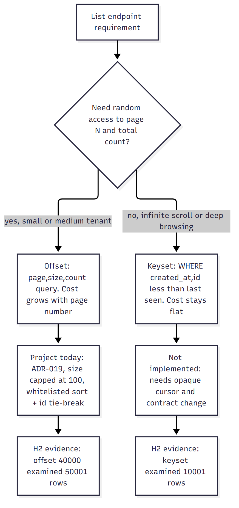
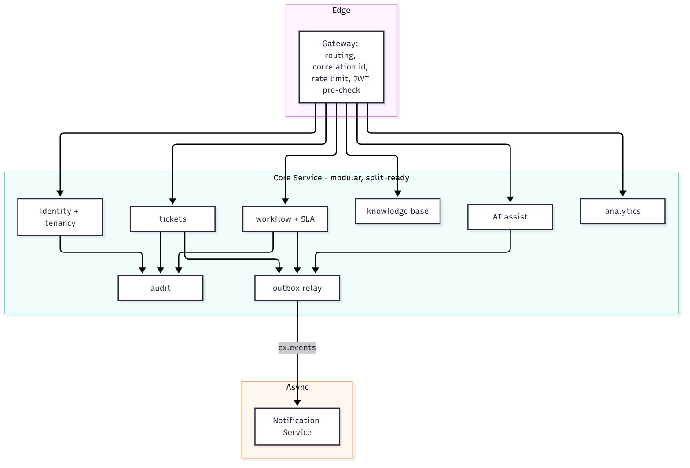

# Part E. REST APIs and system design

This part explains the HTTP API of the multi-tenant CX + ITSM portfolio platform (a self-built learning project, not Freshworks code) and the design decisions around it: HTTP semantics, resource modelling, versioning, pagination, error contracts, idempotency, optimistic locking, authentication and authorisation, rate limiting, service boundaries, the gateway, and the choice of a modular monolith over microservices. The contract is `docs/API-CONTRACT.md`; the decisions are recorded in `ARCHITECTURE-DECISIONS.md` (ADRs).

> **Labels used in this part.** "Project-implemented behaviour" means the code exists in the repository and a file path is cited. "Conceptual learning example" means a teaching snippet or design that is not in the repository and was not executed. "NOT implemented" means the feature does not exist. "H2 ONLY" and "NOT EXECUTED" follow the definitions in `PERFORMANCE-AND-TROUBLESHOOTING-GUIDE.md`: H2 evidence says nothing about PostgreSQL timings, and NOT EXECUTED means a procedure is given but no result exists.

> **What was executed for this part.** Nothing was run against the backend in this pass. The numbers quoted come from the existing performance guide (measured by its author on one laptop on 2026-10-17, H2 in memory, load generator on the same machine) and are cited as such. The front-end checks that were run (`npx tsc --noEmit` exit 0; `npx vitest run` 85 of 86 on the first run (one 5 second timeout) and 86 of 86 on a later re-run) are described in Part C. No `curl` example below was executed; they are templates.

## E.1 HTTP semantics

### What it is and why it exists

HTTP defines a small vocabulary (methods, status codes, headers, representations) so that clients, servers, caches, proxies and gateways can cooperate without knowing each other's internals. A REST-style API that respects the vocabulary gets caching, retries, tooling and monitoring "for free". An API that ignores it (everything is `POST /doAction` returning 200) forces every intermediary and every client developer to read documentation to know whether a retry is safe.

### How it works internally: the properties that matter

| Property | Meaning | Methods |
|---|---|---|
| Safe | No intended state change on the server; may be prefetched or cached | GET, HEAD, OPTIONS |
| Idempotent | Repeating the identical request has the same intended effect as sending it once | GET, HEAD, OPTIONS, PUT, DELETE (and by contract not POST, not PATCH) |
| Cacheable | A response may be stored for reuse | GET and HEAD by default, POST only with explicit freshness |

Idempotent does not mean "same response": a second `DELETE` may return 404 instead of 204, yet the server state is the same. Safe is about intent, not logging: a GET that increments a counter violates the contract.

Status code classes: 2xx success (200 OK, 201 Created with a `Location` header ideally, 202 Accepted for async work, 204 No Content), 3xx redirection and caching (304 Not Modified), 4xx client error (400 malformed or invalid, 401 not authenticated, 403 not authorised, 404 not found, 405 method not allowed, 409 conflict with current state, 412 precondition failed, 415 unsupported media type, 422 semantically invalid, 429 too many requests), 5xx server error (500 unexpected, 502 and 504 gateway problems, 503 unavailable).

Headers that matter: `Content-Type` and `Accept` (negotiation), `Authorization`, `Cache-Control`, `ETag` with `If-Match` and `If-None-Match`, `Retry-After`, `Location`, `Idempotency-Key` (a convention in an IETF draft, not yet a final standard in my knowledge), and custom tracing headers such as `X-Correlation-Id`.

### How this project uses HTTP (Project-implemented behaviour)

Base path `/api/v1`, JSON only, through the gateway on port 8080 to `core-service` on 8081 (`docs/API-CONTRACT.md`).

| Operation | Method and path | Success | Notes |
|---|---|---|---|
| Login | `POST /auth/login` | 200 | public; rate limited by `LoginRateLimiter` |
| List tickets | `GET /tickets?page&size&sort&q&status...` | 200 | safe, bounded page size |
| Create ticket | `POST /tickets` with `Idempotency-Key` | 201 | replay returns the original 201 plus `Idempotent-Replay: true` |
| Read ticket | `GET /tickets/{id}` | 200 | cross-tenant id returns 404 |
| Edit ticket | `PUT /tickets/{id}` with `version` | 200 | 409 on stale version |
| Assign | `POST /tickets/{id}/assign` | 200 | action sub-resource, carries `version` |
| Transition | `POST /tickets/{id}/transition` | 200 | 422 for a transition the workflow forbids |
| Add comment | `POST /tickets/{id}/comments` | 201 | not idempotent (ADR-008) |
| Logout | `POST /auth/logout` | 204 | writes `jti` to the revocation table |
| Delete category | `DELETE /ticket-categories/{id}` | 204 | ADMIN |

Controller evidence (`core-service/.../tickets/TicketController.java`): `@RestController`, `@RequestMapping("/api/v1/tickets")`, `@GetMapping` for the list with bounded parameters, `@PostMapping` for create with `@RequestHeader("Idempotency-Key")` and `@Valid @RequestBody`, building `ResponseEntity.status(HttpStatus.CREATED)` and adding `Idempotent-Replay` when the result is a replay. `@PreAuthorize("hasRole('AGENT')")` guards update and assign.

Choices worth discussing in an interview:

1. **`PUT` for update with a full body.** The edit form sends all editable fields plus `version`, which fits PUT's replace semantics. `PATCH` for partial updates is not used. The server nevertheless compares fields and records only the changes (the code builds a `changes` list for the activity feed), so unchanged fields do no harm.
2. **`POST` for actions.** `assign` and `transition` are modelled as `POST` sub-resources because they are commands with business rules (workflow validation, customer restrictions, activity and outbox events), not field updates. Using `PUT /tickets/{id}/status` would also be defensible; the trade-off is discussed in E.2.
3. **`422` for invalid transitions, `409` for version conflicts.** 409 means "the request conflicts with the current state of the resource" (someone else changed it). 422 means "the request was well-formed but violates a business rule". The pair lets the client react differently: reload on 409, show the rule on 422.
4. **404 for cross-tenant ids.** The contract says `NOT_FOUND` "also used for cross-tenant ids". Returning 403 would reveal that the id exists in another tenant; 404 leaks nothing.
5. **429 with `Retry-After`** (gateway and core, E.9).
6. **503 only for the AI provider.** `AI_UNAVAILABLE` is a 503 in the code, but the contract also says that provider failure on `analyze` returns HTTP 200 with `degraded: true`; the 503 code exists for other cases. The degraded-200 design means the UI can keep working without error handling for an optional feature.

### Implemented versus not implemented

| Feature | Status |
|---|---|
| Correct use of GET/POST/PUT/DELETE | Implemented |
| `PATCH` | NOT used |
| `Location` header on 201 | NOT set in the controller code shown (the body carries the ticket id) |
| `HEAD` and `OPTIONS` | `OPTIONS` handled for CORS preflight; no custom `HEAD` |
| Content negotiation beyond JSON | NOT implemented |
| Conditional requests (`ETag`, `If-Match`, `If-None-Match`) | NOT implemented (version carried in the JSON body instead) |
| `Cache-Control` on API responses | NOT set |
| `202 Accepted` for async work | NOT used; side effects go through the outbox, but the request itself completes synchronously |
| Bulk endpoints | NOT implemented |
| Problem Details (RFC 9457) | NOT used; a custom error schema (E.5) |

### Additional features and how they would work

- **`Location` on create.** `ResponseEntity.created(URI.create("/api/v1/tickets/" + id))` helps clients that follow the redirect-like convention and costs one line.
- **`PATCH` with JSON Merge Patch** for single-field edits (change priority only): the client sends `{ "priority": "HIGH", "version": 7 }` with `Content-Type: application/merge-patch+json`. It avoids sending the whole form but needs care with `null` meaning "remove" and with validation of partial objects.
- **Bulk assign** (`POST /tickets/bulk-assign` with up to N ids): returns 207 Multi-Status style per-item results, since partial success is the norm; each item carries its own `version`.

### Performance, security, mistakes, debugging

- **Performance.** Safe, idempotent GETs are cacheable and retryable, which helps both browsers and the gateway; only the dashboard is cached server side today (60 s, tenant-keyed).
- **Security.** Method restrictions: `GlobalExceptionHandler` maps unsupported methods to 405 with the contract error body. 401 versus 403: the project distinguishes "not logged in" (`UNAUTHENTICATED`) from "not allowed" (`FORBIDDEN`). Do not return stack traces: the catch-all handler returns `Unexpected error` and logs the exception server-side.
- **Common mistakes.** `GET` with side effects; `POST` for everything; 200 with an error body; using 500 for validation errors; 401 versus 403 confusion; ignoring idempotency on retried POSTs; not documenting which errors are retryable.
- **Debugging.** `curl -i` to see status and headers; the `X-Correlation-Id` returned in every response and in error bodies; Swagger UI at `/swagger-ui.html` (permitted in `SecurityConfig`); in the browser the Network panel's Headers and Preview tabs.

### Alternatives and trade-offs

| Style | Pros | Cons |
|---|---|---|
| REST over JSON (used) | Ubiquitous, cacheable, tooling | Over/under-fetching, many round trips |
| GraphQL | Client picks fields; one endpoint | Harder caching, authorisation per field, N+1 on the server |
| gRPC | Typed, efficient, streaming | Browser needs a proxy (gRPC-Web); less human-debuggable |
| JSON-RPC | Simple commands | Loses HTTP semantics, caching |
| OData | Rich query syntax | Complexity and attack surface |

### Interview questions and answers

**Q1. What is the difference between safe and idempotent, and why does it matter for retries?**
Safe means the request is not meant to change state (GET). Idempotent means repeating it has the same effect as doing it once (PUT, DELETE, and all safe methods). A client or gateway may automatically retry idempotent requests after a timeout because a duplicate is harmless; it must not retry a plain POST, because the first attempt may have succeeded. That is exactly the gap `Idempotency-Key` closes for ticket creation.

**Q2. Why 409 for a stale version and 422 for an invalid transition, instead of 400 for both?**
400 means the request could not be understood or failed basic validation. A stale version is a conflict between the request and the current resource state (409); the cure is to reload and retry. An invalid transition is a valid request that breaks a domain rule (422); reloading will not help unless the workflow changed. Different codes (and distinct `code` values `TICKET_VERSION_CONFLICT` and `INVALID_TRANSITION`) let the UI behave differently: banner with "Reload latest" versus an error message.

**Q3. Is `PUT /tickets/{id}` really idempotent in this implementation?**
In terms of server state, yes: sending the same body with the same `version` twice produces the same final state, except that the second call carries a now-stale `version` and returns 409. The conflict response is not a violation: idempotency concerns the intended effect (state) not identical responses. The optimistic lock turns the retry into a detectable conflict rather than a silent double-apply, which is the safe behaviour.

**Q4. Why return 404 instead of 403 when a user requests another tenant's ticket?**
Because the existence of the id is itself information. With 403 an attacker can enumerate which ids exist in other tenants; with 404 an id from another tenant is indistinguishable from a non-existent one. The repository lookups are `findByIdAndTenantId`, so the other tenant's row is simply not found.

## E.2 Resource modelling

### What it is and why it exists

Resource modelling decides the nouns of the API (tickets, comments, categories), their identifiers, relationships (sub-resources), representations (JSON fields) and which operations are exposed. A good model keeps URLs stable while the internals change, gives each noun one canonical representation, and maps naturally to the permissions and caching you want.

### The project's model (Project-implemented behaviour)

| Resource | Path | Identity | Relationship | Source |
|---|---|---|---|---|
| Tenant (organisation) | `/auth/register-organization`, `/tenant/settings` | uuid (`tid` claim) | Root of all data | contract |
| User | `/users` | uuid | Belongs to tenant; has roles | contract |
| Ticket | `/tickets`, `/tickets/{id}` | uuid, plus human number per tenant | Belongs to tenant; requester and assignee are users; category | `TicketController` |
| Comment | `/tickets/{id}/comments` | uuid | Sub-resource of ticket; visibility PUBLIC or INTERNAL | contract |
| Activity | `/tickets/{id}/activity` | uuid | Read-only timeline of a ticket | contract |
| Ticket category | `/ticket-categories` | uuid | Admin-managed lookup | contract |
| Article | `/articles`, `/articles/{id}/versions` | uuid, slug | Knowledge base, versioned | contract |
| Workflow | `/workflows`, `/workflows/{id}/activate` | uuid, version | Each POST creates a new version | contract |
| SLA policy | `/sla-policies` | uuid | One per priority | contract |
| Notification | `/notifications`, `/notifications/{id}/read` | uuid | Per recipient; served by the notification module | contract |
| AI suggestion | `/tickets/{id}/ai/analyze`, `/ai/suggestions/{id}/approve` | uuid | Sub-resource of ticket with a review state machine | contract |
| Audit event | `/audit-events` | uuid | Read-only, ADMIN | contract |

Modelling decisions:

1. **Tenant is not in the URL.** The tenant is derived from the signed JWT claim `tid` (ADR-004), never from a path or header supplied by the client. Alternative designs put the tenant in the path (`/tenants/{id}/tickets`) or in a subdomain; both make the tenant visible but require a check that the path tenant equals the token tenant, which is where bugs hide.
2. **Two identifiers for tickets.** A uuid `id` for the API and a per-tenant sequential `number` for humans (`#42`). Numbers are allocated by `TicketNumberAllocator` in a tiny separate transaction, so they are unique and increasing but can have gaps (ADR-009, performance guide 3.1.1).
3. **Sub-resources for owned collections.** Comments and activity only exist in the context of a ticket, so `/tickets/{id}/comments` states ownership, supports permission checks on the parent, and avoids a global comments endpoint nobody needs.
4. **Actions as `POST` sub-resources** (`/assign`, `/transition`, `/publish`, `/activate`, `/approve`, `/reject`, `/read`). Reasons: they trigger rules and side effects (events, activity entries, audit), carry their own input (reason, version), and may be rejected by business logic. The "pure REST" alternative is to PATCH a `status` field and let the server derive the action; this hides the intent and the rules.
5. **Representations carry display data** (`categoryName`, `requester.displayName`) so the list needs no N+1 calls from the client; the server resolves names with batched queries (the N+1 guard test shows 6 statements for 2 rows and for 30 rows, performance guide section 6).
6. **Visibility is part of the representation** (`PUBLIC` or `INTERNAL` on comments and articles); the server filters based on the caller's role (a CUSTOMER never receives INTERNAL comments).
7. **Versioning inside the resource.** `version` on tickets and articles supports optimistic concurrency (E.7); workflows are immutable versions where activating one deactivates another.
8. **State machines as data.** The transition map is returned to the client as `DEFAULT_TRANSITIONS`, but the real source is the active workflow on the server, so the UI copy is a hint only (`api/types.ts` states so).

### Implemented versus not implemented

| Feature | Status |
|---|---|
| Consistent plural-noun paths | Implemented |
| Sub-resources for comments, activity, AI suggestions | Implemented |
| HATEOAS links in responses | NOT implemented; the client knows the URLs from the contract |
| Field selection (`fields=`), expansion (`expand=`) | NOT implemented |
| Filtering by multiple values (`status=OPEN,PENDING`) | NOT implemented; single values only |
| Full-text search | Portable `lower(title) like '%q%'` form on title and description (performance guide 7.1, Q3: scans the tenant's rows); trigram index exists only in the PostgreSQL migration set |
| Soft delete | Not described for tickets; categories can be deleted (ADMIN) |
| Bulk operations | NOT implemented |
| Long-running operations as resources (`/exports/{id}`) | NOT implemented |

### Additional features and how they would work

- **`?expand=comments`** returns the first page of comments inside the ticket response, saving a round trip on the detail page. It needs a size cap and a decision about permissions on the expanded part.
- **Export as a resource.** `POST /ticket-exports` returns 202 with `Location: /ticket-exports/{id}`; the client polls `GET /ticket-exports/{id}` until `status: DONE` and then downloads a pre-signed URL. This avoids request timeouts (the gateway's response timeout is 30 s) and lets the work run in the background.
- **Multi-value filters** with repeated parameters (`status=OPEN&status=PENDING`) map cleanly to `IN` clauses; the whitelist and the `size` bound must remain in force.

### Performance, security, mistakes, debugging

- **Performance.** Deep nesting (`/tenants/{t}/tickets/{id}/comments/{c}/attachments`) multiplies routing and permission checks; keep nesting to one level and expose identifiers globally unique within the tenant.
- **Security.** Every repository call is tenant-scoped (`findByIdAndTenantId`), the Hibernate tenant filter (ADR-002) applies as a second layer, and PostgreSQL row-level security is an optional third (ADR-003). Never expose internal ids that reveal volume (sequential global ids); the project exposes uuids and per-tenant numbers.
- **Common mistakes.** Verbs in URLs for plain CRUD; exposing the database schema as the API; returning different shapes for the same resource in list and detail without documenting it; putting the tenant id in the client-controlled path and trusting it; nesting too deeply.
- **Debugging.** Compare the contract to the actual response (`/v3/api-docs`); check serialisation of nulls; use the correlation id to find the server log; for 404s check both the path and the tenant of the token.

### Alternatives and trade-offs

| Decision | Chosen | Alternative | Trade-off |
|---|---|---|---|
| Tenant location | JWT claim | Path or subdomain | Claim is tamper-proof; path is explicit and cache-friendly but needs verification |
| Command endpoints | POST sub-resources | PATCH status | Commands express intent and rules; PATCH is more uniform |
| Ticket ids | uuid + number | Auto-increment | uuid prevents enumeration; number helps humans |
| Embedded names in list | Yes | IDs only | Fewer client calls vs bigger payloads and staleness of names |

### Interview questions and answers

**Q1. Why is the tenant not in the URL?**
The server derives the tenant from the signed JWT (`tid`), which the client cannot alter without invalidating the signature. A tenant in the path adds a second source of truth that every handler must compare against the token; forgetting one comparison is a cross-tenant data leak. The cost of the claim-based approach: caches keyed by URL alone cannot separate tenants, and a user belonging to two tenants must log in twice (the contract says "switching tenant = re-login").

**Q2. How do you model "assign this ticket"? Why not `PUT /tickets/{id}` with a new `assigneeId`?**
Assignment has its own rules: the assignee must be an active staff user of the same tenant, the activity feed must record who assigned whom, events and notifications must fire, and a no-op assignment must not bump the version. A dedicated `POST /tickets/{id}/assign` gives these rules a single entry point with a purpose-built request body and error codes, and lets permissions differ from general edits. The cost is more endpoints.

**Q3. What are the downsides of embedding `categoryName` in the ticket representation?**
Denormalised data can be stale if the category is renamed while a client holds a cached list; payloads are slightly larger; the server needs a batched lookup per page (done: one `IN` query, so no N+1). The benefit is that the list renders without extra requests.

**Q4. How would you design file attachments properly?**
Today attachments are metadata only (name, type, size). A proper design uses a pre-signed upload: the client calls `POST /tickets/{id}/attachments` with metadata, receives an upload URL and an attachment id, uploads bytes straight to object storage, then the server marks the attachment as available after a size and content check (and ideally a malware scan). Downloads go through short-lived signed URLs after an authorisation check. None of this exists in the repository.

## E.3 API versioning

### What it is and why it exists

An API is a contract with clients you do not control (an SPA at a different release, mobile apps, integrations). Versioning is the policy for changing that contract without breaking them: which changes are compatible, how breaking changes are introduced, how long old versions live.

### How the project does it (Project-implemented behaviour)

URL-path major version: every route starts with `/api/v1` (controllers use `@RequestMapping("/api/v1/...")`; the front end sets `const PREFIX = '/api/v1'` in `api/client.ts`; the gateway routes `/api/v1/**`). The contract file `docs/API-CONTRACT.md` is the source of truth for both sides. Evolution practice visible in the code:

- **Additive changes only inside v1.** New error codes are noted as "additive codes" (`ErrorCode` javadoc: "plus a few additive codes"); `ErrorCode.CONFLICT`, `METHOD_NOT_ALLOWED` and `UNSUPPORTED_MEDIA_TYPE` exist beyond the contract's list. The client is tolerant: `mapKind` falls back to the HTTP status when the code is unknown, so a new code does not crash the UI.
- **Tolerant reader.** The client parses error bodies as `Partial<ApiErrorBody>`, and the types include honest unions (`Ticket.number: number | string`, `Article.author` as string or object) for contract looseness.
- **Resource versions inside the API.** Workflows and articles are versioned resources (separate from API version).

### Versioning strategies compared

| Strategy | Example | Pros | Cons |
|---|---|---|---|
| URL path (used) | `/api/v1/tickets` | Visible, easy routing and caching, easy in gateways | Whole API versions together; URLs change on major bumps |
| Header | `Accept: application/vnd.cx.v2+json` | Clean URLs, per-resource evolution | Harder to test in a browser, caching needs `Vary` |
| Query parameter | `?api-version=2` | Easy to try | Easy to forget; cache keys |
| Date-based | `API-Version: 2026-10-01` (Stripe style) | Fine-grained, per-client pinning | Needs transformation layer per date |
| No versioning, additive only | n/a | Simplest | A breaking change forces coordinated deploys |

### Compatible versus breaking changes

Compatible (safe in v1): adding an optional request field; adding a response field (clients must ignore unknown fields); adding a new endpoint; adding a new enum value only if clients handle unknown values (not always safe: the TypeScript `TicketStatus` union and `Record<TicketStatus, ...>` maps would fail to compile or render unknown values in a switch, so a new status is effectively a coordinated change); loosening a validation rule.
Breaking: removing or renaming a field; changing a type or meaning; making an optional field required (the `Idempotency-Key` header became required for create, which breaks old clients); changing status codes or error codes; tightening validation; changing pagination shape.

### Implemented versus not implemented

| Feature | Status |
|---|---|
| Major version in the path | Implemented |
| Deprecation signalling (`Deprecation`, `Sunset` headers) | NOT implemented |
| Parallel v2 | NOT implemented |
| Contract tests between SPA and API | Partial: front-end tests mock the API; backend has controller tests; there is no consumer-driven contract test (Pact) |
| OpenAPI diff in CI to catch breaking changes | NOT implemented |
| Generated clients | NOT implemented |
| Feature flags to roll out API changes | NOT implemented |

### Additional features and how they would work

- **Deprecation process.** Mark an endpoint deprecated in OpenAPI, return `Deprecation: true` and `Sunset: <date>` headers plus a `Link` to the migration note, log usage by client (use the `X-Correlation-Id` plus an `X-Client-Version` header), and remove only after usage is zero.
- **OpenAPI diff in CI.** Export `/v3/api-docs` from the build and compare it with the previous release using a tool such as `openapi-diff`; fail the build on removed fields or tightened types. (NOT executed; tool choice is an example.)
- **v2 in parallel.** The gateway routes `/api/v2/**` to the same `core-service` with new controllers while v1 controllers delegate to the same services; DTO mapping is where versions differ.

### Performance, security, mistakes, debugging

- **Performance.** Versioning costs nothing at runtime except extra controllers; supporting many versions multiplies tests.
- **Security.** Old versions keep old bugs; set a sunset to remove them. Each version must apply the same authorisation checks, preferably in the service layer shared by all controllers (the project's authorisation lives in services and method security, not in DTO mapping).
- **Common mistakes.** Treating "we will never break it" as a plan; versioning every small change; leaking internal entities as DTOs (so a column rename becomes an API break; `ArchitectureRulesTest` enforces an entity-exposure rule in this project); no tolerant reader on the client.
- **Debugging.** When a client breaks after a deploy, diff the response bodies and the OpenAPI document across versions; check unknown enum values.

### Alternatives

GraphQL avoids versioning with deprecation of fields; gRPC uses protobuf field numbers for compatibility; event schemas use schema registries with compatibility modes (the project's event envelope in `platform-events` has the same problem for consumers).

### Interview questions and answers

**Q1. Why URL versioning here and when would you pick header versioning?**
URL versioning is visible, trivial to route in a gateway, trivially testable with a browser or curl, and cache-friendly. I would pick header or date-based versioning when many external integrators need fine-grained pinning and the API changes frequently; the price is a transformation layer and weaker visibility.

**Q2. Is adding a new `TicketStatus` value a compatible change?**
For the server's JSON, yes; for this client, effectively no. The TypeScript union and `Record<TicketStatus, TicketStatus[]>` map assume a closed set, so the client needs a coordinated release (and the badge components would render an unknown value without styling). A tolerant client would map unknown values to a neutral display. This shows why "additive" is not automatically safe for enums.

**Q3. The server team wants to make `Idempotency-Key` required. What is the rollout?**
Because it breaks clients that do not send it, either introduce it as optional first (server generates a random key if absent so nothing changes but the client can opt in), monitor adoption, then require it with a deprecation notice, or ship in `/v2`. In this project it was required from the start (the controller marks the header `required = false` so the service can return a contract-shaped 400 instead of a framework error).

**Q4. How do you stop DTOs from becoming accidental breaking changes?**
Keep entities out of controllers (enforced by an architecture test), generate and diff OpenAPI in CI, and keep a contract document. Renames in the database should not change JSON.

## E.4 Pagination: offset versus keyset



### What it is and why it exists

Returning every row of a large collection is impossible: memory, bandwidth, latency and cost all grow with the table. Pagination returns a bounded slice plus the information needed to get the next slice. The two main techniques are offset (page number) and keyset (also called seek or cursor-based).

### How each works internally

**Offset.** `ORDER BY created_at DESC, id DESC LIMIT 20 OFFSET 40000`. The database must produce rows in order and skip the first 40000 before returning 20. With a matching index it walks 40020 index entries; without one it sorts. Cost grows linearly with the page number. A second `COUNT(*)` query provides `totalElements`/`totalPages`, which is its own cost on large tenants. Also, rows inserted or deleted between page requests shift the window: items can be duplicated or skipped.

**Keyset.** `WHERE (created_at, id) < (:lastCreatedAt, :lastId) ORDER BY created_at DESC, id DESC LIMIT 20`. The database seeks directly to the position in the index and reads 20 rows, so cost is flat regardless of depth, and results are stable under inserts. The cost: no random access to "page 37", no cheap total count, the sort order must be total (a unique tiebreaker such as `id`), sorting by arbitrary columns requires an index per sort, and the cursor must be opaque and tamper-checked (encoded last-seen values, ideally signed or at least validated).

**Cursor-based** is the API form of keyset: the response includes `nextCursor` (opaque string), and the client sends it back as `cursor=`.

### How the project paginates (Project-implemented behaviour)

Contract (`docs/API-CONTRACT.md`): query `page` (0-based), `size` (1..100, default 20), `sort=field,dir`; response `{ content, page, size, totalElements, totalPages }`. Server code `core-service/.../common/PageParams.java`:

```java
public static final int MAX_SIZE = 100;
...
if (p < 0) throw ApiException.validation("page", "must be >= 0");
if (s < 1 || s > MAX_SIZE) throw ApiException.validation("size", "must be between 1 and " + MAX_SIZE);
...
if (!allowed.contains(field)) throw ApiException.validation("sort", "unsupported sort field '" + field + "'");
...
sorting = Sort.by(dir, field).and(Sort.by(Sort.Direction.ASC, "id"));
```

So: size is bounded; sort is a whitelist (an attacker cannot sort by an unindexed or sensitive column, and cannot inject SQL through the sort parameter); and `id` is appended as a deterministic tiebreaker so pages are stable when the sort column has duplicates. ADR-019 records the consequences: `OFFSET` cost grows with page number, the `count(*)` runs on every page request, `page` itself is not capped, and the contract exposes page numbers so switching to keyset would be a contract change.

The client side (`lib/ticketFilters.ts`): page, size and sort live in the URL; `size` is clamped to 1..100 and `page` to at least 0 client-side as well; `Pagination` shows page and total; the list uses `placeholderData: keepPreviousData`.

### H2 evidence (H2 ONLY; copied from `PERFORMANCE-AND-TROUBLESHOOTING-GUIDE.md` section 7.1)

Method: real Flyway migrations V1 to V15 loaded into H2 2.2.224 in PostgreSQL mode, 3 tenants with 50 000 / 20 000 / 5 000 tickets; "rows examined" from `EXPLAIN ANALYZE`; wall-clock times were discarded as unreliable at this size.

| Query | Index chosen | Rows examined | Reading |
|---|---|---:|---|
| Q1 list page: `tenant_id = ? and status = 'OPEN' order by created_at desc, id desc limit 20` | `ix_ticket_sla_scan (tenant_id, status, sla_checked_at)` | 14 287 | Index narrows by status, but all of the tenant's OPEN rows are read and then sorted; no index provides the `created_at` order |
| Q1 on a copy of the table without indexes | table scan | 75 001 | 5.2x more rows examined |
| Q2 `status = 'OPEN'` without tenant predicate | table scan | 75 001 | Tenant-led indexes are useless without a tenant predicate |
| Q3 `lower(title) like '%jammed ticket 4999%'` | tenant index only | 50 001 | Leading wildcard scans every row of the tenant |
| Q4 offset page: `limit 20 offset 40000` | tenant index | 50 001 | Reads and discards 40 000 rows |
| Q4b keyset page at the same position | `ix_ticket_tenant_created` | 10 001 | 5x fewer rows examined (H2 still reads more than 20) |
| Q1 with candidate index `(tenant_id, status, created_at desc, id desc)` | H2 still chose `ix_ticket_sla_scan` | 14 287 | No improvement shown on H2; says nothing about PostgreSQL |

What may and may not be concluded (the guide's own caution, repeated here): offset depth and contains-search scale with tenant size, and the keyset form examines fewer rows in this engine. It must not be concluded that keyset is "5 times faster" in production, that the candidate index helps, or anything about PostgreSQL timings. The PostgreSQL `EXPLAIN (ANALYZE, BUFFERS)` commands are written in section 7.2 of the guide and were NOT EXECUTED.

The ticket-list load test (guide section 3, `ticket-list` scenario) measured `GET /tickets?page=0&size=20` only, that is, the shallowest page; no deep-page load test exists.

### Offset versus keyset versus cursor

| Aspect | Offset (used) | Keyset | Opaque cursor (API form of keyset) |
|---|---|---|---|
| Random access to page N | Yes | No | No |
| Total count | Yes (extra `count(*)`) | Hard (separate estimate) | Usually omitted |
| Cost at depth | Grows with page | Flat | Flat |
| Stable under concurrent inserts | No (shifts) | Yes | Yes |
| Arbitrary sort columns | Easy | Needs index and unique tiebreaker per sort | Same |
| UI fit | Numbered pages, jump to page | Infinite scroll, next/prev | Infinite scroll, next/prev |
| Contract impact in this project | none (current) | contract change | contract change |

### Implemented versus not implemented

| Feature | Status |
|---|---|
| Bounded `size`, whitelisted sort, deterministic tiebreaker | Implemented |
| Total count in every response | Implemented |
| Cap on `page` | NOT implemented (ADR-019 notes it) |
| Keyset / cursor pagination | NOT implemented (evidence only) |
| Covering index for the list order | NOT implemented; the candidate index is untested on PostgreSQL |
| Count estimation for large tenants | NOT implemented |
| `Link` header for next/prev | NOT implemented |
| `useInfiniteQuery` on the client | NOT implemented |

### Additional features and how they would work

**Keyset for the ticket list (Conceptual learning example, not in the repository, not executed).**

1. Request: `GET /tickets?size=20&cursor=<opaque>`; first page without a cursor.
2. The cursor encodes the last row's sort values: for the default sort `createdAt,desc` it is `base64url(json({ c: "2026-10-17T10:15:30Z", i: "<uuid>" }))`, signed with an HMAC so clients cannot craft arbitrary seeks (or at least strictly validated).
3. SQL: `WHERE tenant_id = ? AND (created_at, id) < (?, ?) ORDER BY created_at DESC, id DESC LIMIT 21`; fetch one extra row to know whether a next page exists.
4. Response: `{ content, nextCursor | null }`, optionally `hasMore`; no `totalElements` (or a separately cached approximate count).
5. Index: `(tenant_id, created_at DESC, id DESC)` exists as `ix_ticket_tenant_created` per the guide's Q4b; filtering by `status` as well would need `(tenant_id, status, created_at DESC, id DESC)`, which is the candidate index not yet validated on PostgreSQL.
6. Client: `useInfiniteQuery({ queryKey, queryFn: ({ pageParam }) => ..., initialPageParam: undefined, getNextPageParam: (last) => last.nextCursor })`, with an "Load more" button or intersection observer.
7. Sorting by another column (`priority`) requires its own composite index and cursor shape; restrict keyset to a small set of sorts and keep offset for the rest, or accept offset for admin screens with bounded depth.

**Hybrid.** Keep offset for the first N pages (cheap) and cap `page` at, say, 500; provide `cursor` for deep traversal and exports.

### Performance, security, mistakes, debugging

- **Performance.** Offset with a good index on the first pages is fine; depth is the issue. `count(*)` on a large filtered set can dominate; options are caching counts briefly, using estimates, or dropping totals. Size caps bound payload.
- **Security.** The sort whitelist closes injection and information-leak routes (sorting by a hidden column reveals ordering). Unbounded `size` is a denial-of-service lever; the cap of 100 stops it; the uncapped `page` is a smaller lever (expensive deep scan) that the gateway rate limit partially bounds. Cursors must not expose internal data and must be validated to avoid cross-tenant seeks (the tenant predicate is always applied from the token, never from the cursor).
- **Common mistakes.** Sorting by a non-unique column without a tiebreaker (duplicates or gaps between pages); `OFFSET` on huge tables; unbounded page size; returning `totalElements` when you do not need it; changing sort between page requests (cursor invalid); exposing raw database values in cursors.
- **Debugging.** Compare `EXPLAIN (ANALYZE, BUFFERS)` for page 1 and a deep page; watch `Rows Removed by Filter` and sort nodes; reproduce duplicates by inserting rows between page requests; log the page parameters with the correlation id.

### Alternatives and trade-offs

Search-engine pagination (`search_after` in Elasticsearch/OpenSearch) is keyset in another form; "load all and paginate in the browser" works only for small, bounded sets; materialised views or pre-aggregated counts speed up totals.

### Interview questions and answers

**Q1. Why is offset pagination slow for deep pages, and how does keyset fix it?**
`OFFSET n` forces the database to generate and discard n rows before returning the page, so cost is proportional to depth: on H2 with 50 000 rows in one tenant, offset 40 000 examined 50 001 index entries. Keyset states the position as a predicate on the sort key, so the index can seek to it and read only the page; the same position examined 10 001 rows on H2 (still more than 20 because of H2's row-value handling). On PostgreSQL I would expect near-constant cost, but that is not measured in this project.

**Q2. What do you lose by switching to keyset?**
Random access to arbitrary page numbers and cheap totals; also freedom of sort (each sort needs a matching index and a total order), and the contract changes from `page` to `cursor`, so the front-end `Pagination` component with page numbers must be replaced by next/previous or infinite scroll. In an ITSM list people often filter and sort by many columns and jump to pages, which is why offset is acceptable at the current scale.

**Q3. Why does `PageParams` append `id` to every sort?**
Sorting by `priority` alone leaves ties in an unspecified order, which can differ between queries; with offset paging rows may then appear on two pages or none. Adding a unique column makes the order total and repeatable.

**Q4. A tenant has 5 million tickets. What changes?**
Deep offset pages become expensive, `count(*)` becomes slow, contains-search (`like '%q%'`) becomes a full scan. Moves: keyset or cursor pagination for lists, estimated or cached counts, a trigram or full-text index (or a search engine) for search, partial indexes for the open-queue case, and archiving closed tickets. The existing performance guide lists the PostgreSQL experiments to run before committing to any of it.

## E.5 Error contracts

### What it is and why it exists

An error contract defines the shape and codes of failures so clients can react programmatically (show field errors, retry, re-authenticate) and humans can debug (message, correlation id). Without it, every client parses ad hoc strings, and every server framework leaks its own error format.

### The project's contract (Project-implemented behaviour)

From `docs/API-CONTRACT.md` and `GlobalExceptionHandler`:

```json
{ "timestamp": "ISO", "status": 409, "error": "CONFLICT", "code": "TICKET_VERSION_CONFLICT",
  "message": "...", "path": "/api/v1/...", "correlationId": "...",
  "fieldErrors": [ { "field": "title", "message": "must not be blank" } ] }
```

| `code` | HTTP | When | Client behaviour |
|---|---|---|---|
| `VALIDATION_FAILED` | 400 | Bean validation, malformed JSON, bad enum, bad page/size/sort | Map `fieldErrors` onto form fields |
| `UNAUTHENTICATED` | 401 | Missing, invalid, expired or revoked token | Clear session, go to login |
| `FORBIDDEN` | 403 | Role or ownership rule | Show "no permission" |
| `NOT_FOUND` | 404 | Missing or cross-tenant id | "Not found" |
| `TICKET_VERSION_CONFLICT` | 409 | Stale `version` | Conflict banner, "Reload latest" |
| `DUPLICATE_SUBMISSION` | 409 | Same `Idempotency-Key`, different body | "Already submitted" |
| `INVALID_TRANSITION` | 422 | Workflow forbids the move | Show message |
| `RATE_LIMITED` | 429 | Bucket empty; header `Retry-After` | Back off |
| `AI_UNAVAILABLE` | 503 | Optional AI provider failure (the `analyze` call degrades to 200 instead) | Show degraded state |
| `INTERNAL_ERROR` | 500 | Anything unexpected | Generic message |
| `CONFLICT`, `METHOD_NOT_ALLOWED`, `UNSUPPORTED_MEDIA_TYPE` | 409, 405, 415 | Additive codes (unique constraint violations, wrong method, wrong `Content-Type`; the 405 and 415 mappings are covered by `ErrorContractTest`) | Generic |

Server mapping (`common/GlobalExceptionHandler.java`, `@RestControllerAdvice`): handlers for `ApiException`, `RateLimitedException` (adds `Retry-After`), `MethodArgumentNotValidException` and `ConstraintViolationException` (build `fieldErrors`), `HttpMessageNotReadableException` and `MethodArgumentTypeMismatchException` ("Malformed request"), `MissingRequestHeaderException` (field error naming the header, which is how a missing `Idempotency-Key` surfaces), `AccessDeniedException`, `AuthenticationException`, `ObjectOptimisticLockingFailureException` (mapped to `TICKET_VERSION_CONFLICT`: Hibernate's concurrency failure becomes the same 409 the explicit version check produces), `DataIntegrityViolationException` (logged, generic 409), `HttpRequestMethodNotSupportedException`, `NoResourceFoundException`, and a final `Exception` handler that logs and returns `Unexpected error` with no internals. Security-layer failures (before controllers) are written by `ErrorWriter` in `SecurityConfig`'s entry point and access-denied handler in the same schema, and the gateway writes the same schema for its own 401, 429, 503, 504 and 404 (`ErrorResponses`, `JsonErrorWebExceptionHandler`), so the client sees one format regardless of which layer rejected the call.

Client side (`api/client.ts`): `mapKind(status, code)` maps the code first, then the HTTP status as a fallback; `ApiError` carries `status`, `code`, `kind`, `fieldErrors`, `correlationId`; `describeError` produces safe text.

### Error design principles illustrated

1. **Machine-readable code plus human message.** Clients switch on `code`; humans read `message`. Messages are not part of the contract (they may change).
2. **Field-level errors** with the exact field names of the request, so the UI can attach them to inputs.
3. **No internals.** The catch-all handler hides stack traces and SQL; `DataIntegrityViolationException` logs the cause but returns a generic message.
4. **Correlation id** returned in the body and the `X-Correlation-Id` header, exposed through CORS, so a user can quote it and an engineer can grep the logs (`CorrelationIdFilter`).
5. **One schema for every layer** (gateway, security filter, controller advice).
6. **Same HTTP status can carry distinct codes** (409 has three) because HTTP status alone is too coarse.
7. **Do not reveal existence.** Login failure returns the same generic message for unknown tenant, unknown email or wrong password (the SPA shows "Invalid organization, email or password.").

### Comparison with RFC 9457 Problem Details

| Aspect | Project schema | RFC 9457 `application/problem+json` |
|---|---|---|
| Machine code | `code` | `type` (a URI) |
| Human text | `message` | `title`, `detail` |
| HTTP status | `status` | `status` |
| Field errors | `fieldErrors[]` | extension member (commonly `errors`) |
| Correlation | `correlationId` | extension member |
| Media type | `application/json` | `application/problem+json` |
| Tooling | Custom | Spring 6 has `ProblemDetail` support |

Migrating to Problem Details would be a mostly mechanical change in `GlobalExceptionHandler` and the client's `ApiErrorBody`; the benefit is standardisation, the cost is changing a contract that already works.

### Implemented versus not implemented

| Feature | Status |
|---|---|
| Single error schema across gateway, security and controllers | Implemented |
| Field errors | Implemented |
| `Retry-After` on 429 | Implemented (gateway and core) |
| Correlation id in errors | Implemented |
| Localised messages | NOT implemented |
| Error documentation per endpoint in OpenAPI | Partial (Swagger UI exists; completeness not verified) |
| RFC 9457 | NOT used |
| Machine-readable retryability flag (`retryable: true`) | NOT implemented |
| Error budgets and alerting by `code` | Metrics exist at the HTTP level (`gateway_proxied_total{route,status}`); per-code metrics are not described |

### Additional features and how they would work

- **Retryability.** Add `retryable` and `retryAfterSeconds` to the body for 429/503/504; the client's retry policy then needs no status table.
- **Documentation URLs per code** (`type` or `helpUrl`) for support staff.
- **Validation messages with i18n keys** (`validation.title.min`, params) so the SPA can localise.
- **Sentinel for partial failure** in bulk endpoints: top-level 207 with per-item error objects in the same schema.

### Performance, security, mistakes, debugging

- **Performance.** Building error bodies is negligible; logging full stack traces for expected 4xx errors is not (the handler logs 5xx and integrity violations, not validation errors).
- **Security.** Do not echo user input unescaped into `message` if the client renders HTML (React escapes; other clients may not); do not include SQL, class names or file paths; do not differentiate "user not found" from "wrong password"; apply rate limits to login.
- **Common mistakes.** 200 with `{ "error": ... }`; returning 500 for validation; inconsistent shapes between layers; leaking internals; relying on message text in the client; swallowing errors in a generic handler and losing the cause (the project logs it with the stack).
- **Debugging.** Take `correlationId` from the error, grep core, gateway and notification logs (all propagate it); reproduce with `curl -i`; for 400s read `fieldErrors`; for 409 check which code. For a 500 the log line `Unhandled exception on {method} {uri}` carries the stack.

### Alternatives and trade-offs

Plain status codes with text bodies (simple, unparseable), GraphQL `errors` array with `extensions.code`, gRPC status codes with details, and RFC 9457. Using codes and a stable schema is the common denominator.

### Interview questions and answers

**Q1. Why have `code` when HTTP status already exists?**
Status is coarse: three different situations return 409 here (stale version, duplicate submission, a generic constraint conflict), and the UI must behave differently for each. The `code` is a stable, documented, machine-readable discriminator; the message is free text for humans and may change.

**Q2. How does the Hibernate optimistic lock exception end up as the same 409 as the explicit version check?**
The service first calls `checkVersion` and throws a domain exception for an obviously stale version. If two transactions pass that check and race, Hibernate's `@Version` makes the second flush fail with `ObjectOptimisticLockingFailureException`; `GlobalExceptionHandler` maps that to `TICKET_VERSION_CONFLICT`. The client therefore sees one behaviour whether the conflict was detected early or at commit.

**Q3. A client developer says "your 500s have no details". What do you answer?**
That is intentional: the response says `Unexpected error` with a correlation id; details live in server logs. Provide the id and the engineer finds the stack. Returning exception text to clients leaks internals and gives attackers information.

**Q4. How should a client use these errors to decide whether to retry?**
Retry network errors and 502/503/504 with backoff and jitter, honour `Retry-After` on 429, never retry 400, 401 (re-authenticate), 403, 404, 409 or 422 automatically. A POST is retried only if idempotent (with an `Idempotency-Key`). The front end encodes part of this in `queryClient.retry` (no retry for 4xx; one retry otherwise) and never retries mutations.

## E.6 Idempotency and the Idempotency-Key

### What it is and why it exists

A POST that creates something is not idempotent: sending it twice creates two things. In real networks, requests are sent twice all the time: a timeout while the response was in flight, a user double click, a proxy or client library retrying, a mobile app resuming. The client cannot tell whether the first request succeeded. An idempotency key lets the client attach a unique token to the logical operation so the server can recognise the repeat and return the original outcome instead of repeating the side effect.

### How it works internally (generic)

1. The client generates a unique key (UUID) once per logical operation and sends it in a header on every attempt.
2. The server, on first sight of (scope, key), executes the operation and stores the key together with a fingerprint of the request and the response.
3. On a repeat with the same key and the same fingerprint it returns the stored response without executing again.
4. A repeat with the same key but a different request is a client bug and is rejected (409 or 422).
5. Concurrent duplicates must be serialised: a unique constraint or a lock ensures only one executes.
6. Keys expire after a retention window.

### The project's implementation (Project-implemented behaviour)

Files: `core-service/.../tickets/TicketController.java` (header), `TicketCommandService.java` (logic), `IdempotencyKey.java` (entity), `IdempotencyKeyRepository.java`, `db/migration/V11__idempotency_key.sql` (table), ADR-008.

Table (`V11__idempotency_key.sql`): `id`, `tenant_id`, `user_id`, `idem_key varchar(100)`, `request_hash varchar(64)`, `response_status`, `response_body varchar(20000)`, `created_at`, with `constraint uq_idem_scope unique (tenant_id, user_id, idem_key)` and an index on `created_at` for purging.

Algorithm (`TicketCommandService.create`, abbreviated from the real code):

```java
if (idempotencyKey == null || !KEY.matcher(idempotencyKey).matches())
    throw ApiException.validation("Idempotency-Key", "required: 1-100 chars of letters, digits, . _ : -");
AuthUser me = CurrentUser.require();
UUID tenant = TenantContext.require();
String hash = hash(request);                 // SHA-256 of the JSON body

for (int attempt = 0; attempt < 2; attempt++) {
    Optional<IdempotencyKey> existing = keys.findByTenantIdAndUserIdAndKey(tenant, me.userId(), idempotencyKey);
    if (existing.isPresent()) return replay(existing.get(), hash);
    try {
        long number = numbers.next(tenant);  // own tiny transaction, before the business transaction
        TicketDto created = tx.execute(status -> {
            TicketDto dto = tickets.create(request, number);
            IdempotencyKey k = new IdempotencyKey(); /* ... set tenant, user, key, hash, 201, json(dto) ... */
            keys.saveAndFlush(k);            // unique violation surfaces here, rolling back the ticket too
            return dto;
        });
        return new Result(created, false);
    } catch (DataIntegrityViolationException e) {
        log.debug("Idempotency race on key {}; replaying the winner", idempotencyKey);
    }
}
throw ApiException.conflict("Could not complete idempotent creation; retry");
```

And `replay`: if the stored `request_hash` differs from the new request's hash, throw `DUPLICATE_SUBMISSION` (409); otherwise deserialise the stored `response_body` and return it as a replay, which the controller turns into `201` plus `Idempotent-Replay: true`.

Design properties, each tied to code:

| Property | Mechanism |
|---|---|
| Scope | (tenant, user, key): two users or tenants can use the same key string without colliding |
| Key format validated | Regex `^[A-Za-z0-9._:-]{1,100}$`; prevents oversize keys and odd characters |
| Request fingerprint | SHA-256 of the serialised request body (hex, 64 chars) |
| Atomicity | The key row is inserted in the same transaction as the ticket, so a failed creation never consumes the key and a stored key always has its ticket |
| Concurrency | The unique constraint is the arbiter; the loser's transaction rolls back (ticket included) and the loop replays the winner's stored response |
| Replay signalling | Response header `Idempotent-Replay: true` |
| Retention | `purgeOldKeys` scheduled hourly deletes keys older than 24 h, per tenant (so it works under PostgreSQL row-level security) |
| Tested | "4 concurrent same-key creates produce 1 ticket" (ADR-008) |

The numbering interplay: the ticket number is allocated before the business transaction; if the transaction later rolls back (for example the loser of an idempotency race), the number is burned. That is a documented trade-off (numbers unique and increasing but not gap-free, ADR-009). Under an idempotency race one number is consumed by the loser.

The client half (Part C.5): `useRef(newId())` creates one key per form mount; `ticketApi.create(body, key)` sends the `Idempotency-Key` header; the key is reused on retry; the next mount makes a new key; the form disables the button and uses a synchronous ref guard. Tests assert the same key on retry and a different key on a new mount.

### Limits and edge cases

1. **Only ticket creation.** `POST /tickets/{id}/comments` is not idempotent; a retried comment is duplicated (ADR-008, explicitly listed). Assign, transition and update are protected by optimistic locking instead, because a repeat carries a stale `version` and fails with 409 (E.7). A repeated transition therefore fails with 409 rather than silently succeeding, which is safe but means a client that lost the response sees an error although the first call succeeded; reloading shows the new state.
2. **Replay returns the stored snapshot**, not the current ticket (ADR-008 lists it): if the ticket changed in between, the replay shows the old state.
3. **Different body with the same key** returns 409 `DUPLICATE_SUBMISSION`; a client that edits the form after a failed attempt but reuses the key gets this error (see Part C.5 for the UI consequence).
4. **Response size limit.** `response_body` is limited to 20 000 characters; a ticket with large attachments' metadata could exceed it (the DTO currently carries metadata only).
5. **Same-key concurrent request while the first is still running** is not blocked: both proceed until the insert; the loser rolls back and replays. The work (validation, number allocation) is duplicated for the loser, but the outcome is correct.
6. **Key retention of 24 hours** means a retry after more than a day creates a new ticket.
7. **Hash instability.** Hashing the serialised request depends on stable JSON serialisation (field order from the record), which is deterministic for a given record class.
8. **Header optionality in the controller.** The controller marks the header `required = false` and the service validates it, producing a contract-shaped 400 instead of a generic framework error.

### Implemented versus not implemented

| Feature | Status |
|---|---|
| Idempotency key with request hash, atomic with the write, concurrency-safe | Implemented and tested |
| Expiry job | Implemented (24 h, hourly) |
| Idempotency for comments, assignments, transitions | NOT implemented (optimistic locking covers the latter two) |
| Locking or "in progress" state for concurrent duplicates | NOT implemented (rollback and replay instead) |
| Response header showing original timestamp | NOT implemented |
| Client regenerating keys when the body changes | NOT implemented |
| Redis-based key store | NOT implemented (alternative considered in ADR-008) |
| Metrics on replays | NOT described |

### Additional features and how they would work

- **Idempotent comments.** Add the same table logic to `addComment`, keyed by (tenant, user, key); the front end's comment form would hold a key per draft in a ref and rotate it after success. The cost is another stored response per comment; alternatively use a client-generated comment id (`PUT /tickets/{id}/comments/{commentId}`), which is idempotent by construction.
- **"In progress" marker.** Insert the key row first with status `PROCESSING` (separate transaction), execute, then update to `DONE` with the response; concurrent duplicates see `PROCESSING` and receive 409 with `Retry-After`. This prevents duplicated work but needs recovery for crashed requests (lease expiry).
- **Stable error replay.** Store failed outcomes too (for deterministic 4xx), though in this design failures roll back and do not consume the key, which is a reasonable choice for transient errors.
- **IETF draft conformance.** The draft "The Idempotency-Key HTTP Header Field" suggests 400 when missing, 422 when reused with a different payload, and 409 when a request with the same key is in progress. The project uses 409 `DUPLICATE_SUBMISSION` for the mismatch and has no in-progress state; mention that the draft exists and is not final in my knowledge.

### Conceptual learning example (not executed): the three outcomes with curl

```bash
KEY=$(uuidgen)
# 1st call: creates the ticket -> 201
curl -s -i -X POST http://localhost:8080/api/v1/tickets \
  -H "Authorization: Bearer $TOKEN" -H "Content-Type: application/json" -H "Idempotency-Key: $KEY" \
  -d '{"type":"SUPPORT","title":"Printer jammed","description":"Tray 2 jams every page","priority":"MEDIUM","severity":"MINOR","categoryId":null,"tags":[],"attachments":[]}'
# 2nd call, identical body and key -> 201 with header "Idempotent-Replay: true", same ticket id
# 3rd call, same key, different title -> 409 {"code":"DUPLICATE_SUBMISSION", ...}
```

(The shape of the body is taken from `TicketInput` in `frontend/src/api/types.ts`; the command was not run.)

### Performance, security, mistakes, debugging

- **Performance.** The check costs one indexed lookup on the unique key per create plus the insert; the hash and the JSON serialisation of the response add CPU. The ticket-create load test in the performance guide sent a unique key per request, so it measured the first-time path, not replays. The stored response doubles write volume for hot tenants (ADR-008).
- **Security.** Scope the key to the authenticated principal (done) so one user cannot read another's stored response by guessing a key; limit key length and charset (done); the stored response contains ticket data, so the table needs the same tenant isolation as tickets (it extends `TenantOwned` with the Hibernate filter, and the migration has a tenant foreign key). Purge retains data for at most 24 h.
- **Common mistakes.** Generating the key per attempt rather than per operation; scoping keys globally (cross-user leaks); not hashing the request (replaying a different request's response); storing the key outside the business transaction (a crash leaves a consumed key with no resource, or an executed operation with no key); no expiry; treating a key as a lock.
- **Debugging.** Look for the `Idempotent-Replay` header in responses; query `idempotency_key` for the (tenant, user, key); compare `request_hash` values; check the log line "Idempotency race on key"; verify the client sends the same key on retry (Network panel, Request Headers).

### Alternatives and trade-offs

| Approach | Pros | Cons |
|---|---|---|
| Idempotency-Key + DB table (used) | Atomic with the write; works for any POST | Storage, expiry, only where implemented |
| Natural-key dedupe (title + requester + window) | No client change | Fragile; false positives |
| Client-generated resource id with `PUT` | Idempotent by construction | Client must generate ids; contract change |
| Redis `SETNX` | Fast | Loses atomicity with the DB write |
| Exactly-once messaging | Not available over HTTP | Use at-least-once plus idempotent consumers (ADR-007) |

### Interview questions and answers

**Q1. Why is the key row written in the same transaction as the ticket?**
To keep them atomic: if the ticket insert fails the key is rolled back, so the client can retry with the same key; if the key insert fails (a concurrent duplicate), the ticket insert rolls back too, so there is never an orphan ticket. A separate transaction could leave a consumed key without a ticket or a ticket without a key, and either breaks the guarantee.

**Q2. Two identical requests arrive at the same instant. Walk through what happens.**
Both read "no existing key" and both create tickets inside their own transactions. The first to flush the key row wins; the second's insert violates `uq_idem_scope`, throws `DataIntegrityViolationException`, and its transaction rolls back including its ticket. The loop runs once more, now finds the winner's row, compares hashes, and replays the stored 201. The client receives the same ticket from both calls and one row exists. The loser burns a ticket number.

**Q3. Why hash the body instead of just trusting the key?**
A key reused for a different operation is a client bug (or an attack on another operation's stored response). Without the hash the server would return the wrong response. With it, the server detects the mismatch and returns 409 `DUPLICATE_SUBMISSION`.

**Q4. Is Idempotency-Key a replacement for optimistic locking?**
No, they solve different problems. Idempotency deals with duplicate delivery of the same create request. Optimistic locking deals with concurrent edits of an existing resource by different actors (or the same actor repeating a stale update). Edits retried with a stale `version` fail loudly with 409.

**Q5. What breaks if the idempotency table is purged after 24 hours and a client retries at hour 25?**
A new ticket is created. That is acceptable because client retry windows are minutes; the retention is a trade-off between storage and the length of the safety window. A longer window costs storage proportional to creates per day.

## E.7 Optimistic locking, `version` and ETags

### What it is and why it exists

Two people can open the same ticket, edit different fields and save. Without concurrency control the last save silently overwrites the first (the "lost update" problem). Pessimistic locking prevents it by holding a database lock while the user thinks, which wastes connections and blocks others. Optimistic locking lets everyone proceed, and detects conflicts at save time using a version number that changes on every update; a stale version is rejected and the user resolves it.

### How it works internally

- The row has a `version` column. Reading returns the version. Updating issues `UPDATE ticket SET ..., version = version + 1 WHERE id = ? AND version = ?`; if zero rows are updated, someone else changed it and the ORM throws (`OptimisticLockException`; in Spring `ObjectOptimisticLockingFailureException`).
- At the API level the version travels with the request so the check spans the user's think time, not only the transaction: the client sends the version it saw; the server compares it with the stored one before changing anything (a second line of defence is Hibernate's own check at flush).
- In HTTP-native form the version is an `ETag` returned on GET, sent back in `If-Match` on PUT; a mismatch returns `412 Precondition Failed`. The conditional GET variant uses `If-None-Match` and returns `304`.

### How the project does it (Project-implemented behaviour)

Backend (`tickets/Ticket.java` has a `@Version` column; `TicketService.checkVersion(t, r.version())` called in `update`, `assign` and `transition`). Rejections are 409 `TICKET_VERSION_CONFLICT`; Hibernate's flush-time failure is mapped to the same code by `GlobalExceptionHandler`. ADR-009 records: tested (two parallel updates with the same version give exactly one 200 and one 409); the SLA monitor uses bulk `UPDATE`s that do not bump `version`, so background work never causes spurious conflicts for users; the UI shows a "Reload latest" notice; no automatic merge.

API contract: `PUT /tickets/{id}` body includes `version` (409 on stale); `POST /tickets/{id}/assign` `{assigneeId|null, version}`; `POST /tickets/{id}/transition` `{toStatus, reason, version}`; `Ticket.version` is part of the representation.

Frontend:

- Edit form sends `version: existing.data.version` (`TicketFormPage`); on a conflict `setConflict(true)` shows the notice with "Reload latest" (`existing.refetch()`), which replaces the form values with the latest server state.
- Detail page: assign and transition mutations pass `ticket.version`; success writes the returned ticket into the cache (`qc.setQueryData`), so the next action carries the new version; a conflict shows `conflict-banner` with "Reload latest" which invalidates the ticket and lists.
- Articles also carry `version`.

A subtle point: a no-op assign (same assignee) returns the current ticket without a version bump (`if (Objects.equals(t.getAssigneeId(), r.assigneeId())) return mapper.toDto(t);` after the check), so repeating an identical assign with the current version is idempotent and not a conflict.

### Implemented versus not implemented

| Feature | Status |
|---|---|
| Version column and API-level version check on tickets | Implemented |
| Conflict UI (banner, reload) | Implemented |
| `ETag` and `If-Match` / `If-None-Match` | NOT implemented (version is a JSON field) |
| `412 Precondition Failed` | NOT used (409 with a domain code) |
| Automatic merge of non-overlapping field changes | NOT implemented |
| Version on comments, users, categories | Not described; tickets and articles only |
| Showing what changed (diff) in the conflict UI | NOT implemented |
| Version-based conditional GET (304) | NOT implemented |

### Additional features and how they would work

**ETag/If-Match flavour (Conceptual learning example; not in the repository; not executed).**

```text
GET /api/v1/tickets/42            ->  200, ETag: "7"
PUT /api/v1/tickets/42  If-Match: "7"  body {...}  ->  200, ETag: "8"
PUT /api/v1/tickets/42  If-Match: "7"  (stale)     ->  412 Precondition Failed
GET /api/v1/tickets/42  If-None-Match: "8"          ->  304 Not Modified
```

Server (Spring): return `ResponseEntity.ok().eTag("\"" + t.getVersion() + "\"").body(dto)`; on write read the `If-Match` header, compare, and throw the conflict before touching state. Benefits: standard semantics that caches, proxies and generic clients understand; conditional GETs save bandwidth. Costs: a contract change; CORS must allow `If-Match` and expose `ETag`; strong versus weak ETags (a version number is a strong validator for the representation only if the representation depends only on the version, which is not true if the JSON includes data computed from other tables such as `categoryName`; then include those in the hash or use a weak ETag `W/"7"`).

**Field-level merge.** Compare the client's base version with the server's changes: if the changed field sets do not overlap, apply the edit and return the merged ticket; otherwise 409 with the conflicting fields listed so the UI can show a diff. This needs the server to keep or recompute the base snapshot (the activity log contains the changes per version, which could supply it).

**Real-time presence.** Showing "Alex is editing" via SSE reduces conflicts socially, not technically.

### Performance, security, mistakes, debugging

- **Performance.** One `version = ?` predicate on the update; no lock is held across user think time; contention appears only as 409s. Under heavy concurrent edits to the same ticket, retries cost user effort rather than database waits.
- **Security.** The version is not a secret and not an authorisation token; always check permissions before comparing versions, otherwise a 409 versus 404 difference could leak existence. In this project cross-tenant ids are 404 before any version check (tenant-scoped lookup).
- **Common mistakes.** Forgetting to return the new version to the client after an update (the next save fails); background jobs that bump the version and cause spurious conflicts (the SLA job avoids it deliberately); catching the exception and retrying silently, which defeats the purpose; using a timestamp as a version (resolution issues); updating via bulk queries that bypass the version column (so concurrent edits are lost); sending the version of a *different* ticket in a bulk UI.
- **Debugging.** Compare `version` in the failing request with the row (`select id, version from ticket where id = ...`); read the activity feed for who changed it; check the front end cache (`qk.ticket`), which may hold a stale ticket for up to the 15 s `staleTime`; confirm `onSuccess` writes the response.

### Alternatives and trade-offs

| Approach | Pros | Cons |
|---|---|---|
| Optimistic with version (used) | No locks during think time; simple | User resolves conflicts; wasted edits |
| Pessimistic `SELECT FOR UPDATE` | No conflicts | Holds connections; bad across user think time; deadlocks |
| Soft locks with lease ("checked out") | Prevents wasted work | Stale locks; admin override |
| Last write wins | Simplest | Silent data loss |
| CRDT / operational transform | Real-time merge | Complex, overkill |
| Event sourcing | Full history; merge by replay | Heavy |

### Interview questions and answers

**Q1. Why carry `version` in the request body instead of using `If-Match`?**
It was a pragmatic contract choice: JSON bodies are simple for the SPA and for tests, and the version applies to commands (`assign`, `transition`) that are POSTs where `If-Match` is semantically unusual. The HTTP-native form would let caches, proxies and generic clients participate and gives conditional GETs; the price is CORS header configuration and strong-versus-weak validator care. Both implement the same check.

**Q2. Two agents save the same ticket simultaneously. Describe what each sees.**
Both loaded version 5. Agent A saves first: the version check passes, the update commits and the row becomes version 6; A receives the updated ticket. Agent B sends version 5: the pre-check rejects with 409, or if both passed the pre-check concurrently, Hibernate's `UPDATE ... WHERE version = 5` affects zero rows for B and throws, which the exception handler maps to the same 409. B sees the "modified by someone else" banner and "Reload latest", loses their form edits (the notice says edits will be replaced), and must reapply.

**Q3. Why does the SLA job not bump `version`?**
It updates SLA status via bulk `UPDATE` statements every 60 seconds for many tickets. If each run incremented `version`, every user with a ticket open would get a conflict on their next save through no fault of their own. Excluding technical, non-user-visible changes from the version keeps conflicts meaningful (ADR-017 and ADR-009).

**Q4. Is optimistic locking enough for "assign to least-loaded agent" in the workflow engine?**
No. Choosing the least-loaded agent reads other tickets' counts, which can change concurrently; the version on one ticket does not protect that read. That needs either tolerating slight imbalance (acceptable here), serialising assignment per tenant, or a counter row with an atomic update.

## E.8 Authentication versus authorisation

### What it is and why it exists

Authentication answers "who are you" (identity proof: password, token). Authorisation answers "what may you do" (permissions on resources). They are separate steps with different failure codes (401 versus 403) and different places in the stack. Multi-tenancy adds a third question: "which tenant's data may you see", which this project treats as part of authorisation.

### How the project does it (Project-implemented behaviour)

**Authentication.** `POST /api/v1/auth/login` with `{tenantSlug, email, password}` verifies the password with BCrypt (cost 10, `PasswordEncoder` bean) inside the tenant, applies `LoginRateLimiter`, and returns an HS256 JWT (60 minute TTL, claims `sub`, `tid`, `roles`, `email`, `jti`, `iss`, `iat`, `exp`) plus the user object (ADR-005). The SPA sends it as `Authorization: Bearer <token>`. Verification happens twice: the gateway `AuthFilter` checks signature and expiry; core's `JwtAuthFilter` (registered before `UsernamePasswordAuthenticationFilter`) validates the token again and checks the `revoked_token` table (with the negative cache of 3 s by default, ADR-005), then populates the security context and `TenantContext` from the claims. Logout writes the `jti` to the revocation table.

**Authorisation layers.**

1. *Edge:* the gateway rejects missing or invalid tokens before they reach core (cheap 401).
2. *Route level:* `SecurityConfig` permits only login, register-organization, health and prometheus, Swagger and OPTIONS; `anyRequest().authenticated()`.
3. *Method level:* `@EnableMethodSecurity` plus `@PreAuthorize("hasRole('AGENT')")` on update/assign; a `RoleHierarchy` `ADMIN > MANAGER > AGENT` (CUSTOMER deliberately outside the hierarchy).
4. *Business rules in services:* a customer may only reopen own resolved or closed tickets (`transition`), sees only own tickets (`mine`), cannot see INTERNAL comments, cannot post INTERNAL comments; an assignee must be an active staff user of the tenant.
5. *Tenant isolation:* tenant from the JWT claim only (ADR-004); repository methods take the tenant id; a Hibernate filter adds `tenant_id` conditions (ADR-002); PostgreSQL row-level security is optional defence in depth (ADR-003); cross-tenant ids return 404.
6. *Front end:* route guards and nav filtering (UX only; Part C.7).

Roles table (from the contract):

| Role | Can |
|---|---|
| CUSTOMER | Create and view own tickets, public comments, public articles, reopen own resolved tickets |
| AGENT | Work tickets and KB, use AI assist, list users for assignment |
| MANAGER | AGENT plus analytics and workflow read |
| ADMIN | MANAGER plus users and roles, settings, workflow write, SLA, audit |

### Authentication versus authorisation versus tenancy

| Question | Mechanism | Failure | Example |
|---|---|---|---|
| Who are you? | Password + JWT signature, expiry, revocation | 401 `UNAUTHENTICATED` | Expired token |
| What role may do this action? | `@PreAuthorize`, role hierarchy | 403 `FORBIDDEN` | Customer calls `PUT /tickets/{id}` |
| Is this your resource? | Ownership checks in services (customer owns the ticket) | 403 or 404 | Customer opens another customer's ticket |
| Which tenant? | `tid` claim, tenant-scoped queries | 404 | Id from another tenant |

### Implemented versus not implemented

| Feature | Status |
|---|---|
| Password hashing with BCrypt, login rate limit | Implemented |
| JWT, revocation by `jti`, gateway + core verification | Implemented |
| RBAC with hierarchy | Implemented |
| Tenant isolation in three layers | Implemented (RLS optional) |
| Refresh tokens, key rotation, asymmetric signing (RS256/EdDSA with JWKS) | NOT implemented |
| OAuth2 / OIDC / SSO / SAML | NOT implemented (ADR-005 names an external IdP as the production answer) |
| MFA | NOT implemented |
| Attribute-based or per-object ACLs (share a ticket with a specific user) | NOT implemented |
| Revocation on user deactivation | NOT implemented (documented gap) |
| Password reset, lockout policy beyond rate limit | Not described |
| Audit of authorisation denials | Audit events exist for actions; denials not described |
| API keys for integrations | NOT implemented |

### Additional features and how they would work

- **OIDC login.** The SPA redirects to the IdP (authorisation code flow with PKCE); the backend validates the ID/access token via the IdP's JWKS endpoint (asymmetric keys: only the public key is needed by the gateway and services, which fixes the "every verifier holds the signing secret" weakness of ADR-005); roles and tenant arrive as claims or are mapped from the IdP groups.
- **Refresh token rotation.** 5 to 15 minute access tokens; refresh in an HttpOnly cookie with rotation and reuse detection; keeps `jti` revocation small.
- **Revoke on deactivation.** Add a `token_valid_after` timestamp per user; the auth filter rejects tokens with `iat` earlier than it. One extra cached lookup per request, same pattern as the revocation negative cache.
- **Fine-grained sharing.** An `ticket_access` table (`ticket_id`, `user_id`, `permission`) consulted by services for requesters adding collaborators.
- **MFA.** TOTP or WebAuthn at login; step-up authentication for sensitive admin actions.

### Performance, security, mistakes, debugging

- **Performance.** Verifying an HS256 JWT is microseconds; the revocation lookup is the per-request database touch, softened by caches (positive 10 minutes, negative 3 s default). BCrypt cost 10 makes login deliberately slow (around tens of milliseconds of CPU) which is why login is separately rate limited.
- **Security.** Verify algorithm explicitly (reject `none` and algorithm confusion); require a minimum secret length (32 bytes, enforced); fail startup with the development secret in the docker profile (`StartupGuards`); constant-time or generic login errors; do not trust client-provided tenant or roles; least privilege for service accounts; the gateway is not a security boundary on its own (ADR-015).
- **Common mistakes.** Authorising in the UI only; mixing up 401 and 403; checking role but not ownership (IDOR / broken object level authorisation, the number one item in the OWASP API Security Top 10); trusting a `tenantId` request parameter; returning 403 for objects in other tenants (existence leak); long-lived tokens without revocation; logging tokens.
- **Debugging.** Decode the JWT payload (not the secret) to check `exp`, `tid`, `roles`, `jti`; check whether the token's `jti` is in `revoked_token`; confirm which layer produced the 401 (gateway error bodies use the same schema, so look at the `path` and the gateway logs and metrics `gateway_upstream_errors_total`); check the `RoleHierarchy` for unexpected 403s (CUSTOMER is not under AGENT).

### Alternatives and trade-offs

| Approach | Pros | Cons |
|---|---|---|
| Stateless JWT + revocation list (used) | No session store; any node can verify | Revocation needs a store; shared secret |
| Server sessions in Redis | Instant revoke | Stateful; session store dependency |
| Opaque tokens + introspection | Central control | Extra call per request |
| OIDC with an IdP | SSO, MFA, standards | Integration and vendor dependence |
| mTLS for service-to-service | Strong identity | PKI operations |

### Interview questions and answers

**Q1. What is the difference between 401 and 403 and which layers produce them here?**
401 means the request lacks valid credentials (no, malformed, expired or revoked token). 403 means the caller is known but not allowed. The gateway produces 401 for bad signature or expiry; core produces 401 for a revoked token or other authentication failures and 403 from `@PreAuthorize` and service rules. All use the same error schema with codes `UNAUTHENTICATED` and `FORBIDDEN`.

**Q2. How does a request prove which tenant it belongs to, and what stops a user from forging it?**
The `tid` claim inside the signed JWT. A forged or modified claim fails signature verification. The client never supplies a tenant id in the path or body; the server puts the claim into `TenantContext` and every repository query is scoped, so even a guessed id from another tenant returns 404. Switching tenant requires a new login.

**Q3. What is the main weakness of HS256 across the gateway and core, and how would you fix it?**
Every verifier holds the signing secret, so a leak of any one (gateway, core, notification) allows forging tokens for any tenant. Switch to asymmetric signing (RS256 or EdDSA) with the private key only in the issuing service and a JWKS public key set elsewhere, plus key rotation via `kid`.

**Q4. Give an example of broken object level authorisation and how this project prevents it.**
An authenticated customer requests `GET /tickets/{id}` with another customer's ticket id in the same tenant. If the service only checked the role, it would leak. The project applies ownership rules in the service layer for customers (they only see their own tickets, `mine` semantics) and tenant scoping for cross-tenant ids; tests exist for tenancy (`TenancyTest`). I would still add a negative test per endpoint for each role as a regression suite.

## E.9 Rate limiting

### What it is and why it exists

Rate limiting caps how many requests a client can make in a period to protect capacity (one noisy client should not starve others), reduce abuse (credential stuffing, scraping, enumeration), control cost (AI provider calls), and ensure fairness. Common algorithms: fixed window counter (simple, bursty at boundaries), sliding window (smoother, more memory), leaky bucket (smooths output rate), token bucket (allows bursts up to capacity and a steady refill).

### How it works internally (token bucket)

Each key has a bucket with capacity C tokens and a refill rate R tokens per second. A request consumes one token; if available it is allowed, otherwise rejected with 429 and a `Retry-After` indicating when a token will be available. Tokens are refilled lazily on access: `tokens = min(C, tokens + elapsed * R)`.

### The project's limiters (Project-implemented behaviour)

| Limiter | File | Key | Behaviour | Scope |
|---|---|---|---|---|
| Gateway token bucket | `gateway/.../RateLimitFilter.java`, `TokenBucketLimiter.java` | `u:<subject>` for authenticated, `ip:<socket address>` for anonymous routes | Default burst 100, refill 20 per second (performance guide section 2); 429 with `Retry-After`; metric `gateway.rate.limited` | Per gateway instance (in memory) |
| Login limiter | `core-service/.../security/LoginRateLimiter.java` | `ip:<addr>` and `acct:<tenantSlug>:<email>`; both must have a token | Capacity and refill per minute from config (profile `local`: 100 burst, 60 per minute); Caffeine with max size and 30 min idle expiry | Per core node |
| AI limiter | `core-service/.../ai/AiRateLimiter.java` | tenant id | Fixed window, default 30 analyze calls per minute per tenant per node, Caffeine-bounded memory; throws `RateLimitedException` with a retry hint (429 `RATE_LIMITED`) | Per core node |

Details of `TokenBucketLimiter` that are good interview material:

- `ConcurrentHashMap<String, Bucket>` with `synchronized (b)` per bucket: lock granularity is per key, not global.
- Lazy refill from a `LongSupplier nanoClock` (injectable for tests).
- Eviction: when the map grows beyond `maxKeys`, idle and full buckets are removed, so a key flood (rotating identities) cannot exhaust memory.
- The `Retry-After` value is `ceil((1 - tokens) / refill)` seconds, minimum 1.
- `RateLimitFilter` deliberately does not trust `X-Forwarded-For`: a client could rotate it to evade the limit. The key is the socket peer address. Consequence: behind a reverse proxy or load balancer every user shares the proxy's address on anonymous routes, so the proxy's address must be treated carefully (configure trusted proxies to read the real client address).
- The limiter applies only to proxied API routes (`AuthFilter.isProxied`), after the auth filter (order +30) so authenticated traffic is keyed by user.

Front end: `ApiError.kind === 'rate_limited'` gives the message "Too many requests. Please wait a moment." `Retry-After` is exposed through CORS (`setExposedHeaders(List.of("X-Correlation-Id", "Retry-After"))`) but the client does not yet read it. TanStack Query does not retry 4xx, so 429s are not retried automatically.

### Implemented versus not implemented

| Feature | Status |
|---|---|
| Per-user token bucket at the gateway | Implemented, unit-tested with JDK `HttpServer` stubs (gateway notes) |
| Login and AI limits | Implemented |
| Distributed (global) limit | NOT implemented: with N gateway replicas the effective limit is N times (ADR-015) |
| Per-tenant quotas / plans | NOT implemented |
| Per-endpoint limits (stricter on expensive endpoints, e.g. dashboard, search) | NOT implemented |
| `RateLimit-*` headers (draft standard `RateLimit-Limit`, `RateLimit-Remaining`, `RateLimit-Reset`) | NOT implemented; only `Retry-After` on 429 |
| Client honours `Retry-After` | NOT implemented |
| Load test of the gateway limiter | NOT executed ("The gateway was not load tested in this pass") |
| Adaptive throttling, circuit breakers | NOT implemented |

### Additional features and how they would work

- **Redis-backed distributed bucket.** Store `(tokens, timestamp)` per key and update atomically with a Lua script (`EVALSHA`) so refill and consume are one operation; key by tenant and user; set a TTL equal to the time to refill fully. Costs: Redis round trip on every request, an availability dependency (decide fail-open or fail-closed; fail-open keeps service but loses protection).
- **Tenant-level quotas.** In addition to the per-user bucket, a per-tenant bucket (key `t:<tenantId>`) prevents one tenant from consuming shared capacity even with many users: noisy-neighbour control, essential in multi-tenancy.
- **Cost-based limits.** Charge more tokens for expensive operations (dashboard recompute, AI analysis, export) than for cheap reads.
- **`RateLimit` headers** so well-behaved clients self-throttle: respond with remaining tokens and reset time on every response.
- **Front-end back-off.** On 429 read `Retry-After`, pause the notification poll and show a countdown.

### Conceptual learning example (not executed): a Redis token bucket in Lua

```lua
-- KEYS[1]=bucket key; ARGV: capacity, refillPerSec, nowMillis
local data = redis.call('HMGET', KEYS[1], 'tokens', 'ts')
local tokens = tonumber(data[1]) or tonumber(ARGV[1])
local ts = tonumber(data[2]) or tonumber(ARGV[3])
tokens = math.min(tonumber(ARGV[1]), tokens + (tonumber(ARGV[3]) - ts) / 1000 * tonumber(ARGV[2]))
local allowed = tokens >= 1
if allowed then tokens = tokens - 1 end
redis.call('HSET', KEYS[1], 'tokens', tokens, 'ts', ARGV[3])
redis.call('PEXPIRE', KEYS[1], math.ceil(tonumber(ARGV[1]) / tonumber(ARGV[2]) * 1000) + 1000)
return allowed and 1 or 0
```

This sketch does not return a retry time and uses client-supplied time (clock skew across nodes matters; use Redis `TIME` in production).

### Performance, security, mistakes, debugging

- **Performance.** In-memory limiter work is a hash lookup and a short synchronised block, negligible. The gateway test passes burst 100 at 20/s; the performance guide had to raise `GATEWAY_RATE_CAPACITY` and `GATEWAY_RATE_REFILL_PER_SEC` for through-gateway load tests, a reminder that limits shape load tests.
- **Security.** Limit by authenticated identity first, then by IP for anonymous endpoints; do not trust spoofable headers; limit login by IP and by account (distributed attacks on one account, one IP trying many accounts); bound limiter memory (done); return generic errors; combine with account lockout or CAPTCHA for credential stuffing; remember that limiting by user does nothing against unauthenticated floods, which need edge limits or a WAF.
- **Common mistakes.** Per-instance limits mistaken for global; keying by IP behind a proxy so all users share one bucket; trusting `X-Forwarded-For`; no `Retry-After`; rate limiting health checks and breaking orchestration; limits too low for legitimate bursts (page load fires several calls); counting failed and successful requests the same for login; forgetting that mobile users behind carrier NAT share IPs.
- **Debugging.** Check the `gateway_rate_limited_total` metric (management port 8090), the 429 body and `Retry-After`; check which key was used (user or IP); reproduce with a loop of curl calls; compare with the per-user capacity configuration.

### Alternatives and trade-offs

| Approach | Notes |
|---|---|
| In-app token bucket (used) | Simple, no dependency, per instance |
| Redis-based limiter | Global and consistent; dependency and latency |
| API gateway product (Kong, Envoy, cloud) | Rich policies, per-key quotas; operations and cost |
| CDN/WAF rate rules | Protects before your infrastructure; coarse |
| Sliding window log | Accurate; memory per request |
| Fixed window | Cheapest; boundary bursts (2x at window edges) |

### Interview questions and answers

**Q1. Why a token bucket rather than a fixed window?**
Token bucket allows short bursts up to capacity, which suits UI behaviour (a page load fires several calls), while enforcing an average rate via the refill. A fixed window lets a client send the full allowance at the end of one window and again at the start of the next, doubling the instantaneous rate at the boundary.

**Q2. The gateway limiter is per instance. What does that mean when you run three replicas?**
A client whose requests are spread across replicas by the load balancer can send up to three times the configured rate, because each replica has its own bucket. Sticky routing by user would restore the limit at the cost of load-balancing flexibility; a shared Redis bucket gives a true global limit.

**Q3. Why does the limiter ignore `X-Forwarded-For`?**
It is client-controlled unless set by a trusted proxy; an attacker could rotate arbitrary values and get a fresh bucket each time. Anonymous routes (login) are therefore keyed on the socket peer address. In a deployment behind a trusted proxy, configure the proxy to set the header and trust only that hop.

**Q4. How would you protect against credential stuffing beyond rate limits?**
Both IP and account keys on login (done), generic error messages (done), progressive delays or temporary lockouts, CAPTCHA after repeated failures, breached-password checks, MFA, and monitoring of failure rates. The existing `LoginRateLimiter` takes a token from both keys, so a single IP cannot target many accounts and many IPs cannot hammer one account indefinitely (each is capped).

## E.10 Service boundaries and the gateway



### What it is and why it exists

A service boundary is the line around a unit that owns its data and behaviour and exposes an interface; everything inside can change freely, everything across the line is a contract. Boundaries should follow cohesion (things that change together stay together), transactional needs (what must be consistent now versus eventually), team structure, and different runtime profiles (scaling, failure modes). An API gateway is a single entry point in front of services that centralises cross-cutting edge concerns.

### The project's boundaries (Project-implemented behaviour)

Three deployables (ADR-001, `docs/gateway-notes.md`):

| Unit | Port | Responsibility | Why separate |
|---|---|---|---|
| `gateway` | 8080 (management 8090) | One public origin; correlation id; edge JWT check; token-bucket rate limit; streaming proxy; error mapping (503 upstream down, 504 timeout, 429) | Edge policy independent of business code |
| `core-service` | 8081 | Identity, tickets, workflow, SLA, analytics, audit, KB, AI assist (packages by capability) | These share a transactional boundary: a ticket change writes ticket, activity, audit and outbox row in one commit |
| `notification-service` | 8082 | Consumes domain events, fan-out and retry/DLQ; own tables and Flyway history | Natural asynchronous consumer; independent retry and scaling |

Inside `core-service`, packages by capability: `tickets`, `workflow`, `sla`, `identity`, `outbox`, `cache`, `ai`, `kb`, `analytics`, `docstore`, `security`, `tenancy`, `common`. Seams are interfaces (`EventPublisher`, `CacheService`, `DocumentStore`) and the event envelope (`platform-events/.../DomainEvent.java`). The notification module can run embedded as a library (`NotificationAutoConfiguration`, `cx.notifications.embedded=true` in profile `local`), proving the seam is real (ADR-001).

Communication styles in use:

| Style | Where | Guarantee |
|---|---|---|
| Synchronous HTTP | SPA to gateway to core; gateway routes `/api/v1/notifications/**` to the notification service | Request/response, timeouts (2 s connect, 30 s response at the gateway) |
| Asynchronous events (transactional outbox, at-least-once, idempotent consumers) | core to notification via RabbitMQ in docker profile, in-process in local profile (ADR-006, ADR-007) | Event written in the same transaction as the state change; delivered at least once |

### Gateway: pros and cons (from `docs/gateway-notes.md` and ADR-015)

| Pros | Cons |
|---|---|
| One public origin for the SPA; services can be moved or split without client change (notification-service was split without frontend changes: only a route property moved) | Another hop and failure domain; if it is down everything is down |
| Cross-cutting policy once: correlation id, coarse authentication, rate limits, timeouts, security headers | Logic duplication and drift (JWT validation in gateway and core must match) |
| Cheap rejection of unauthenticated or abusive traffic before it consumes threads or DB connections | Per-instance state (in-memory limiter: N replicas means N times the limit) |
| Uniform observability: access metrics and a trace root | Extra operational surface; it holds the shared JWT secret (blast radius) |
| Enables strangler-style migration | Business logic creep ("one more rule") |

Decision (ADR-015): a hand-written WebFlux proxy of roughly 300 lines instead of Spring Cloud Gateway: three routes and four concerns do not justify a route DSL; avoid the Spring Cloud release train coupling to Spring Boot; every line is explainable and unit-testable (14 tests with JDK `HttpServer` stubs). Costs: no retries, circuit breaker, Redis rate limit, websocket proxying or dynamic routes; upstream timeout (504) implemented but not covered by a test; filters ordered by `getOrder`: correlation, auth (+20), rate limit (+30), proxy (+40). Rule of thumb in the notes: one service behind a load balancer that already does TLS does not need a custom gateway; several services plus one SPA and a need for uniform edge policy does; if you need managed features (OAuth2 relay, JWKS, WAF, per-key quotas) use an off-the-shelf gateway.

Security boundary point (repeated for emphasis): the gateway is not an authorisation layer. It validates signature and expiry only; revocation, roles and tenant rules remain in core. A direct call to core (in a flat network) must be equally safe.

### Implemented versus not implemented

| Feature | Status |
|---|---|
| Single entry point, correlation, edge JWT check, rate limit, proxy | Implemented |
| Retries, circuit breaker, bulkheads | NOT implemented |
| TLS termination, mTLS between services | NOT configured in the documented local setups |
| Service discovery, dynamic routes | NOT implemented (static route properties) |
| WebSocket / SSE proxying | NOT implemented |
| Request size limits and header hygiene beyond what is described | Partial; details in the gateway code and tests |
| BFF layer for the SPA | NOT implemented |
| Per-tenant routing / cell architecture | NOT implemented |
| Contract tests across services | Partial (event envelope shared as a module) |

### Additional features and how they would work

- **Circuit breaker and retry** (Resilience4j or the Spring Cloud Gateway filters): open the circuit after N failures to an upstream, fail fast with 503, retry only idempotent requests with jittered backoff; keep retry budgets so retries cannot multiply load.
- **BFF.** A thin service tailored to the SPA that aggregates calls (ticket detail with comments and activity in one round trip) and could hold tokens in HttpOnly cookies (Part D.8).
- **mTLS and service identity** between gateway and services so a direct call to core from an arbitrary workload is rejected; or a service mesh.
- **Cell-based isolation.** Group tenants into cells (independent stacks) to limit blast radius and enable per-cell scaling; the tenant claim already carries the routing key.

### Performance, security, mistakes, debugging

- **Performance.** The extra hop adds small latency; streaming proxy avoids buffering large bodies; keep gateway work minimal. The gateway was not load tested (guide section 5.5).
- **Security.** The gateway's secret is a high-value target; strip or overwrite hop-by-hop and spoofable headers upstream; prevent direct public access to core and notification (network policy); expose actuator on a separate management port (done: 8090).
- **Common mistakes.** Putting business rules in the gateway; letting services trust gateway headers without verification (identity must be re-validated or protected by mTLS); chatty synchronous chains between services; shared database between services (here core and notification have separate tables and Flyway histories); distributed transactions instead of outbox and idempotent consumers.
- **Debugging.** Follow `X-Correlation-Id` through gateway, core and notification logs; gateway metrics `gateway_proxied_total{route,status}` and `gateway_upstream_errors_total{route,type}` show whether a failure is at the edge or upstream; a 503 from the gateway body with the contract schema means upstream down, 504 means timeout.

### Alternatives and trade-offs

| Option | Notes |
|---|---|
| Hand-written WebFlux gateway (used) | Explainable, small; limited features |
| Spring Cloud Gateway | Rich filters; release-train coupling |
| Envoy / Kong / cloud API gateway | Production-grade policies; operational complexity |
| nginx only | Simple, fast; limited logic |
| No gateway (ingress/load balancer only) | Fewest hops; no uniform app-level edge policy |

### Interview questions and answers

**Q1. When does an API gateway pay for itself and when is it overhead?**
It pays off with several services behind one client, when uniform edge policy (auth, rate limit, correlation, TLS) is needed, and when you expect to move or split services without breaking clients. It is overhead for a single service behind a load balancer that already terminates TLS; then it adds a hop, a failure domain and duplicated logic.

**Q2. The gateway validates the JWT. Why does core validate it again?**
Defence in depth and correctness. The gateway checks only signature and expiry; revocation, roles and tenant rules need the database and domain knowledge and live in core. Also core must remain safe if reached without the gateway (internal calls, misconfigured network). Trusting the gateway blindly turns it into a single point of security failure.

**Q3. What failure modes does the gateway introduce, and how does it map them?**
Upstream down gives 503, upstream timeout gives 504 (30 s response timeout, 2 s connect), rate limit gives 429 with `Retry-After`, bad token gives 401, unknown path gives a JSON 404 — all in the contract error schema so the SPA handles them uniformly. Not covered: retries, circuit breaking, and a test for the 504 path.

**Q4. How does the outbox pattern relate to service boundaries?**
Crossing a boundary asynchronously needs reliability without distributed transactions. The service writes the state change and an outbox row in one local transaction; a relay publishes the event; the consumer is idempotent because delivery is at least once. This lets `notification-service` fail or lag without affecting ticket creation.

## E.11 Microservices versus modular monolith (ADR-001)

### What it is and why it exists

A microservice architecture splits a system into independently deployable services, each owning its data. A modular monolith keeps one deployable but enforces strong internal module boundaries. The choice is about trade-offs between organisational scaling, operational complexity, consistency, and performance, not about fashion.

### The decision recorded in the project (ARCHITECTURE-DECISIONS.md ADR-001)

**Context.** The domain parts (identity, tickets, workflow, SLA, analytics, audit, KB, AI assist) are strongly related and share one transactional boundary. The team is one author. The goal is explainable architecture. Docker is not available for local multi-service runs (ADR-014).

**Decision.** One deployable `core-service` organised in packages by capability; only parts with a clearly different runtime profile are separate services: `notification-service` and `gateway`. Contracts: the event envelope and the REST contract.

**Consequences recorded.**

- (+) Cross-entity changes are one ACID transaction; no distributed transactions or sagas for the core flow.
- (+) One build, one deploy, simple local run.
- (+) Split points are enforced by interfaces (`EventPublisher`, `CacheService`, `DocumentStore`) and the event contract.
- (-) Core scales as a unit: a hot analytics query and the ticket write path share one JVM and one Hikari pool (default max 10 connections per node, observed as `hikaricp_connections_max 10`).
- (-) Package boundaries are by convention; `ArchitectureRulesTest` enforces only the tenancy and entity-exposure rules, not a general module dependency graph.
- (+) The gap between "notification could be split" and "is split" is closed: `core-service` depends on the notification library jar and `cx.notifications.embedded=true` in profile `local`; docker profile uses the separate service with RabbitMQ.
- (-) Embedded listener runs synchronously on the relay thread in local mode, so a slow notification channel delays the relay there only.

**Alternatives considered.** (1) Full microservices (tickets, workflow, SLA, identity separate): rejected for network failure modes, distributed consistency and four or more deployables with no demonstrated scaling need. (2) Monolith including notifications: rejected because fan-out is the natural async consumer with its own retry and DLQ. (3) Modular monolith with enforced module boundaries (ArchUnit, Spring Modulith): a reasonable next step, not done.

### Comparison

| Dimension | Microservices | Modular monolith (this project's core) |
|---|---|---|
| Deployment | Many pipelines, versioning, orchestration | One artifact |
| Consistency | Eventual across services; sagas or outbox | ACID in one database transaction |
| Latency | Network hops between services | In-process calls |
| Scaling | Per-service | Whole unit (can still scale replicas) |
| Failure isolation | Process boundaries; partial failure modes | Shared process: one bug can stop everything |
| Team autonomy | High, with contracts | Needs discipline on module boundaries |
| Tech heterogeneity | Free | Constrained |
| Operational cost | Observability, tracing, service discovery, security between services | Low |
| Testing | Contract and integration tests across services | Mostly in-process tests (the project has TenancyTest, N+1 guard, concurrency tests) |
| Data ownership | Per-service databases | Shared schema with module ownership by convention (here also `tenant_id` everywhere) |

### When to split (signals)

1. Different scaling profile that is the actual bottleneck (analytics queries hurting the write path, shown by metrics).
2. Different availability needs (a flaky external integration should not take down ticket creation: already isolated via outbox).
3. Independent team ownership and release cadence.
4. Different technology needs (a search or ML component).
5. Regulatory or security isolation (PII boundary).

None of these was demonstrated for tickets, workflow, SLA and identity, which is why they stay together; the notification module met signals 2 and a natural async consumer.

### Implemented versus not implemented

| Feature | Status |
|---|---|
| Separate gateway and notification service | Implemented |
| Embedded mode for notification | Implemented |
| Interfaces at seams | Implemented |
| Enforced module dependency rules (ArchUnit / Spring Modulith) | NOT implemented (named as next step) |
| Per-module schemas or databases | NOT implemented (one schema; notification has its own tables and Flyway history) |
| Distributed tracing across services | Observability design exists (diagram 16); tracing backends are not part of what was executed |
| Independent deploy pipelines | NOT applicable locally |

### Additional features and how they would work

- **Spring Modulith.** Declare application modules per package, verify with `ApplicationModules.of(App.class).verify()` in a test, publish internal events between modules, and generate documentation. This hardens boundaries without adding deployables.
- **Strangler extraction of analytics.** If analytics queries become the bottleneck: first give analytics a read replica (read-only datasource), then move to its own service consuming events into a read model; the dashboard endpoint stays the same behind the gateway.
- **Database per service migration path.** Start by prefixing tables and forbidding cross-module joins (module owns its tables), then move tables to a separate schema, then a separate database, replacing joins with events or API calls.

### Performance, security, mistakes, debugging

- **Performance.** In the modular monolith a ticket create is one transaction and one process; the measured numbers in the performance guide (for example p50 around 17 to 30 ms at low concurrency for create on a laptop) are for that single-process path and exclude network hops that a split design would add. The shared Hikari pool of 10 is the capacity limit to watch.
- **Security.** One process means one blast radius: a vulnerability in any module exposes the whole data set (tenant isolation layers matter more); microservices add many internal interfaces that each need authentication and authorisation.
- **Common mistakes.** Microservices too early (a "distributed monolith" with tight coupling and shared database); a monolith with no module discipline (a "big ball of mud"); splitting by technical layer rather than business capability; synchronous chains of service calls; sharing a database between services while pretending they are independent; ignoring data ownership.
- **Debugging.** In a monolith: one log stream and a debugger; in microservices: correlation ids and distributed traces. This project already propagates `X-Correlation-Id` end to end so the transition would be easier.

### Alternatives and trade-offs

Serverless functions, event-driven architectures, cell-based architecture, and the "macroservices" middle ground. The right framing in an interview: start with a modular monolith with explicit seams; extract only where evidence (metrics, team boundaries, availability) justifies the cost.

### Interview questions and answers

**Q1. Why did you not build microservices? Is that a weakness for a portfolio project?**
The decision is documented (ADR-001): the ticket, workflow, SLA and analytics operations share transactional boundaries, the author is one person, and there is no scaling evidence to justify network failure modes and distributed consistency. The system still has the two services whose runtime profile differs (gateway, notification) and the seams that make further extraction possible. Demonstrating that I can justify not splitting, and showing the seams (interfaces, outbox, embedded mode), is stronger evidence of judgment than splitting for its own sake. The honest gap is that module boundaries are conventions, not enforced; Spring Modulith or ArchUnit rules would be the next step.

**Q2. How would you extract analytics into its own service?**
Measure first (the dashboard miss costs about 22 ms at 3 753 tickets and folds up to 50 000 rows in memory according to the guide). If it harms the write path, route it to a read replica; if that is insufficient, publish ticket events via the outbox, build a read model in an analytics store, and serve `GET /analytics/dashboard` from there through the gateway unchanged. The cache-aside layer (60 s TTL, tenant-keyed) already softens load.

**Q3. What is a distributed monolith and how do you avoid it?**
Services that must be deployed together, share a database, or call each other synchronously in long chains: you pay microservice costs without independence. Avoid by splitting along business capabilities with owned data, communicating through events or stable contracts, and measuring coupling (change coupling in version control).

**Q4. How do you keep data consistent between core and notification without distributed transactions?**
Transactional outbox: core writes the event row in the same transaction as the ticket change; a relay publishes to RabbitMQ with retries; notification-service consumes at-least-once and dedupes (idempotent consumer, ADR-007) with its own tables and retry/DLQ topology (ADR-020). Consistency is eventual: a notification may arrive seconds later, but it is never lost and never applied twice.

**Q5. What would make you reverse the decision and merge notification back into core, or split core further?**
Merge back if operating the separate service costs more than it saves (the embedded mode already shows it works as a library). Split core when metrics show a bottleneck that scaling the unit cannot address (the shared pool, a hot analytics path), when teams need independent release cadences, or when a compliance boundary requires isolation.

## E.12 Troubleshooting exercises, summary tables and checklist

### Exercise 1. Duplicate tickets reported by one customer

Symptoms: two tickets with identical content a few seconds apart. Investigate: (1) Network panel: are both POSTs the same `Idempotency-Key`? Different keys mean the form was remounted or a different client created them. (2) Server: query `idempotency_key` for the (tenant, user) pairs; both tickets may belong to different keys. (3) Response header `Idempotent-Replay: true` on retries confirms the replay path. (4) If the same key produced two tickets, suspect the uniqueness scope or a purge (retry more than 24 h later). (5) A comment duplicated instead? Comments are not idempotent (ADR-008). Resolution options: add a key to comments, or reduce double-click sources.

### Exercise 2. Users see "modified by someone else" constantly on one ticket

Check whether a background job bumps the version (the SLA job should not; if a new job does a regular `save()` on tickets it will). Check the client cache: stale `existing` data for up to 15 s. Check the activity feed for rapid automatic updates (workflow rules triggered by events updating the same ticket through the entity path).

### Exercise 3. The list page gets slower as the page number grows

Reproduce with `page=2000&size=20` and capture `EXPLAIN (ANALYZE, BUFFERS)` on PostgreSQL (commands in the performance guide 7.2); expect offset cost proportional to page; confirm with `Rows Removed`; options: cap `page`, keyset, or a better index; verify with the same plan after the change. (No PostgreSQL result exists in the repository.)

### Exercise 4. A 429 storm after a page load

Check: how many calls a page load makes (the Network panel) against the gateway burst of 100 per user and 20 per second refill; whether many users share an address on an anonymous route (login behind a proxy); whether the front end polls every 30 s per open tab. Metrics: `gateway_rate_limited_total`. Fix by raising capacity for authenticated users, batching calls, or per-endpoint limits.

### Exercise 5. Cross-tenant data appears in an API response

Treat as severity one. Check: the query uses a tenant-scoped repository method; the Hibernate filter is enabled for the transaction (`TenantAwareJpaTransactionManager`); native queries include `tenant_id`; the cache key includes the tenant (ADR-010 tenant-keyed cache); the `ArchitectureRulesTest` and `TenancyTest` pass. A common cause is a native SQL or a cache key missing the tenant.

### Exercise 6. 401 on every request after deploy

Check that the signing secret is identical on gateway and core (a different `JWT_SECRET` makes the gateway reject or core reject); check clock skew and `exp`; check the docker profile `StartupGuards` that refuses the development secret; check the gateway's `AuthFilter` public route list; read the error `path` and correlation id to see which layer rejected.

### Exercise 7. Retry storms after an upstream slows down

Symptoms: latency spikes, then error spikes, then more load. Causes: clients and gateway retrying without limits. Fix: retry budgets, exponential backoff with jitter, circuit breaker, timeouts shorter than the caller's. Currently the gateway has no retries (so it cannot amplify), but the SPA's single TanStack retry exists; mutations are not retried.

### Summary tables

| Concern | Project decision | Evidence |
|---|---|---|
| Versioning | URL major version `/api/v1` | all controllers, `client.ts` |
| Pagination | Offset, size at most 100, whitelisted sort + id tiebreaker | `PageParams.java`, ADR-019 |
| Offset vs keyset cost | H2: 50 001 vs 10 001 rows examined at offset 40 000 | performance guide 7.1 (H2 ONLY) |
| Errors | One schema with code, fieldErrors, correlationId across gateway, security, controllers | `GlobalExceptionHandler`, `ErrorResponses` |
| Idempotency | `Idempotency-Key` on ticket create; (tenant, user, key) unique; SHA-256 body hash; replay header; 24 h purge | `TicketCommandService`, V11, ADR-008 |
| Concurrency | Optimistic `version` in body; 409 | `TicketService.checkVersion`, ADR-009 |
| AuthN | HS256 JWT 60 min, `jti` revocation, BCrypt 10 | ADR-005, `SecurityConfig` |
| AuthZ | Role hierarchy + method security + service rules + tenant from JWT | `SecurityConfig`, ADR-004 |
| Rate limits | Gateway token bucket (per instance), login limiter, AI limiter | `RateLimitFilter`, `LoginRateLimiter` |
| Architecture | Modular monolith + gateway + notification | ADR-001, ADR-015 |

| Status code | Meaning here | Retry? |
|---|---|---|
| 400 | Invalid input | No: fix the request |
| 401 | Not authenticated | No: log in again |
| 403 | Not allowed | No |
| 404 | Missing or other tenant | No |
| 409 `TICKET_VERSION_CONFLICT` | Stale version | After reload |
| 409 `DUPLICATE_SUBMISSION` | Key reused with a different body | No: new key or check list |
| 422 | Workflow forbids transition | No |
| 429 | Rate limited | After `Retry-After` |
| 500 | Server bug | Maybe, with backoff |
| 503 / 504 | Upstream down / timeout | Yes, with backoff (idempotent calls only) |

### Self-review checklist

1. Can I state which methods are safe and idempotent and why POST needs `Idempotency-Key`?
2. Can I walk through the concurrent same-key create race step by step?
3. Can I explain offset versus keyset cost, quote the H2 evidence and say what it does not prove?
4. Can I explain 409 versus 422 versus 412 and the optimistic lock in both body and ETag forms?
5. Can I describe the three authorisation layers plus tenancy, and the HS256 weakness?
6. Can I explain per-instance rate limiting and the distributed alternative?
7. Can I defend the modular monolith and name what would make me split?
8. Can I state what was measured (performance guide numbers, H2 only) and what was never executed (PostgreSQL plans, browser metrics, gateway load, keyset, ETag)?
